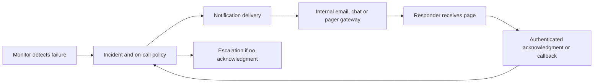

# Air-Gapped Alerting: Deliver Incident Notifications Without Cloud Services

Author: [nawazdhandala](https://www.github.com/nawazdhandala)

Tags: Air-Gapped, Alerting, Incident Management, Monitoring

Description: Build and rehearse internal incident delivery through email, chat, or paging, with explicit receipt, acknowledgment, escalation, and failure evidence.

An incident created inside an isolated network is useful only if someone can learn about it and take responsibility. A notification marked sent does not prove that a mailbox received it, that a responder noticed it, or that an acknowledgment returned to the incident system.

Design offline alerting as a complete conversation. The outbound path carries the incident to a person; the return path records what that person did. Both need working DNS, certificates, authentication, routing, and supporting services inside the required boundary.

## Draw the delivery and acknowledgment paths

Start with one critical service, one on-call team, and one internal delivery channel. Keep the first rehearsal small enough that every message can be accounted for.



For each arrow, name the source, destination, port, credentials, certificate issuer, and owner. Include the final device or client: a local chat server does not establish that a sleeping phone can be notified offline.

OneUptime supports internal email and integrations with tools you operate, as described in its [air-gapped overview](https://oneuptime.com/enterprise/air-gapped/). The following workflow is an acceptance plan for your installation. Product configuration and channel behavior must be checked against the release you actually deploy.

## Choose channels by their full dependency chain

| Channel | What can remain internal | Dependency to investigate |
| --- | --- | --- |
| Email | SMTP relay, mailbox service, webmail or desktop client | Mail forwarding, hosted authentication, external mailbox delivery |
| Mattermost | Chat server, browser or desktop clients, integration callbacks | Mobile push infrastructure and off-network clients |
| Local paging gateway | Connector, gateway, on-site receivers | Carrier service, radio coverage, gateway licensing and power |
| Generic webhook | HTTP delivery to an internal receiver | Whether the receiver actually notifies a person and supports acknowledgment |

SMTP stands for Simple Mail Transfer Protocol. It moves email between systems; it does not guarantee someone reads the result. A webhook is an HTTP request sent when an event happens; accepting that request says nothing about downstream human receipt.

Mattermost's mobile push flow can still use Apple Push Notification Service or Google's Firebase Cloud Messaging even with a privately hosted push proxy. Mattermost documents that dependency in its [mobile FAQ](https://docs.mattermost.com/deployment-guide/mobile/mobile-faq). Do not count that path as available during complete disconnection merely because the chat server is local.

Similarly, a modem or SMS gateway may avoid an Internet API while still relying on a cellular carrier. Describe the boundary accurately and test the actual delivery medium. For a fully isolated site, an attended operations console or an approved local paging system may be the dependable endpoint.

## Configure the correct email sender in OneUptime

For self-hosted instance email, OneUptime documents **Admin Dashboard → Settings → Notifications → Emails**. Select **Custom SMTP** and configure the internal relay, approved sender, authentication, and required TLS. A project's custom SMTP configuration is a separate setting commonly used by status pages; changing it does not automatically change the instance's other email. Follow the [SMTP guide](https://oneuptime.com/docs/en/emails/smtp).

Coordinate with the mail administrator before rehearsing. Confirm the relay accepts the sender address, the recipient mailbox is local, and no forwarding rule silently sends the message outside. Keep relay credentials in the supported secret configuration, and distribute the internal certificate authority to the runtime that sends mail.

An internal endpoint can still depend on a hosted OAuth token service. Inspect authentication endpoints as well as the relay hostname. Choose an approved authentication mode whose dependencies are available within your environment.

## Check transport before sending a test page

This read-only OpenSSL 3.x example checks an SMTP submission endpoint that supports STARTTLS on port 587. STARTTLS upgrades the SMTP connection to TLS. Run it from the sending workload's network, with an approved CA bundle already present:

```bash
openssl s_client \
  -connect smtp.internal.example:587 \
  -starttls smtp \
  -servername smtp.internal.example \
  -verify_hostname smtp.internal.example \
  -verify_return_error \
  -CAfile /path/to/internal-ca-chain.pem \
  </dev/null
```

Replace the hostname and certificate path. The expected result is a successful TLS handshake and certificate verification. `-verify_return_error` makes verification failure fatal instead of letting the diagnostic client continue. The hostname check verifies the intended server name. These options are documented in the [OpenSSL client reference](https://docs.openssl.org/3.0/man1/openssl-s_client/).

This sends no email and tests no mailbox credentials. It also does not prove the application's TLS configuration uses the same trust store. An implicit-TLS endpoint such as port 465 requires a direct TLS connection rather than the `-starttls smtp` option. Match the test to the relay's documented transport.

Once transport is correct, use the product's configured channel test or a controlled incident to exercise the actual sender. Do not repair certificate failures by disabling verification or allowing plaintext fallback.

## Make acknowledgment a separate acceptance step

An email containing an internal incident link can provide a simple return path: the responder opens OneUptime, signs in internally, and acknowledges the incident. Test that from the responder's real workstation. A link that points to a public hostname or an unreachable private address is a broken return path even when the email arrived.

Mattermost integration can support actions on incidents, but it needs both the project connection and the responder's account connection. The [OneUptime Mattermost guide](https://oneuptime.com/docs/en/workspace-connections/mattermost) explains how actions use the responder's permissions. Verify server-to-server callback reachability as well as browser access.

For a custom pager connector, check the product's supported integration contract. OneUptime's **Custom Channels** require an Enterprise license that includes the feature and provide signed requests and action links. An ordinary webhook should not be assumed to have those semantics. See the [custom channel documentation](https://oneuptime.com/docs/en/self-hosted/custom-notification-channels).

Protect acknowledgment links and tokens as credentials. Do not put them in public logs or automatically follow them while scanning a message. A delivery receipt and an acknowledgment are different events, and automation must not accidentally acknowledge an incident on a person's behalf.

## Run a controlled end-to-end drill

Use a staging policy and agreed test recipients. Label the incident clearly, for example `OFFLINE-DRILL-2026-11-20-01`, and tell participants when the exercise begins. Keep public egress blocked through the approved staging controls while allowing the documented internal paths.

Record evidence at each stage:

| Stage | Evidence to capture | Passing condition |
| --- | --- | --- |
| Detection | Monitor event and incident identifier | Intended policy starts for the intended service |
| Routing | Selected on-call user and escalation step | Correct responder is selected at the test time |
| Transport | Relay or connector acceptance and correlation identifier | Message accepted without unexpected external dependency |
| Receipt | Mailbox, chat client, or pager observation | Intended person can see the correct incident |
| Acknowledgment | Incident audit entry with actor and time | Human action reaches the correct incident |
| Escalation | Separate unacknowledged test incident | Next configured responder is notified |
| Resolution | Incident state and follow-up message | Recipients receive the expected end state |

Use synchronized internal clocks when comparing timestamps. Measure detection-to-receipt and receipt-to-acknowledgment separately. A long transport delay and a slow human response require different fixes.

Do not reuse the acknowledged incident to prove escalation. Create a second controlled test and deliberately leave it unacknowledged until the next step fires. Confirm that acknowledging the first incident stops the escalation behavior your policy promises.

## Rehearse a failed delivery service

In staging, make the primary test destination temporarily unavailable without disrupting real responders. Observe queueing, retry limits, error visibility, and the fallback path. Restore it and check whether delayed messages arrive, whether duplicates are recognizable, and whether the incident state remains correct.

Avoid assuming retries last forever. Set an operational response for a channel that cannot deliver: monitor the relay or gateway independently, inspect delivery failures, and route the failure through a channel outside the same failure domain where possible.

Retain the channel configuration, dependency map, recipient roster, timing evidence, and recovery result together. Repeat the drill after identity, certificate, mail-routing, client, or monitoring-platform changes. Offline alerting is ready when a real responder can receive, understand, and acknowledge the incident under the conditions the network is expected to survive.
