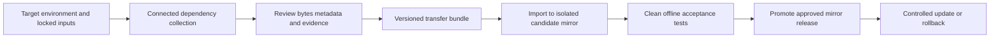

# Build an Air-Gapped Artifact Mirror with Complete Dependencies

Author: [nawazdhandala](https://www.github.com/nawazdhandala)

Tags: Air-Gapped, Artifact Management, Dependency Management

Description: Prepare versioned offline artifact bundles, include transitive and platform dependencies, and promote updates only after clean offline acceptance tests.

An offline mirror is incomplete if an installation succeeds only on a developer's laptop. That laptop may already contain a compiler, a cached dependency, a container layer or a browser binary that the mirror never supplied.

Define completeness against a workload and a target environment. A dependency closure is the full set of artifacts that the workload needs, including dependencies of dependencies. For an air-gapped environment, that set also needs the tools and supporting data required to install, start, test and maintain the workload without public network access.

The useful deliverable is a reviewed, versioned bundle with a tested installation path. A large directory of downloaded packages is only a starting point.

## Specify the target before collecting files

Record the operating system, CPU architecture, runtime versions and features enabled in production. A dependency that is optional on one platform may be required on another. Native packages can also depend on system libraries that the language package manager does not provide.

Use a closure inventory organized by purpose:

| Category | Frequently missed content |
| --- | --- |
| Application packages | Transitive dependencies, optional feature packages and platform variants |
| Build tools | Compilers, build plugins, generators and isolated build dependencies |
| Containers | Required platform manifests, layers, init containers and admission-injected images |
| Kubernetes installation | Charts, subcharts, hooks and images referenced through configuration |
| Runtime assets | Browser binaries, models, fonts and downloaded data files |
| Verification and operation | Trust roots, signature evidence, scanner databases and repair tooling |

Mark whether each item is needed for building, installation, normal operation or recovery. That distinction helps explain why a runtime-only mirror does not necessarily support rebuilding the application inside the isolated environment.

Keep the mirror's bootstrap requirements outside the mirror itself. Retain the repository service image, import tool and recovery credentials independently so an empty replacement environment can bring the mirror online.

## Collect a locked set on the connected side

Resolve dependencies in a controlled preparation environment that matches the target as closely as possible. Pin versions and retain the exact archives you approved. Record package identities, file hashes, source locations, tool versions and relevant platform information.

For Python, `pip download` resolves and collects distribution files rather than installing them. The [pip 26.2.1 documentation](https://github.com/pypa/pip/blob/26.2.1/docs/html/cli/pip_download.rst) describes using the downloaded directory for later installation. Its cross-platform options require careful selection of platform, Python version, implementation and ABI, the binary interface used by compiled extensions.

Here is a preparation example using **pip 26.2.1** in an already provisioned environment matching the target. Replace the index URL with your approved connected repository. `requirements.lock` must already contain every required package pinned to an exact version with approved hashes:

```bash
python -m pip download \
  --index-url https://packages.example.internal/simple \
  --only-binary=:all: \
  --require-hashes \
  --no-cache-dir \
  --dest wheelhouse \
  --requirement requirements.lock
```

Use a new empty `wheelhouse` directory for each candidate bundle. Configure credentials and internal certificate trust through your approved client configuration. Do not add a public fallback index to make an incomplete internal source appear successful.

`--only-binary=:all:` deliberately requires wheels, Python's built distribution format. If an approved dependency has no suitable wheel, this preparation should fail. Decide whether to build and review a wheel in a matching environment or to include a separately tested offline source-build toolchain. Quietly allowing source archives can introduce another layer of build-time downloads.

Hash checking requires the full dependency set to be pinned and hashed; it does not automatically establish that a package is trustworthy. See pip's [secure-install guidance](https://github.com/pypa/pip/blob/26.2.1/docs/html/topics/secure-installs.md). Review the requirements file itself, including direct URLs and included files, rather than assuming the `.lock` suffix guarantees its contents.

## Include installation artifacts beyond language packages

A chart lockfile records chart dependencies, not every container image a deployment will use. For Helm **3.17.3**, `helm dependency build` reconstructs dependencies from `Chart.lock`; if the lockfile is absent, it behaves like dependency update. That behavior is explicit in the [tagged Helm source](https://github.com/helm/helm/blob/v3.17.3/cmd/helm/dependency_build.go).

Collect subchart archives on the connected side and render with the exact intended values. Inventory images from the resulting manifests, then consider what controllers or admission webhooks inject later. Include jobs and upgrade hooks that an ordinary steady-state inspection might miss.

For containers, preserve the platform content required by the actual nodes. An image available for one architecture does not demonstrate availability for another. Record source and internal destination digests and verify the relationship after import. Keep signature and provenance evidence needed by your deployment policy alongside the corresponding artifact identities.



## Transfer and import without changing the approved bytes

Give each bundle a unique release identifier and a manifest listing its files and expected hashes. Protect the manifest with your organization's signing or approval process. Verify it before transfer and again after arrival; a checksum supplied next to a tampered file is not an independent trust anchor.

Import into a candidate repository or namespace first. Preserve the original approved archives rather than repackaging them during transport. Rebuilding an archive can change its digest and invalidate evidence even when its extracted files look similar.

Check package discovery as well as storage. An archive present on disk is not enough if the repository's index, authentication or client configuration cannot serve it through the expected package-manager path. Confirm that private names resolve only through the approved internal source.

## Prove closure on a clean client

Use an isolated staging client with no public egress and empty relevant caches. Keep the internal mirror and required local services reachable. Do not test by indiscriminately disconnecting production.

For the Python wheelhouse, provision a fresh virtual environment with the approved Python and pip versions from retained tools. Audit the lockfile to exclude remote direct references, then run:

```bash
python -m pip install \
  --no-index \
  --find-links ./wheelhouse \
  --only-binary=:all: \
  --require-hashes \
  --no-cache-dir \
  --requirement requirements.lock
```

`--no-index` disables index lookup, while `--find-links` supplies local distribution files. Neither flag is a general network firewall: direct references or application behavior need separate controls. Follow installation with imports, application startup and the actual feature paths that can trigger lazy downloads.

For this article, pip 26.2.1 installed two synthetic local wheels, one depending on the other, into a fresh target directory. Importing the application succeeded; removing its dependency made a second clean installation fail. That tests a small transitive closure, not a production workload or enforced air gap. The connected download command was source-reviewed rather than executed against the example repository.

## Update through candidates, not silent replacement

Prepare the next bundle separately. Compare added, removed and changed artifact identities, scan the approved set, and repeat the clean-client test matrix. A patch update can change transitive dependencies or introduce a new runtime download.

Promote only after installation, startup, upgrade and rollback paths pass for supported targets. Keep the previous approved bundle and its metadata until every consumer has moved beyond its rollback window. Do not let a cleanup policy remove dependencies merely because they have not been downloaded recently.

When acceptance fails, capture the missing identity and the operation that requested it. Fix the declared closure and rerun from a clean environment. Manually copying a file into the failing worker may unblock one test, but it leaves the next replacement worker with the same unexplained dependency gap.
