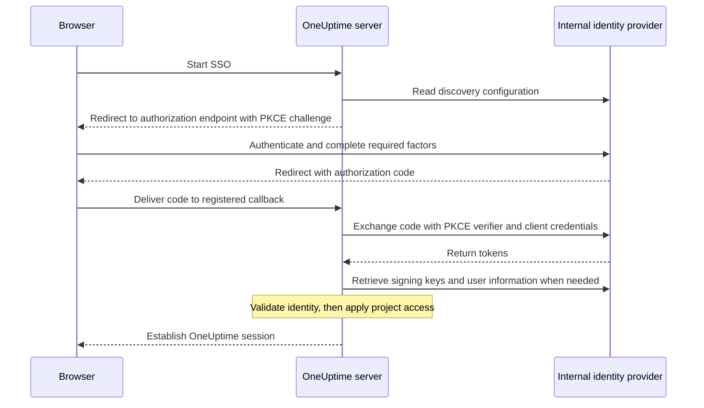

# Configure Air-Gapped Monitoring with an Internal SAML or OIDC Provider

Author: [nawazdhandala](https://www.github.com/nawazdhandala)

Tags: Air-Gapped, Monitoring, Observability

Description: Connect OneUptime to an internal identity provider, verify offline sign-in dependencies, and plan certificate rotation and emergency administrator access.

An internal identity provider (IdP) centralizes accounts and authentication. Single sign-on (SSO) lets people use it to enter monitoring without another everyday password. In an air-gapped environment, the entire sign-in path must work internally, including name resolution, certificates, signing keys, and any second authentication factor.

Current OneUptime supports both Security Assertion Markup Language (SAML) 2.0 and OpenID Connect (OIDC). This is confirmed by its [SSO documentation](https://oneuptime.com/docs/en/identity/sso) and [OIDC implementation](https://github.com/OneUptime/oneuptime/blob/0de2d9ceac0a2404f5df7ad1f9ab1e22c56bea7e/packages/App/FeatureSet/Identity/Utils/OIDC.ts). The source revision reviewed here is `0de2d9ceac0a2404f5df7ad1f9ab1e22c56bea7e`; verify the features in your deployed release. These are source-reviewed instructions, not a live integration test.

## Choose the Protocol and Map Its Dependencies

SAML sends a signed assertion: a statement identifying the user. OIDC uses an authorization code that the application exchanges for tokens, including a signed identity token. Both need configured trust; neither becomes offline simply because its sign-in page has an internal address.

| Requirement | SAML path | OIDC path |
| --- | --- | --- |
| Browser connectivity | OneUptime and IdP sign-in endpoint | OneUptime and IdP authorization endpoint |
| Return address | Assertion Consumer Service (ACS), also called Reply URL | Redirect URI, also called callback URL |
| Application trust | Configured IdP signing certificate | Public keys obtained from the provider's JWKS endpoint |
| Configuration | Issuer, sign-on URL, certificate, audience and reply address | Issuer, discovery URL, client ID and secret, callback |
| Server connectivity | Depends on selected bindings and features; the example uses browser-delivered responses | Discovery, token, signing-key and potentially user-information endpoints |

A JSON Web Key Set (JWKS) is a document containing public verification keys. OIDC discovery is another document that lists the provider's endpoints. An internal discovery URL can still advertise public addresses. Review every returned address, not just the first one.

This diagram shows the OIDC code flow used by OneUptime. PKCE, or Proof Key for Code Exchange, binds the code exchange to the request that started sign-in.



The browser does not exchange the client secret. The server does. A successful browser visit therefore cannot prove that server-side sign-in dependencies work.

## Prepare Internal Names and Trust

Use stable HTTPS names, for example `monitoring.example.internal` and `identity.example.internal`. The examples below assume an existing Keycloak realm named `operations`; a realm is an isolated set of users, clients, and identity settings. Replace these names and file paths consistently.

Distribute the internal certificate authority (CA) root to browsers and to the OneUptime server runtime. TLS, the encryption behind HTTPS, verifies the server name and protects the connection. SAML assertion signatures and OIDC token signatures separately verify who issued the identity statement. Installing a TLS root does not configure SAML signing trust, and pasting a SAML certificate does not fix HTTPS trust.

For the Node.js runtime making OneUptime's outbound identity requests, a supported trust mechanism is:

```bash
export NODE_EXTRA_CA_CERTS='/etc/pki/internal-ca-bundle.pem'
```

Mount the approved PEM certificate bundle at that path and supply the variable to the actual application process before startup through your deployment configuration. Exporting it in an administrator's terminal does not change running containers. [Node.js documents](https://nodejs.org/api/cli.html#node_extra_ca_certsfile) that this file extends its trusted roots and is read when the process starts; an explicitly supplied TLS `ca` option can override that behavior. Verify the deployed runtime's connection afterward. Keep verification enabled.

Provide internal DNS and synchronized clocks. Ensure authentication does not depend on public CAPTCHA, external fonts required by custom themes, cloud directory federation, or an internet-only push factor. Choose factors that meet your policy and remain usable offline.

## Configure the OIDC Path in OneUptime

For an existing internal Keycloak server, create an OpenID Connect client with client authentication enabled and the standard authorization-code flow enabled. Configure PKCE with `S256` for this client. Keep the client secret in your approved secret store. Keycloak's [administration guide](https://www.keycloak.org/docs/latest/server_admin/index.html) explains these client settings.

In OneUptime, open **Project Settings → Security → SSO → Add OIDC Provider**. Enter a descriptive name, the client ID and secret, and this example issuer:

```text
https://identity.example.internal/realms/operations
```

Review the default scopes `openid email profile`, claim names `email` and `name`, and the Teams selected for newcomers. A claim is a named identity field. Give the test user only the project access needed for the trial.

Save the provider and copy the **Redirect URI** from OneUptime's configuration dialog into Keycloak's allowed redirect URIs. Use the exact address, including scheme and path, rather than a wildcard or a guessed callback. Enable the provider and use OneUptime's SSO sign-in link to test it. Keep SSO enforcement off during setup. These fields and the code-with-PKCE flow are documented in the [pinned SSO guide](https://github.com/OneUptime/oneuptime/blob/0de2d9ceac0a2404f5df7ad1f9ab1e22c56bea7e/packages/App/FeatureSet/Docs/Content/en/identity/sso.md).

## Inspect Discovery from the Application Network

With curl installed and the approved CA file available, run this from an authorized diagnostic environment on the application's network:

```bash
ISSUER='https://identity.example.internal/realms/operations'
CA_FILE='/etc/pki/internal-ca-bundle.pem'
curl --fail --silent --show-error --cacert "$CA_FILE" \
  "$ISSUER/.well-known/openid-configuration"
```

Expected output is JSON, not an HTML login page or proxy error. Check that `issuer` exactly matches the configured issuer. Inspect `authorization_endpoint`, `token_endpoint`, `jwks_uri`, and `userinfo_endpoint`: each must lead to an approved internal service. [OIDC discovery](https://openid.net/specs/openid-connect-discovery-1_0.html) defines these fields; [Keycloak documents](https://www.keycloak.org/securing-apps/oidc-layers) its realm endpoints.

After reviewing the returned `jwks_uri`, inspect that address. For the standard Keycloak path shown here:

```bash
curl --fail --silent --show-error --cacert "$CA_FILE" \
  "$ISSUER/protocol/openid-connect/certs"
```

Expect a JSON `keys` array containing public keys. This verifies retrieval, not token validation. [`--cacert`](https://curl.se/docs/sslcerts.html) supplies trust for these diagnostic requests only; curl success does not configure Node.js trust.

OneUptime's reviewed source performs discovery and token requests, and can request user information when identity-token claims are missing. Its network guard permits private ranges on self-hosted installations but rejects loopback and link-local destinations. Use routable internal names, not `localhost` or metadata-service addresses. Review outbound proxy settings as well as firewall rules.

## Configure SAML When That Fits Your Identity Service

For SAML, obtain the IdP's sign-on URL, issuer, and public signing certificate through an authenticated administrative channel. In OneUptime, choose **Add SAML Provider** and enter those values. The documented defaults are `RSA-SHA256` for signatures and `SHA256` for digests.

Save, then copy OneUptime's **Identifier (Entity ID)** and **Reply URL** into the IdP's audience and ACS settings. Send the user's email address as Name ID. For the documented Keycloak integration, use a SAML client, force the email Name ID format, and disable **Client signature required** because OneUptime does not sign its sign-in requests. That setting concerns requests, not the IdP's response: configure signed, unencrypted responses as required by OneUptime's guide.

Inspect the retained public signing certificate without exposing private keys:

```bash
openssl x509 -in idp-signing.pem -noout \
  -subject -issuer -dates -fingerprint -sha256
```

Compare its fingerprint with the identity administrator's trusted record. The [OpenSSL inspection](https://docs.openssl.org/3.0/man1/openssl-x509/) shows the certificate's identity and validity period; it does not prove a SAML response is valid. Test fresh sign-in before enforcing SSO.

## Plan Rotation and an Identity Outage Drill

Treat three changes separately: TLS CA rotation, SAML signing-certificate rotation, and OIDC signing-key rotation. During a CA change, distribute overlapping old and new trust before serving the new chain. Restart processes that load trust only at startup.

For SAML, do not assume a single certificate field automatically refreshes metadata or accepts multiple certificates. Rehearse a coordinated certificate update with the identity team and retain administrator access during the cutover. For OIDC, publish the new public signing key before using it, retain old verification keys for the required token lifetime, and test fresh sign-ins against the new key. Do not assume cached keys make an unreachable JWKS service acceptable. Rotate client secrets as a separate coordinated change.

Keep a tested local master-administrator account and protected offline recovery credentials. OneUptime's [global SSO documentation](https://oneuptime.com/docs/en/identity/global-sso) identifies `/accounts/admin-login` as the master-admin password entry point when instance-wide SSO is enforced. Ordinary local passwords are not a guaranteed bypass for projects requiring SSO. Rehearse the recovery route on your release before enforcement; never make emergency access depend on an unavailable identity service or email reset.

In isolated staging, deny public egress and test a fresh browser session, expected team access, and a deliberately unauthorized account. Then simulate an IdP outage: verify the local administrator can reach the recovery controls and record how to restore identity service or temporarily change enforcement under policy. Preserve secrets and session tokens outside diagnostic logs. Acceptance means fresh sign-in and emergency administration both work through their intended internal paths.
