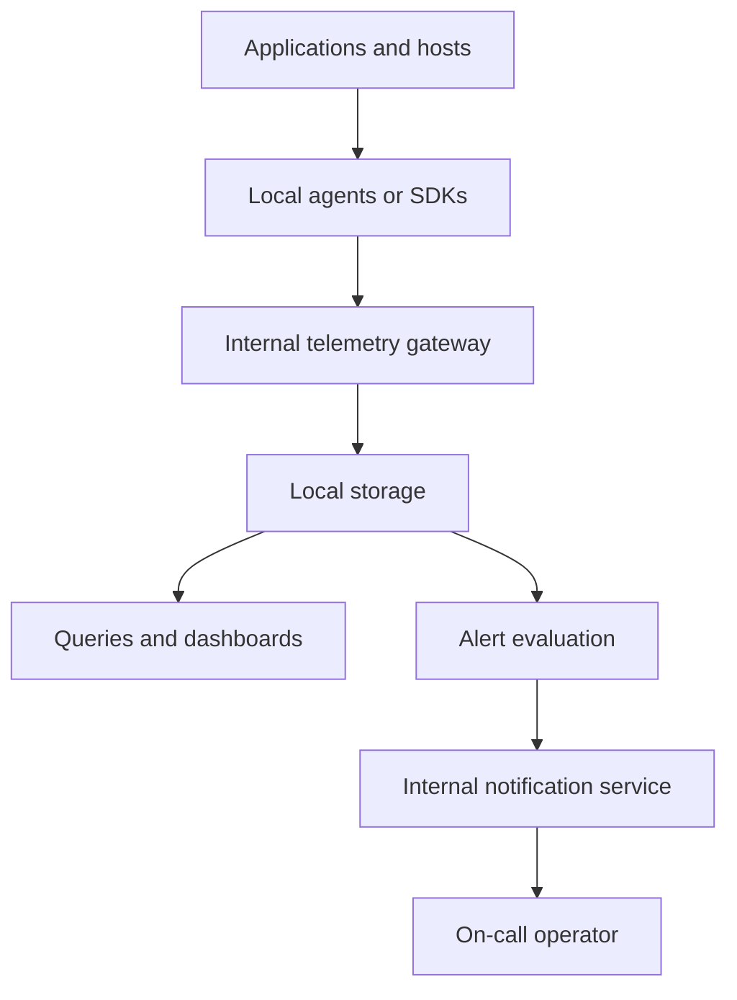

# Air-Gapped Observability: Monitor Logs, Metrics, and Traces Offline

Author: [nawazdhandala](https://www.github.com/nawazdhandala)

Tags: Air-Gapped, Observability, OpenTelemetry, Monitoring

Description: Design an air-gapped observability stack with local telemetry collection, storage, dashboards, and alert delivery, then verify it without internet access.

An application can keep serving requests after internet access disappears while its monitoring silently stops working. A collector might export to a public endpoint, a dashboard might require an external identity provider, or an incident might exist only in a notification service that nobody inside the network can reach.

Air-gapped observability requires the entire operational path to work inside the isolated environment. Logs must remain searchable, metrics must keep arriving, traces must retain useful context, and an actionable alert must reach a person. Installing a dashboard on an internal server is only one part of that design.

Telemetry is the data a system reports about itself: logs record individual events, metrics track measurements over time, and traces follow requests across services.

This guide describes an architecture and an acceptance exercise for a network with no internet route. The capacity figures are illustrative planning examples, not product benchmarks.

## Define the Offline Boundary

Start with a network diagram that includes both machines and people. Mark the application subnets, monitoring subnet, operator workstations, internal DNS, time service, certificate authority, registry, identity provider, and notification destination.

For each component, record three kinds of dependency:

| Dependency | Example | Offline design decision |
| --- | --- | --- |
| Installation | Container images and SDK packages | Import approved, versioned artifacts before deployment |
| Runtime | Telemetry endpoint and identity discovery | Use reachable internal services |
| Recovery | Database backups and registry bootstrap images | Retain a recovery copy outside the failed service |

Give each dependency an owner and a recovery procedure. An internal registry does not solve recovery if the only copy of its own image lives inside that registry.

Also define what “offline” means for operator access. A workstation connected to the public internet can hide missing fonts, external login redirects, or documentation dependencies during testing. Run the acceptance exercise from a workstation subject to the same isolation as the production users.

## Keep Collection, Storage, and Response Local

A practical design separates the telemetry path from the human response path:



Internal DNS, certificate trust, time synchronization, and authentication support several stages. Put these dependencies on the diagram even though they do not carry telemetry themselves.

As a concrete backend example, OneUptime documents a self-hosted architecture using PostgreSQL for configuration and state, ClickHouse for telemetry, and Valkey for cache and queues. Its deployment uses images from your registry and can use your mail server. Consult the [air-gapped deployment overview](https://oneuptime.com/enterprise/air-gapped/) when deciding which services your team will operate.

Avoid making the entire response path depend on one machine. For example, a separate internal probe can check whether the monitoring dashboard and ingestion endpoint are reachable. Decide how that probe reaches an operator when the main alerting service is unavailable.

## Collect Each Signal Deliberately

Treat logs, metrics, and traces as different operational tools. Define a minimum useful dataset for each before enabling every available integration.

For logs, begin with application errors, request outcomes, and service lifecycle events. Preserve a service identifier and a timestamp. Where your instrumentation supports it, include trace context so an operator can move from an error log to the request that produced it. Establish a policy for sensitive fields before collecting production traffic.

For metrics, start with request rate, errors, latency, and resource saturation. Avoid unbounded labels such as raw request IDs: those identifiers belong in individual events or traces. Decide which measurements remain useful if part of the application network becomes unreachable.

For traces, pick a small transaction that crosses at least two services. Confirm that the downstream service receives the trace context and that both services use recognizable names. A collection of isolated spans will not explain a slow multi-service request.

The OpenTelemetry Collector connects receivers, processors, and exporters through explicitly enabled pipelines. Defining a component alone does not activate it. Use the [Collector configuration documentation](https://opentelemetry.io/docs/collector/configuration/) to check the components available in your chosen distribution and validate the finished configuration with that exact binary:

```bash
# Run inside the isolated environment using the staged Collector binary.
otelcol validate --config=/etc/otelcol/config.yaml
```

Use the actual executable name and path from your installation. Configuration validation checks the configuration; it does not establish that a remote destination accepts telemetry.

## Point Instrumentation at an Internal Endpoint

OneUptime's documented self-hosted OTLP/HTTP endpoint uses the installation's `/otlp` path and an ingestion key in the `x-oneuptime-token` header. For an already instrumented application whose SDK supports these environment variables:

```bash
# Replace the example host with your internal OneUptime address.
export OTEL_EXPORTER_OTLP_ENDPOINT="https://monitoring.example.internal/otlp"
export OTEL_EXPORTER_OTLP_PROTOCOL="http/protobuf"

# Inject ONEUPTIME_INGESTION_KEY through your normal secret mechanism.
export OTEL_EXPORTER_OTLP_HEADERS="x-oneuptime-token=${ONEUPTIME_INGESTION_KEY}"
```

These settings do not install instrumentation or enable an SDK by themselves. Package the SDK and its dependencies with the application, and verify which signals its configuration actually enables.

For this air-gapped OneUptime setup, use OTLP/HTTP behind an internal TLS proxy. The documented built-in gRPC ingress relies on its own TLS termination and Let's Encrypt certificate provisioning. This is a OneUptime ingress constraint, not a general limitation of gRPC. See the [air-gapped observability configuration](https://oneuptime.com/enterprise/air-gapped/observability).

Distribute your internal CA trust to applications, collectors, and operator browsers. Test renewal before certificates expire. Turning off certificate verification can make a connectivity test pass while leaving the real trust problem unresolved.

## Budget for Storage and Backend Outages

Size storage from measurements taken with a representative workload. Record daily stored growth, the retention period, replication overhead, and the free space needed for maintenance.

For example, suppose a pilot adds 40 GB per day to one copy of telemetry storage. Fourteen days represents approximately 560 GB before replication and operational headroom. Two copies bring that estimate to 1.12 TB. Reserving 30 percent free space gives a preliminary allocation of about 1.6 TB:

```text
40 GB/day × 14 days × 2 copies / 0.70 = 1,600 GB
```

Do not multiply by replication again if your measured daily growth already includes every replica. Measure backups separately and test how storage behaves during compaction, recovery, and increased ingestion.

Collector buffering needs a separate budget. An in-memory sending queue does not survive a process restart. A persistent queue can retain queued data across restarts when its storage survives, but capacity exhaustion and retry limits can still cause loss. Monitor queue size and capacity, and test the failure mode you intend to tolerate. The [Collector resiliency guidance](https://opentelemetry.io/docs/collector/resiliency/) explains these limits.

For an initial queue estimate, 2 MB/s of serialized queued data over a 30-minute outage requires roughly 3.6 GB before storage overhead. Measure the actual queue growth rather than substituting the backend's compressed storage rate. Verify that recovery export throughput exceeds new arrivals; otherwise the backlog will never drain.

## Make Alerts Reach Someone Inside the Boundary

Choose a notification route that is available to the people expected to respond. An internal mail service, internal messaging system, or staffed operations console may fit, depending on the deployment's supported integrations and your operating model.

Write down the complete route from alert evaluation to acknowledgment. Identify who watches the destination, how quickly they should acknowledge, and what happens if they do not. A successful API call to a notification destination is insufficient evidence that a person received the incident.

Use a harmless test condition, such as a dedicated internal test endpoint that temporarily returns an error. Confirm that the alert fires, reaches the expected operator, can be acknowledged, and resolves after the endpoint recovers. Keep the test separate from real customer traffic.

## Prove the System Works Without Internet Access

Run the acceptance exercise in an isolated staging environment with the intended network restrictions enforced. Save the evidence next to the deployment configuration.

| Exercise | Evidence to capture |
| --- | --- |
| Start on a clean node | Every required image comes from an internal source |
| Sign in from an isolated browser | Authentication and dashboard assets load locally |
| Send a unique test log | The log becomes searchable with its expected service name |
| Generate a known request count | The corresponding metric changes within the expected delay |
| Exercise a two-service transaction | The trace contains the expected service relationship |
| Interrupt backend access briefly | Queue growth, recovery, and any data loss are recorded |
| Trigger and resolve a test alert | Delivery, acknowledgment, and recovery timestamps are recorded |
| Restore into a separate environment | Retained configuration and data can be queried |

Inspect denied outbound traffic during both startup and normal operation. A blocked request can be optional or essential; identify its caller and purpose before accepting it. A dashboard that eventually renders after a timeout may still contain a dependency that will become critical during renewal or recovery.

Finally, rehearse the replacement of an empty node and the restoration of the registry. Warm image caches and long-lived browser sessions make weak offline designs look healthy. A successful cold start, searchable new telemetry, and a completed alert acknowledgment provide much stronger evidence that your observability stack is ready to operate inside the air gap.
