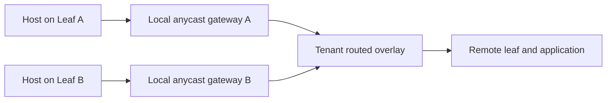

# Anycast Gateway Works on One Leaf: Check MAC, SVI, and Routing

Author: [nawazdhandala](https://www.github.com/nawazdhandala)

Tags: VXLAN, Networking, Troubleshooting

Description: Separate local gateway failures from routed-overlay failures by checking host neighbor state, the shared anycast MAC, SVI readiness, and symmetric IRB routes.

A workload reaches other subnets when attached to Leaf A but fails after attaching to Leaf B. The default-gateway address has not changed. That is exactly the situation a distributed anycast gateway is intended to handle, so compare the local gateway implementation before blaming the remote application.

This procedure targets **Cisco Nexus 9000 NX-OS 10.4(x)** with a distributed IPv4 anycast gateway and symmetric integrated routing and bridging, or IRB. It assumes a conventional fabric rather than a migration involving HSRP coexistence, multi-site gateways, or a new gateway-proxy feature.

The commands are source-reviewed examples. No NX-OS device or live migration was tested for this article.

## Start with the forwarding promise

For the same tenant subnet, the workload should use the intended gateway IP and shared virtual MAC regardless of which participating leaf provides its local gateway. Both leaves can route locally; this is not a requirement to send every packet to one active gateway elsewhere.

Use an explicit comparison sheet:

| Property | Intended value for this example |
| --- | --- |
| Tenant VRF | `blue` |
| Local subnet | `10.10.0.0/24` |
| Gateway IP | `10.10.0.1` |
| Shared virtual gateway MAC | `02:00:00:00:00:01` |
| Local VLAN / Layer 2 VNI | `100` / `10100` |
| Tenant Layer 3 VNI | `50000` |
| Remote application address | `10.20.0.12` |

These are illustrative values. Replace them with the approved fabric design. A VRF is a separate tenant routing table; the Layer 2 VNI identifies a bridged segment, while the Layer 3 VNI carries routed tenant traffic between leaves.



The same gateway identity should work at B and D. The path after the gateway still depends on the tenant's routes and overlay forwarding state. Symmetric IRB includes routing at both the ingress and egress leaf. [EVPN symmetric IRB](https://www.rfc-editor.org/rfc/rfc9135.html).

## Observe what the failing host actually uses

On an authorized Linux staging workload, inspect its route and gateway neighbor entry:

```bash
ip route get 10.20.0.12
ip neigh show to 10.10.0.1
```

Use the real remote application and gateway addresses. The route lookup should select the intended gateway and interface for this off-subnet destination. The neighbor entry, when present, should resolve the gateway to the expected shared MAC. Neither command sends a probe. [Linux route lookup](https://man7.org/linux/man-pages/man8/ip-route.8.html), [Linux neighbor tables](https://man7.org/linux/man-pages/man8/ip-neighbour.8.html).

An empty neighbor entry before any traffic is not a failure. Generate one controlled application request, then inspect again. An incomplete or failed resolution points toward the local attachment, gateway response, or filtering path. A stale entry alone is not proof of failure; it is a neighbor-cache state that can be refreshed through normal use.

Preserve the evidence before changing caches. Prefer a fresh staging client when testing initial resolution rather than flushing a production host's entire neighbor table. If you test mobility, move one staging attachment through the supported procedure; do not create an unintended duplicate live workload with the same IP and MAC.

## Compare the shared MAC and gateway mode

Cisco documents a global anycast MAC and per-SVI gateway mode. Review this configuration relationship on both leaves:

```text
fabric forwarding anycast-gateway-mac 0200.0000.0001

interface Vlan100
  vrf member blue
  ip address 10.10.0.1/24
  fabric forwarding mode anycast-gateway
```

This is a partial reference excerpt, not a complete configuration or an instruction to apply it. The MAC is written in NX-OS dotted notation. Compare the equivalent intended values in your existing configuration, including the SVI's administrative state.

Cisco's 10.4(x) guide requires the same virtual anycast MAC across the participating VTEPs. Configuring the gateway IP alone does not establish that shared identity or enable the per-interface mode. [NX-OS anycast gateway configuration](https://www.cisco.com/c/en/us/td/docs/dcn/nx-os/nexus9000/104x/configuration/vxlan/cisco-nexus-9000-series-nx-os-vxlan-configuration-guide-release-104x/m_configuring_vxlan_bgp_evpn.html).

If the host resolves a different MAC on Leaf B, first confirm that the response belongs to the intended gateway. Another router on the segment, a stale configuration, or an incorrectly attached tenant can produce a misleading answer. Do not change the fabric-wide MAC to accommodate one inconsistent leaf.

## Check SVI readiness separately from configuration text

An SVI is a switched virtual interface, the routing interface associated with a VLAN. On each leaf, inspect:

```text
show interface vlan 100
show running-config interface vlan100
```

The first shows operational state; the second shows configuration. Compare the VLAN, IP prefix, VRF assignment, and anycast mode. A line in the configuration does not prove that the interface is operational. [NX-OS SVI inspection](https://www.cisco.com/c/en/us/td/docs/dcn/nx-os/nexus9000/104x/configuration/interfaces/cisco-nexus-9000-series-nx-os-interfaces-configuration-guide-release-104x/m_configuring_layer_3_interfaces_9x.html).

If the SVI is down, examine the VLAN's existence and local forwarding members. SVI autostate relates operational status to the underlying VLAN interfaces; Cisco documents settings that can alter this behavior. Review the configured behavior before concluding that a configured SVI must be up. [NX-OS autostate behavior](https://www.cisco.com/c/en/us/td/docs/dcn/nx-os/nexus9000/104x/configuration/interfaces/cisco-nexus-9000-series-nx-os-interfaces-configuration-guide-release-104x/m_configuring_layer_2_interfaces_9x.html).

Disabling autostate merely to make the status display look healthy does not repair a missing workload attachment. Likewise, an operationally up SVI does not establish that the particular access port admits the workload's VLAN.

## Decide whether the gateway or the routed overlay fails

Use a small test matrix from staging clients on both leaves:

| Observation | What to investigate next |
| --- | --- |
| Same-subnet access fails too | Local VLAN attachment and Layer 2 forwarding |
| Gateway address cannot resolve | SVI, gateway identity, or local filtering |
| Gateway resolves but remote subnet fails | Tenant routes and routed-overlay dependencies |
| Request reaches application but no reply returns | Reverse route, policy, and remote attachment |

A successful ping to the gateway tests that endpoint's response; it does not prove transit forwarding. Conversely, a missing ICMP reply alone does not prove the gateway is down if policy restricts replies. Combine neighbor state, interface state, and packet observations.

Do not compare a host on one leaf with a switch-originated probe from a different VRF on the other. Keep the workload subnet, source context, and destination consistent across the test.

## Inspect symmetric routing in the correct tenant

Once local gateway resolution works, collect:

```text
show ip route vrf blue
show nve vrf
show nve vni
```

Inspect the route covering `10.20.0.12` in `blue`, the VRF-to-VNI association, and operational VNI state. The default routing table is not a substitute for the tenant table. [NX-OS IP route command](https://www.cisco.com/c/en/us/td/docs/dcn/nx-os/nexus9000/104x/command-reference/show/b_n9k_show_commands_104x/m_i_showcmds.html), [NX-OS NVE verification](https://www.cisco.com/c/en/us/td/docs/dcn/nx-os/nexus9000/104x/configuration/vxlan/cisco-nexus-9000-series-nx-os-vxlan-configuration-guide-release-104x/m_configuring_vxlan_bgp_evpn.html).

Compare Leaf A and Leaf B for the selected remote route and intended routed tunnel context. Investigate EVPN import, next-hop resolution, or local programming if only one leaf lacks the usable route. At the remote leaf, verify the destination attachment and route back to `10.10.0.0/24`.

Keep the host-facing anycast MAC distinct from other router MAC information used in the routed overlay. Similar terminology does not mean every MAC field in every table must be identical. Follow the forwarding role of the field before treating a difference as a fault.

## Validate the correction from both attachment points

After the configuration owner corrects the demonstrated mismatch, repeat initial gateway resolution and the same off-subnet application request from each staging location. If mobility is part of the acceptance test, include a controlled move and normal return traffic.

Record the gateway MAC observed by the host, SVI state, selected tenant route, and application outcome. Release normal traffic only after those observations agree. The local checks for this article verified source references, shell syntax, and diagram structure; they did not exercise gateway failover, host mobility, or live routing.
