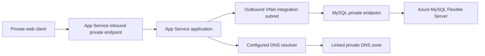

# Connect Azure App Service to Private MySQL: VNet, DNS, and Routes

Author: [nawazdhandala](https://www.github.com/nawazdhandala)

Tags: Azure, MySQL, Networking, Troubleshooting

Description: Trace App Service's outbound connection to private Azure MySQL through VNet integration, private DNS, and routing without confusing inbound private endpoints.

Your Azure MySQL server is reachable from a VM, but the App Service application times out. Both resources appear to be connected to the same virtual network. The app even has a private endpoint. What is missing?

Often, the diagram contains the wrong direction of traffic. An App Service private endpoint allows clients to reach the app privately. It does not provide the app's outbound connection to a database. Outbound access uses VNet integration, where VNet means virtual network. Microsoft's [App Service private endpoint documentation](https://learn.microsoft.com/en-us/azure/app-service/overview-private-endpoint) makes that distinction explicit.

Troubleshoot the database connection from the application outward: integration subnet, DNS resolution, route, network controls, and finally MySQL authentication. A nearby VM can help isolate a problem, but its working configuration does not establish the app's configuration.

## Draw the outbound path first

For a MySQL Private Link deployment, the intended path looks like this:



The app's inbound endpoint and outbound integration subnet have different jobs. App Service requires separate subnets for its private endpoint and VNet integration. Verify the integration on the actual application or slot you are testing, rather than relying on another application's settings.

Also identify which MySQL networking model you have. **Private Link** exposes MySQL through a private endpoint. **VNet-integrated MySQL** uses a delegated database subnet. They are distinct configurations with different resources to inspect. See Microsoft's [Private Link overview](https://learn.microsoft.com/en-us/azure/mysql/flexible-server/concepts-networking-private-link) and [MySQL VNet integration overview](https://learn.microsoft.com/en-us/azure/mysql/flexible-server/concepts-networking-vnet).

For the latter model, replace the private-endpoint portion of the diagram with the database's delegated subnet. Do not try to place the App Service integration into that database subnet simply to make the resources “closer.”

## Verify integration on the running app

In the app's Networking settings, inspect VNet integration and record the selected VNet, subnet, and routing configuration. Regional integration uses a VNet in the app's Region; it can reach suitable resources in peered networks. Confirm the subnet's delegation and capacity are appropriate for App Service. The [integration overview](https://learn.microsoft.com/en-us/azure/app-service/overview-vnet-integration) explains these requirements.

For a **native Windows App Service app**, open its Kudu CMD debug console through Development Tools > Advanced Tools. Kudu is App Service's diagnostic and deployment interface. This read-only command reports the integration address exposed to the current worker:

```cmd
SET WEBSITE_PRIVATE_IP
```

An assigned address supports the integration check; it is not proof of database reachability. Inspect the affected worker instances when the problem is intermittent rather than assuming one console represents every instance.

Next, replace the server placeholder and test DNS and TCP from that console:

```cmd
nameresolver.exe SERVER_NAME.mysql.database.azure.com
tcpping.exe SERVER_NAME.mysql.database.azure.com 3306
```

These are platform-provided diagnostic tools, so there is no standalone tool version to pin in the application. Microsoft documents this syntax for native Windows apps; `nameresolver.exe` is not supported in custom Windows containers or Linux apps. Use the appropriate runtime tools for those environments. See [App Service VNet troubleshooting](https://learn.microsoft.com/en-us/troubleshoot/azure/app-service/troubleshoot-vnet-integration-apps).

The first command should resolve the intended private destination. The second tests whether the selected host and port are reachable. Neither performs a MySQL login or validates a server certificate.

## Link DNS to the app's resolution path

For a MySQL Flexible Server **Private Link** endpoint in Azure public cloud, the documented private DNS zone is `privatelink.mysql.database.azure.com`. Keep the normal server FQDN in the application connection string; DNS should lead it to the intended private endpoint. Azure publishes the service-specific zone names in its [private endpoint DNS reference](https://learn.microsoft.com/en-us/azure/private-link/private-endpoint-dns).

Check the private endpoint's DNS configuration, its address record, and the zone links relevant to the app's integrated VNet. A zone linked only to the database team's VNet does not automatically establish resolution from every application network.

When the VNet uses Azure-provided DNS, the app can use linked private zones through its integration. When it uses custom DNS servers, those servers need an appropriate resolution or forwarding path. A VNet link alone does not configure an unrelated corporate DNS server. Microsoft's [App Service name-resolution guide](https://learn.microsoft.com/en-us/azure/app-service/overview-name-resolution) describes how integration and custom resolvers interact.

Compare answers from the app and the working VM. If they differ, investigate the resolver path before changing database credentials. If both resolve the same private address but only the app fails, move to routing and access controls.

## Follow traffic through the integration subnet

Inspect the integration subnet's network security group and route table. A network security group, or NSG, filters traffic; a user-defined route can send it through a firewall appliance or another next hop. For database traffic routed through integration, confirm outbound TCP 3306 is permitted and the return path is valid.

Do not treat “Route All” as a universal MySQL fix. App Service already routes private address traffic through integration under its normal private-traffic behavior. Routing all outbound traffic changes a broader set of dependencies. A new route through a central firewall may affect services the application needs during startup as well as database traffic.

Current App Service routing documentation distinguishes application traffic from configuration traffic such as container image pulls and content access. Review that distinction before changing routing switches. See [VNet integration routing](https://learn.microsoft.com/en-us/azure/app-service/configure-vnet-integration-routing).

For a Private Link deployment, also confirm that the database private endpoint connection is approved and that the endpoint is in the expected network. For a VNet-integrated database, examine the route and controls toward its delegated subnet instead. Keep public firewall rules out of a diagnosis that is supposed to use only the private path.

## Interpret the result before making another change

| Evidence from the app | Next investigation |
| --- | --- |
| No integration address | App integration, subnet delegation, and worker configuration |
| Name resolves publicly instead of privately | Private zone, record, link, or custom resolver path |
| Private DNS answer but TCP failure | NSG, route table, peering, firewall, endpoint state |
| TCP succeeds but TLS fails | CA trust and certificate hostname |
| TLS succeeds but login fails | Database identity and credentials |

Once TCP works, test a fresh connection with the application's MySQL driver, its normal FQDN, and certificate verification enabled. Then run an approved database operation. A successful TCP probe is evidence about transport, not proof that the application can use the database.

Keep the observed address, worker identity, timestamp, and result with the incident record. Change one boundary at a time, then repeat the test from the original app. That makes the fix reproducible when a new deployment slot or scaled-out worker encounters the same missing dependency.

The commands and architecture were reviewed against official Azure documentation. No Kudu commands, Azure configuration changes, or live database connections were executed for this article.
