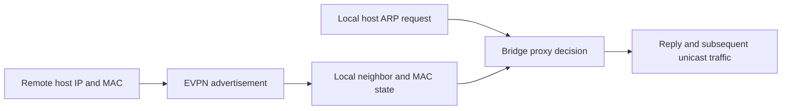

# Validate EVPN MAC/IP Bindings Before Enabling ARP Suppression

Author: [nawazdhandala](https://www.github.com/nawazdhandala)

Tags: VXLAN, Linux, Troubleshooting

Description: Check EVPN IP/MAC bindings, Linux neighbor and forwarding state, and controlled cold-client behavior before enabling ARP suppression on a VXLAN segment.

ARP suppression reduces repeated address-resolution broadcasts across a VXLAN fabric. It also makes the correctness of the fabric's learned IP-to-MAC information more visible. If the local endpoint answers with an obsolete binding, the requesting host can stop asking questions and start sending traffic to the wrong destination.

Before enabling suppression, prove that the binding used to answer requests is current and that the associated MAC can actually be forwarded. A quiet tunnel is not sufficient evidence of success.

This guide targets **FRRouting 10.2.1**, the **Linux 6.12** bridge implementation, and **iproute2 6.12.0** syntax. The example uses one traditional bridge and VXLAN device per Layer 2 VNI. It covers IPv4 ARP; IPv6 Neighbor Discovery has different messages and needs separate validation.

## Understand which component answers

ARP, the Address Resolution Protocol, maps a local IPv4 address to an Ethernet MAC address. With proxy behavior, a network device can answer a request using a learned binding instead of forwarding the broadcast to the remote host.

EVPN, Ethernet VPN, can distribute IP/MAC pairs in Type 2 advertisements. A Type 2 route can also contain only a MAC. That MAC-only route does not supply the missing IPv4 binding by itself. RFC 9161 describes learning, reply, maintenance, and flood handling as distinct functions of proxy ARP/ND. [EVPN proxy address resolution](https://www.rfc-editor.org/rfc/rfc9161.html).

In this Linux/FRR deployment, suppression is a kernel bridge function. FRR documents the need for the appropriate SVI, or segment Layer 3 interface, when using ARP/ND suppression and recommends enabling the suppression flag on VXLAN ports. FRR does not manage that flag for you. [FRR interface requirements](https://docs.frrouting.org/en/stable-10.2/evpn.html).



Inspect the state feeding the decision and the traffic following the reply. Either can fail independently.

## Establish one binding as the test case

Use an actual staging endpoint and substitute its values:

| Field | Example |
| --- | --- |
| Target IPv4 address | `10.20.0.12` |
| Current target MAC | `02:00:00:00:00:12` |
| Segment VNI | `10100` |
| Target's current VTEP | `192.0.2.102` |
| Receiving leaf's bridge | `br10100` |
| Receiving leaf's VXLAN device | `vxlan10100` |

Confirm the target's address and attachment at the remote host or its authoritative inventory. A stale cache cannot validate another stale cache. Record whether the host recently moved, changed its virtual NIC, or received a reused DHCP address.

Keep the sender in the same intended Layer 2 subnet for this test. An off-subnet sender normally resolves its gateway, which tests a different binding.

## Compare control-plane and local binding state

Run these read-only commands from an account allowed to use FRR's `vtysh`:

```bash
vtysh -c 'show bgp l2vpn evpn route type macip'
vtysh -c 'show evpn arp-cache vni 10100'
vtysh -c 'show evpn mac vni 10100 mac 02:00:00:00:00:12'
```

Find the target's IP/MAC pair in the EVPN information, then compare the local ARP cache and MAC state. Record the segment, remote endpoint, and any duplicate or movement indications. These command forms are defined in the tagged sources. [FRR 10.2.1 EVPN commands](https://raw.githubusercontent.com/FRRouting/frr/frr-10.2.1/bgpd/bgp_evpn_vty.c), [Zebra binding commands](https://raw.githubusercontent.com/FRRouting/frr/frr-10.2.1/zebra/zebra_vty.c).

A match on IP alone is insufficient. Compare the MAC and VTEP with the current remote attachment. If multiple leaves claim the address, resolve the ownership problem before relying on a proxy response.

Do not invent a permanent neighbor entry simply to fill a missing cache row. First determine whether the remote system learned and advertised the binding, whether import policy accepted it, and whether local programming succeeded.

## Inspect the kernel state used for the decision

On the receiving leaf:

```bash
ip neigh show to 10.20.0.12 dev br10100
bridge fdb show br br10100
bridge fdb show dev vxlan10100
bridge -d link show dev vxlan10100
```

The neighbor listing connects the IP to a MAC. The forwarding database, or FDB, connects that MAC to a forwarding location. The detailed port listing shows suppression and other bridge-port properties. Use the actual SVI interface for neighbor inspection if your layout differs. [Linux neighbor table](https://man7.org/linux/man-pages/man8/ip-neighbour.8.html), [Pinned bridge inspection](https://raw.githubusercontent.com/iproute2/iproute2/v6.12.0/man/man8/bridge.8).

Linux 6.12's ordinary ARP proxy path looks up a valid neighbor entry and the corresponding FDB entry before considering a reply. If it cannot find usable state, that path does not manufacture a response. The separate bridge forwarding logic determines which ports receive a flooded packet. Therefore, “missing binding” does not by itself prove that suppression drops every normal request. [Kernel proxy decision](https://raw.githubusercontent.com/torvalds/linux/v6.12/net/bridge/br_arp_nd_proxy.c), [Kernel flood handling](https://raw.githubusercontent.com/torvalds/linux/v6.12/net/bridge/br_forward.c).

This distinction matters during troubleshooting. A bad binding can generate a wrong answer; missing state can expose an existing flood-path failure. Requests used for probing or announcements also need their own tests rather than being assumed equivalent to an ordinary request.

## Compare a cold client's request and reply

Use a fresh staging client with no previous binding for the target. Observe its workload-facing link while it starts one ordinary connection. Compare that observation with the tunnel-facing path and the target attachment.

The evidence should answer four questions: Did the client send a request for the expected IP? Did it receive a reply? Which MAC did the reply advertise? Did traffic to that MAC reach the intended host?

Inspect the client's neighbor table after the request:

```bash
ip neigh show to 10.20.0.12
```

The expected MAC is the target's current MAC in this simple same-subnet test. A resolved entry containing an obsolete MAC explains a different failure from an unanswered request. Do not label either outcome merely “ARP is broken.”

Avoid flushing production neighbor or FDB tables to create the cold condition. That can disturb unrelated sessions and erase the state needed to explain the fault. A controlled new client or isolated test segment gives a clearer experiment.

## Enable suppression only after the prerequisites pass

If the staging segment has correct bindings, usable forwarding state, and a working baseline, this is the Linux runtime flag operation for its VXLAN bridge port:

```bash
sudo ip link set dev vxlan10100 type bridge_slave neigh_suppress on
bridge -d link show dev vxlan10100
```

Replace the device name and obtain the segment owner's approved change window. This operation does not populate the IP/MAC cache, establish EVPN sessions, or configure persistence. The listing should show the enabled flag; that is configuration evidence, not a forwarding result. [iproute2 bridge-port options](https://raw.githubusercontent.com/iproute2/iproute2/v6.12.0/man/man8/ip-link.8.in).

Repeat the cold-client request and application test after enabling the flag. Verify the correct reply and successful unicast traffic, not just fewer broadcasts. Record the prior setting and restore that approved baseline if the controlled test regresses, then diagnose the binding or forwarding discrepancy before another attempt.

Use the owning network configuration system to persist an accepted setting. A manual runtime change that is overwritten on restart is not a completed rollout.

## Test binding lifecycle before expanding the rollout

A warm, stable host is the easiest case. Include a silent endpoint, an approved host move, an address reassignment, and a withdrawal in staging. Verify that obsolete bindings stop being used and that the new authoritative binding reaches the receivers.

Also test an unknown destination under the intended flood policy and verify other required address-resolution behaviors. Keep DHCP and boot-time discovery as separate acceptance cases; successful ordinary ARP resolution is not a substitute for those workflows.

Expand only when replies remain correct through those transitions and application traffic works in both directions. The local work for this article reviewed tagged implementation paths and checked shell syntax and diagram structure. It did not enable suppression or exercise live EVPN, kernel forwarding, or host mobility.
