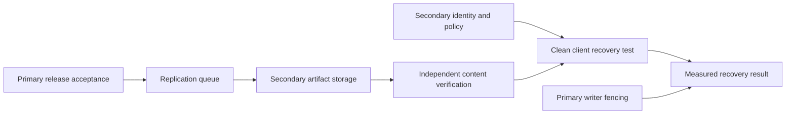

# Design Artifact Repository Failover Around RPO and RTO

Author: [nawazdhandala](https://www.github.com/nawazdhandala)

Tags: Artifact Management, Disaster Recovery, High Availability

Description: Turn recovery targets into measurable artifact replication and failover tests, including missing releases, access dependencies, fencing and failback.

A second registry is useful only if it contains the releases you need and clients can use it during an outage. A green replication job does not answer either question completely. It may cover one filter, one artifact type or one successful transfer while older work remains queued.

Start with explicit recovery targets and work backward to the replication design. This article uses Harbor **2.14.0** for concrete replication behavior, but the assessment applies to other artifact repositories. It separates data protection from service recovery so neither gets hidden behind a healthy dashboard.

## Give the targets operational meaning

Recovery Point Objective, or RPO, is the maximum acceptable data-loss window. Recovery Time Objective, or RTO, is the maximum acceptable time to restore the agreed service. Define when the recovery clock starts and which client operations must work before it stops.

For example, a release repository might require an RPO of five minutes and an RTO of thirty minutes. That should mean more than “replicate every five minutes.” Scheduling delay, transfer time, retries and queue backlog all consume the data-loss budget.

Separate service tiers when necessary:

| Tier | Example recovery requirement | Evidence needed |
| --- | --- | --- |
| Production deployment reads | Current and rollback releases available | Clean clients fetch every required digest and platform |
| Build dependency reads | Approved dependency set available | Representative builds resolve without primary-site access |
| Release publishing | One authorized site accepts new versions | Controlled publish succeeds without split ownership |
| Audit evidence | Signatures and provenance remain retrievable | Verification works against the recovery endpoint |

These are illustrative targets, not Harbor guarantees. A team may restore deployment reads before publishing. State that distinction explicitly rather than reporting the repository recovered while releases remain blocked.

## Decide what replication actually protects

Harbor supports filtered push or pull replication, but it does not replicate project membership information. Its documentation also warns about network delay and failed-task retries. A target containing bytes still needs independently configured authorization. See the [2.14.0 replication documentation](https://goharbor.io/docs/2.14.0/administration/configuring-replication/).

Inventory every state category needed for recovery: artifact content, required platforms, signatures, package indexes, repository policies, identities, trusted certificates and encryption keys. Assign each category either a tested replication mechanism or a backup and restore procedure. Do not equate registry-level artifact copying with database replication or full application recovery.

Keep both Harbor sites on a supported, tested version pairing. The cited documentation says replication between different Harbor versions is unsupported. Review upgrade sequencing before changing either site, rather than discovering compatibility problems during an incident.

High availability within one installation addresses a different failure boundary. Multiple application replicas still depend on their storage and supporting services. Harbor's [HA deployment documentation](https://goharbor.io/docs/2.14.0/install-config/harbor-ha-helm/) makes database, Redis, ingress and storage availability operator responsibilities. A region-wide recovery plan must account for those dependencies too.

## Design the replication rule and deletion policy

For Harbor 2.14.0, create the target endpoint first, then select push-based or pull-based replication, resource filters, destination and trigger. Review the namespace mapping carefully: a successful copy into an unexpected path is still unavailable to a deployment using the original reference.

Harbor's [rule documentation](https://goharbor.io/docs/2.14.0/administration/configuring-replication/create-replication-rules/) distinguishes manual, scheduled and event-based triggers. Manual and scheduled replication do not replicate deletions. Event-based rules can optionally delete remote resources when local resources are deleted. Choose that setting deliberately; immediate deletion propagation can remove the recovery copy after an accidental source deletion.

Label changes alone do not trigger event-based replication. If a release becomes eligible by receiving a label, ensure another documented trigger or reconciliation job actually copies it. Test filter exclusions with representative repository paths before trusting the rule.

Maintain independent retained backups even when replication is healthy. Replication supports availability, while historical recovery may require a copy from before a bad deletion, corrupted upload or unwanted policy change.



## Measure a complete recovery point

Record a release acceptance ledger outside the failed site's sole storage. For each accepted release, retain its time, immutable identity, expected content and required evidence. Confirm those objects at the secondary using a reader account.

A recovery watermark is the latest point through which every required accepted release has been verified. If release 104 is missing but release 105 arrived, release 105's timestamp is not a valid complete watermark. Track holes explicitly. Include skipped filters and failed evidence transfers, not merely successful primary manifests.

The small Python example below checks arithmetic for a drill with an already established complete watermark. It does not discover replication completeness. Replace the three UTC timestamps with your recorded observations and save it as `measure_recovery.py`:

```python
from datetime import datetime


def instant(value):
    return datetime.strptime(value, "%Y-%m-%dT%H:%M:%S%z")


def measure(verified_through, incident, service_restored):
    watermark = instant(verified_through)
    start = instant(incident)
    finish = instant(service_restored)
    if watermark > start or finish < start:
        raise ValueError("Inconsistent recovery timestamps")
    return (start - watermark).total_seconds(), (finish - start).total_seconds()


if __name__ == "__main__":
    loss_window, recovery_time = measure(
        "2026-11-20T10:56:00+0000",
        "2026-11-20T11:00:00+0000",
        "2026-11-20T11:24:00+0000",
    )
    print(f"Verified data-loss window: {loss_window:.0f} seconds")
    print(f"Service recovery time: {recovery_time:.0f} seconds")
    if loss_window > 300 or recovery_time > 1800:
        raise SystemExit("Recovery target missed")
```

This example has three timestamps and two target durations. Running `python3 measure_recovery.py` prints 240 seconds and 1,440 seconds, within the illustrative five-minute and thirty-minute limits. The [Python datetime API](https://docs.python.org/3.9/library/datetime.html) supplies timezone-aware parsing and subtraction. Keep clocks synchronized, and record uncertainty if evidence timestamps come from different systems.

## Rehearse failover without creating two writers

Use an isolated exercise to block the test clients' access to the primary. Do not simulate a regional incident by blindly interrupting production. Begin the agreed recovery clock and establish the verified data-loss window before authorizing promotion.

Fence the old publishing path: ensure it cannot accept conflicting writes if connectivity returns unexpectedly. Fencing may require revoking publishing access, blocking traffic or disabling the application according to your platform's runbook. DNS changes alone do not prove that old clients stopped writing.

Route controlled clients to the secondary and test TLS trust, authentication, downloads and evidence verification with empty caches. Then authorize one designated publisher if publishing recovery is in scope. Include identity-provider and secret-service reachability; a registry login page does not establish that automated clients can obtain access.

After the primary returns, keep it from accepting writes until the sites are reconciled. Inventory releases created during the outage and transfer them under the chosen direction of authority. Avoid blindly enabling bidirectional replication around conflicting mutable tags.

Record the slowest recovery step and any missing release, not just the overall pass result. A useful drill produces a concrete improvement: pre-provisioned credentials, corrected filters, more transfer capacity, or a better fencing procedure. Repeat it after significant topology, authentication or replication-policy changes.
