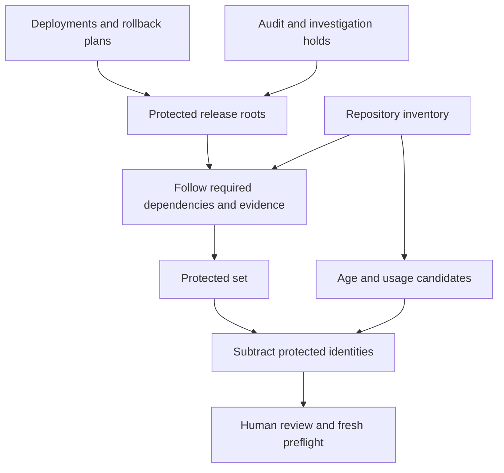

# Retain Artifacts for Deployed Releases, Rollback, and Audit Evidence

Author: [nawazdhandala](https://www.github.com/nawazdhandala)

Tags: Artifact Management, Artifact Repository, CI/CD, Disaster Recovery

Description: Design retention around active deployments, rollback targets, and their evidence, then review deletion candidates without trusting age alone.

An artifact can be old, rarely downloaded, and essential. A service that has run unchanged for six months may need its image tomorrow when a node fails. A rollback package can sit untouched until the exact moment you need it. Audit evidence may never appear in application download statistics.

A useful retention policy therefore begins with what must remain available. Age and usage help find candidates among everything else. They cannot establish whether a release is safe to remove.

This guide designs that decision process. The Python example only produces a review report; it does not connect to a repository or delete anything. Product cleanup settings come afterward, once the protected set is understood.

## Define protection reasons before retention periods

Create an explicit policy for each reason an artifact must survive:

| Protection reason | Source of truth | When protection can end |
|---|---|---|
| Currently deployed | Deployment inventory plus desired configuration | All relevant environments have moved away |
| Approved rollback target | Release owner and rollback plan | The rollback window closes and an alternative is verified |
| Recovery dependency | Recovery procedure and restore rehearsal | The procedure no longer needs that version |
| Audit evidence | Approved evidence retention schedule | The responsible owner authorizes expiry |
| Investigation hold | Incident or review owner | The hold is explicitly released |

Keep the reason, owner, creation time, and review date. A review date asks someone to reconsider protection; it should not silently delete an artifact while the owner is unavailable.

Do not invent a universal duration such as “keep everything for 90 days.” Different products have different deployment intervals, customer support commitments, and recovery needs. Choose periods with the people responsible for those obligations, then make the policy executable and reviewable.

## Protect the whole release dependency set

A deployed digest is a starting point, or *root*. Its dependencies also need protection. For a container image, that includes the applicable manifests, configurations, and layers. A release can additionally require a chart, migration package, signature, provenance, and software bill of materials.

Some relationships are explicit references in the artifact format. Others exist only in your release record. For example, a test report may refer to an image, while the image contains no link back to that report. Your inventory must add that evidence relationship deliberately.



Use identities that include the repository or evidence store and immutable content identity. Two copies of the same digest in different registries have different availability roles. Removing the production copy because a development copy exists can still break production recovery.

## Calculate a review set without deleting anything

The following Python 3.9-compatible helper expects an inventory assembled by your existing reporting process. Each item has a unique `id`, a list of `requires` identities, and a Boolean `eligible` supplied by your age-and-usage policy. `roots` contains every explicitly protected identity.

Save this as `plan.py`:

```python
import json
import sys

def plan(inventory, roots):
    by_id = {item['id']: item for item in inventory}
    if len(by_id) != len(inventory):
        raise ValueError('Duplicate artifact identity')
    for item in inventory:
        if type(item['eligible']) is not bool:
            raise ValueError('Eligibility must be a boolean')
        for dependency in item['requires']:
            if dependency not in by_id:
                raise ValueError('Incomplete dependency inventory')
    protected = set()
    pending = list(roots)
    while pending:
        identity = pending.pop()
        if identity not in by_id:
            raise ValueError('Protected artifact missing from inventory')
        if identity not in protected:
            protected.add(identity)
            pending.extend(by_id[identity]['requires'])
    return {
        'protected': sorted(protected),
        'review_candidates': sorted(
            key for key, item in by_id.items()
            if item['eligible'] and key not in protected
        ),
    }

if __name__ == '__main__':
    with open(sys.argv[1]) as f:
        document = json.load(f)
    print(json.dumps(plan(document['inventory'], document['roots']), indent=2))
```

The loop follows dependencies until every reachable identity is protected. Tracking visited identities prevents cycles from making it loop forever. Missing roots, missing dependencies, duplicate identities, and non-Boolean eligibility values stop the calculation instead of producing a reassuring partial result.

For a small learning fixture, save this as `inventory.json`. These short IDs illustrate relationships; replace them with stable repository-qualified identities in a real report:

```json
{
  "roots": ["deployed-release"],
  "inventory": [
    {"id": "deployed-release", "requires": ["evidence"], "eligible": true},
    {"id": "evidence", "requires": [], "eligible": true},
    {"id": "unused-build", "requires": [], "eligible": true}
  ]
}
```

Run `python3 plan.py inventory.json`. The protected list contains `deployed-release` and `evidence`; only `unused-build` appears under `review_candidates`. Even though all three items satisfy the age policy, protection takes precedence.

This helper cannot discover missing relationships that were never recorded. It also cannot establish that an empty root list is legitimate. Require a successful, fresh inventory from every expected environment before using the report. An unreachable cluster must produce an incomplete-inventory condition, not an empty deployment list.

## Translate the decision into product-specific rules

Retention engines do not all express the same operation. Harbor's [2.14 retention documentation](https://goharbor.io/docs/2.14.0/working-with-projects/working-with-images/create-tag-retention-rules/) describes rules that select what to retain, combining their results with OR. It also explains that retaining one matching tag preserves the artifact and its other tags. Do not read those rules as an ordered list of deletion exceptions.

Nexus Repository offers [cleanup previews](https://help.sonatype.com/en/cleanup-policies.html), but the preview is a snapshot. Publishing and downloads between preview and execution can change the result. Save the preview alongside your protection report and compare identities, rather than approving only a deletion count.

For Artifactory, check your version, subscription, and package support before relying on [package cleanup policies](https://docs.jfrog.com/administration/docs/cleanup-policies). The documentation warns that package cleanup does not verify whether a package belongs to a build or release bundle. It also warns that associated evidence is permanently removed when its package, build, or release bundle is cleaned. Release membership alone is therefore not an adequate protection rule.

If a product cannot express your protected set safely, separate protected releases into an excluded repository or use a reviewed, narrowly scoped process. Do not weaken the protection model merely to fit a convenient scheduler.

## Handle the gap between review and execution

A deletion preview becomes stale as soon as deployments change. Coordinate promotion and cleanup so that a newly selected release receives protection before cleanup can remove it. Immediately before execution, refresh the roots and compare the exact candidate identities again.

Keep the first run small. Confirm that selected candidates are outside the protected set, record the policy revision and inventory timestamps, and preserve the product's execution report. If inventory coverage drops, stop cleanup automatically and investigate.

Measure recovery capability as well as storage savings. From a clean client, retrieve the current release and an approved rollback release with their required evidence. Exercise the documented restore path for a representative archived artifact. A backup that has never been restored is not a reason to relax live retention.

Logical deletion and physical disk reclamation are separate operational concerns. Do not bypass the repository and remove storage files because a retention report says an artifact is unused. The repository must maintain its own metadata and shared-content relationships.

## Validation boundaries

The helper was tested locally with protected roots, shared dependencies, cycles, missing identities, duplicate identities, and invalid eligibility values. It produced review candidates without making repository requests. No Harbor, Nexus, or Artifactory cleanup job was executed.

Use the report to explain *why* each candidate is eligible and *why* every retained release remains recoverable. That explanation is more valuable than a schedule that removes old objects without understanding what they support.
