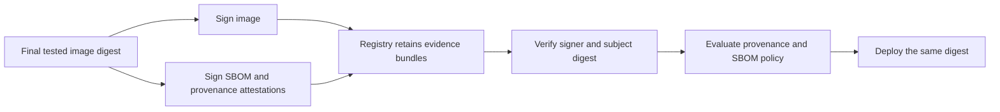

# Attach OCI Evidence with Cosign and Verify It Before Deployment

Author: [nawazdhandala](https://www.github.com/nawazdhandala)

Tags: Software Supply Chain, Security, Docker, CI/CD

Description: Sign OCI artifacts, attach SBOM and SLSA attestations, and enforce signer, digest, and provenance expectations before deploying the approved image.

An image can have a signature and still be unsuitable for production. The signer might be untrusted, the provenance might describe the wrong source revision, or the software bill of materials might belong to another artifact. Evidence becomes useful only when a verifier checks it against an explicit deployment policy.

This walkthrough uses **Cosign 3.0.2** and its default bundle format. It shows keyless signing in an approved CI environment, followed by verification of an exact image digest. The commands are source-checked examples; no live signing, registry upload, or deployment was performed for this article.

## Distinguish the three evidence types

| Evidence | What it contributes | What it does not establish alone |
|---|---|---|
| Image signature | A trusted signer endorsed particular image content | That the image meets your release policy |
| SBOM attestation | A signer binds a software inventory to the image | That every component is safe or the inventory complete |
| SLSA provenance | A builder describes how the artifact was produced | That the builder and build parameters are acceptable |

An SBOM is a software bill of materials. SLSA provenance describes build inputs and execution. An attestation wraps a statement about an artifact and signs it. Treat a loose JSON attachment differently from a signed statement whose subject identifies the approved digest.

## Start with the final immutable reference

Use the digest from the completed build and test process, not a tag resolved again later. For a multi-platform image, decide whether approval covers the full index and which platform builds have actually been tested.

The examples assume these environment values are supplied by trusted release configuration:

```bash
set -euo pipefail
: "${IMAGE_REF:?Set repository@sha256:digest from the approved build}"
[[ "$IMAGE_REF" =~ @sha256:[0-9a-f]{64}$ ]] || exit 1
```

The format check is only a guard against accidentally passing a tag. It does not prove approval. Keep the approved digest, expected signer, and provenance policy under controls separate from the untrusted artifact being evaluated.



## Attach evidence produced by the build

In an authorized CI job with registry write access, supported OIDC identity, and access to the configured Sigstore services, the basic commands are:

```bash
cosign sign --yes "$IMAGE_REF"
cosign attest --yes --type spdxjson \
  --predicate sbom.spdx.json "$IMAGE_REF"
cosign attest --yes --type slsaprovenance1 \
  --predicate provenance-predicate.json "$IMAGE_REF"
```

`sbom.spdx.json` must be the SPDX JSON document generated for this image. `provenance-predicate.json` must contain the SLSA v1 predicate produced by the trusted build process, not an entire in-toto statement. Do not manufacture provenance from a developer-supplied description after the build and present it as builder-generated evidence.

The [Cosign 3.0.2 predicate mapping](https://github.com/sigstore/cosign/blob/v3.0.2/cmd/cosign/cli/options/predicate.go) distinguishes `slsaprovenance1` from the older `slsaprovenance` alias. Choosing the wrong type changes the expected predicate format.

This example uses Cosign's default public Sigstore configuration. Approve the identity and transparency-log use before running it for organizational artifacts; `--yes` accepts the normal signing prompts. Environments requiring private services need their supported signing and trust configuration instead. Do not remove verification checks to imitate an offline deployment.

In this release, the [attestation options](https://github.com/sigstore/cosign/blob/v3.0.2/cmd/cosign/cli/options/attest.go) default to the new bundle format using OCI referrers. Check registry support and retain the evidence alongside its subject. Verify evidence discovery again after copying the image to a different repository; an image-only copy is not proof that all associated attestations moved.

## Verify the exact signing identity

For a GitHub Actions signing workflow, configure the exact certificate identity and issuer expected from your trusted producer. Replace the example workflow URL with the identity your approved signing process actually issues:

```bash
set -euo pipefail
SIGNER='https://github.com/acme/payments/.github/workflows/release.yml@refs/heads/main'
ISSUER='https://token.actions.githubusercontent.com'

cosign verify \
  --certificate-identity "$SIGNER" \
  --certificate-oidc-issuer "$ISSUER" \
  "$IMAGE_REF"

cosign verify-attestation --type spdxjson \
  --certificate-identity "$SIGNER" \
  --certificate-oidc-issuer "$ISSUER" \
  "$IMAGE_REF"
```

Avoid an unrestricted identity regular expression that accepts any workflow. If the SBOM producer has a different trusted identity, give it a separate explicit policy instead of broadening one identity to match everyone.

These checks establish cryptographic and subject-binding prerequisites using Cosign's verification behavior. An accepted SBOM attestation still needs your inventory, vulnerability, and license checks. Do not infer that Cosign's successful exit means the application is free of vulnerable components.

## Require the expected provenance contents

[SLSA verification guidance](https://slsa.dev/spec/v1.2/verifying-artifacts) calls for trusted builders and expected build types and external parameters, in addition to signature verification. External parameters are inputs defined by the builder's build-type contract; they do not have one universal source-repository field layout.

Here is a CUE policy for an **illustrative internal build contract**. CUE is a language for expressing data constraints. In this example only, the contract defines external parameters named `source` and `commit`. Adapt it to your producer's documented schema and expected revision; do not change a producer's evidence to fit this sample.

Save it as `provenance.cue`:

```cue
predicateType!: "https://slsa.dev/provenance/v1"
predicate!: {
    buildDefinition!: {
        buildType!: "https://build.example.internal/types/container/v1"
        externalParameters!: close({
            source!: "https://github.com/acme/payments"
            commit!: "0123456789abcdef0123456789abcdef01234567"
        })
    }
    runDetails!: builder!: id!: "https://build.example.internal/builders/release"
}
```

The example commit is a placeholder. Required fields use `!:` so missing data fails rather than being supplied by a constraint. `close` rejects unrecognized external parameters. The builder ID is another required claim; the signature verifier must also establish that the signer is authorized to speak for that builder.

Add this policy to provenance verification:

```bash
cosign verify-attestation --type slsaprovenance1 \
  --certificate-identity "$SIGNER" \
  --certificate-oidc-issuer "$ISSUER" \
  --policy provenance.cue \
  "$IMAGE_REF"
```

Cosign's [attestation verification implementation](https://github.com/sigstore/cosign/blob/v3.0.2/cmd/cosign/cli/verify/verify_attestation.go) verifies attestations before applying the selected predicate policy. Run the commands in a failing-on-error deployment stage. Do not continue deployment if any required signature, attestation, or content-policy check fails.

## Enforce the gate where deployment actually happens

A pipeline check is effective only if deployments cannot bypass it. Protect the deployment job, policy files, trusted identities, and digest selection. Deploy the same verified repository-and-digest reference; switching back to a mutable tag reintroduces a gap.

Kubernetes environments can additionally use a compatible [Sigstore policy controller](https://docs.sigstore.dev/policy-controller/overview/) at admission. Test its version and bundle-format compatibility, namespace coverage, required predicates, and failure behavior before enforcement. A controller installation alone is not evidence that every workload is covered.

Rehearse negative cases: an unsigned image, an untrusted signer, a missing SBOM, incorrect provenance parameters, and unavailable evidence. Also test required platforms and a copied artifact. Keep the expected result explicit: deny deployment with a diagnosable reason, rather than skipping verification during an outage.

## What was validated locally

Cosign 3.0.2's command flags and predicate aliases were checked against its binary and tagged source. The CUE example was tested with CUE 0.14.1, matching Cosign's declared library version. It accepted the expected synthetic statement and rejected wrong source, commit, builder, build type, extra parameters, and a missing commit.

Those unsigned fixtures test the content policy only. They do not demonstrate signature verification, transparency-log validation, registry referrer support, or admission enforcement. Validate those stages with your actual producer and deployment environment before making this gate authoritative.
