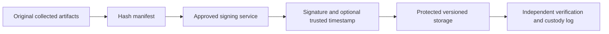

# Protect Audit Evidence with Hashes, Trusted Time, and Custody Records

Author: [nawazdhandala](https://www.github.com/nawazdhandala)

Tags: Compliance, Security, AWS

Description: Build a verifiable evidence package with signed hashes, explicit object versions, trusted timestamps, and custody records that preserve what each check actually proves.

A folder of screenshots and exports can be useful evidence, but its contents may change without leaving a clear history. A checksum beside each file helps only if the checksum itself is protected. An attacker who can replace both the file and its checksum can make the pair look consistent again.

Build an evidence package that answers separate questions: what bytes were collected, who approved the package, when it existed, where its protected version is stored, and who handled it afterward. Do not ask a single hash to answer all five.

This tutorial includes a disposable local signing demonstration tested with OpenSSL 4.1.0 and Python 3.11.13. It does not configure production retention or claim that a particular package satisfies an audit requirement.

## Match each protection to its purpose

| Protection | What it contributes | What it does not establish |
| --- | --- | --- |
| Cryptographic hash | A reproducible digest of exact bytes | That the original data was accurate |
| Digital signature | Verification against an approved signing key | Trust in a public key supplied by an unknown sender |
| Trusted timestamp | Evidence of existence by a stated time | The original business event's time or truth |
| Retained object version | Protection of that stored version | Protection of every later version or metadata claim |
| Custody record | History of collection, transfers, verification and access | Automatic correctness of every recorded action |

Keep original exports separate from transformed reports. If you normalize JSON, redact fields, or convert a spreadsheet to PDF, preserve the transformation description and link the derived artifact to its input. A formatting-only change still changes the bytes being hashed.

## Make the package reproducible

An evidence manifest should list each artifact's identifier, filename or object reference, byte length, digest algorithm and digest. Add collection scope, source, collector version, run identifier, and source/collection timestamps. Define how filenames and paths are interpreted so the verifier cannot accidentally check a different file.

Sign the exact manifest bytes. Reformatting a signed JSON manifest after signing invalidates its signature even if the values appear unchanged. Choose a serialization convention before signing and retain the original signed representation.



In production, restrict signing access separately from evidence upload access where practical. A compromised uploader should not automatically gain the ability to sign replacement packages with the trusted identity.

## Run a disposable signing demonstration

Use an empty working directory and OpenSSL 4.1.0 on PATH. The following creates a new `evidence-demo` folder; it stops if that folder already exists. The generated private key is an unencrypted disposable lab key, not a production key-management pattern.

```bash
set -e
umask 077
mkdir evidence-demo
cd evidence-demo
printf '%s\n' '{"resource":"demo","encryption":"enabled"}' > evidence.json

openssl genpkey -algorithm RSA -pkeyopt rsa_keygen_bits:3072 -out lab-key.pem
openssl pkey -in lab-key.pem -pubout -out lab-public.pem
openssl dgst -sha256 -r evidence.json > manifest.sha256
openssl dgst -sha256 -sign lab-key.pem -out manifest.sig manifest.sha256
openssl dgst -sha256 -verify lab-public.pem \
  -signature manifest.sig manifest.sha256
```

Expect `Verified OK` from the final command. The example hashes one file and signs its checksum manifest. A production package should carry the richer manifest fields described above and use an approved protected signing service or key store. [OpenSSL key generation](https://docs.openssl.org/4.1/man1/openssl-genpkey/), [public-key export](https://docs.openssl.org/4.1/man1/openssl-pkey/), [digest signing and verification](https://docs.openssl.org/4.1/man1/openssl-dgst/)

Signature verification alone checks the manifest, not whether the artifact still matches it. After successfully verifying the signature, run this Python 3 code from inside `evidence-demo`:

```python
from hashlib import sha256
from pathlib import Path

expected = Path("manifest.sha256").read_text().split()[0]
actual = sha256(Path("evidence.json").read_bytes()).hexdigest()
if actual != expected:
    raise SystemExit("Evidence digest mismatch")
print("Evidence digest matches the signed manifest")
```

This verifier intentionally handles one known filename. It is not a general manifest parser. For a multi-file package, validate every entry, reject unsafe paths, and identify missing or unexpected artifacts according to your package policy.

In the local test, changing the artifact made the digest check fail while the unchanged manifest signature still verified. Changing the signed manifest made signature verification fail. These are different failure conditions and should produce different investigation records.

The recipient must obtain the approved public key through an independent trusted mechanism. Accepting whatever key arrives beside the package allows an attacker to replace the package, signature, and key together. Retain key identifiers, authorization history, and the information needed to assess signatures after rotation or compromise.

## Add time evidence without rewriting history

An operating-system modification time is not a trusted timestamp. Keep the source event time, collection time, storage time, and any independent timestamp as separate fields.

RFC 3161 defines a protocol in which a Time Stamping Authority, or TSA, signs a response associated with a message digest. It supports evidence that the referenced data existed by a particular time. It does not prove when the underlying configuration first became true. [RFC 3161](https://www.rfc-editor.org/rfc/rfc3161.html)

From the same lab folder, this command creates a timestamp request for the signature:

```bash
openssl ts -query -data manifest.sig -sha256 -cert -out request.tsq
```

Creating the request does not obtain trusted time. An approved TSA must return a response, and the verifier must validate its signature, certificate trust, message imprint and applicable policy. Preserve the response and required validation material with the package. No TSA request was transmitted in this tutorial. [OpenSSL timestamp operations](https://docs.openssl.org/4.1/man1/openssl-ts/)

Timestamping the signature ties the time evidence to that signed package. A late timestamp still cannot repair missing observations from an earlier audit period. Record that limitation honestly rather than backdating collection metadata.

## Protect exact storage versions

In Amazon S3, Object Lock protects object versions and requires versioning. A protected version can remain intact while a new version or delete marker changes what an ordinary latest-object lookup returns. Record the bucket, key, and version identifier for each package component. [S3 Object Lock](https://docs.aws.amazon.com/AmazonS3/latest/userguide/object-lock.html)

Governance mode permits bypass by specially authorized users making the required bypass request. Compliance mode prevents users, including the account root user, from overwriting or deleting a protected version during retention; its retention period cannot be shortened. Select the mode and duration with the responsible records owner before applying irreversible retention settings. [S3 retention modes](https://docs.aws.amazon.com/AmazonS3/latest/userguide/object-lock.html)

Protect the manifest, signature, timestamp response, and relevant verification records as well as the raw artifacts. Test retrieval by explicit version in staging. Also preserve access to encryption keys: retaining ciphertext is not useful if the organization loses its ability to decrypt it.

## Record verification at each handoff

For each collection, transfer, or export, record the package identifier, actor or service identity, UTC time, source and destination references, verification result, and purpose. Append a new custody event rather than editing the prior event to match a later interpretation.

At handoff, verify the trusted signature, every required artifact digest, and the applicable timestamp and storage references. On a mismatch, preserve both copies and the failure details; do not overwrite the earlier copy or regenerate its manifest just to make verification pass.

Finally, rehearse retrieval from the retained versions using an independent verifier. A useful evidence package remains understandable and verifiable after the original collector has changed, its keys have rotated, and the people who assembled it are no longer available.
