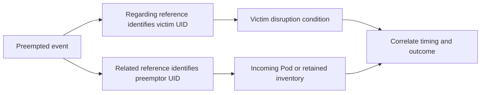

# Audit Which Kubernetes Pod Preempted Which Victims

Author: [nawazdhandala](https://www.github.com/nawazdhandala)

Tags: Kubernetes, Troubleshooting, Incident Management

Description: Correlate scheduler preemption events, victim UIDs, related Pod references, and disruption conditions without mistaking a replacement Pod for the original.

After several Pods disappear, a list of recent high-priority deployments is not enough to say which one caused the disruption. A useful preemption audit connects a specific incoming Pod UID to specific victim UIDs and records where that connection came from.

Names, conditions, events, and API audit logs each provide part of the story. Their limits matter as much as their contents. A `DisruptionTarget` condition identifies a mechanism, while an event can identify the related incoming Pod; neither should be replaced with a guess based on timing alone.

This procedure is grounded in **Kubernetes 1.34.0** default scheduler source. It uses read-only API queries and local JSON inspection. Custom schedulers may emit different records.

## Preserve identities before objects disappear

A Pod UID is the unique identifier for that particular object. A controller can replace a Pod with similar labels, and a recreated named Pod can have the same name but a different UID. Use UIDs as the audit's join keys.

Save available Pods and scheduler events from the victim namespace promptly. Substitute the correct context and namespace:

```bash
kubectl --context staging -n workloads get pods -o json > pods.json
kubectl --context staging -n workloads get events.events.k8s.io \
  -o json > scheduler-events.json
```

The second command explicitly selects the `events.k8s.io` API group. Its events use fields such as `regarding`, `related`, and `note`. Legacy core events expose different field names, so avoid applying a filter written for one representation to the other without checking `apiVersion`.

Store these snapshots in the approved incident location. Pod specifications and event messages can contain operational details. A snapshot cannot recover objects already removed; retained event and log exports are important for later investigations.

## Know what the scheduler records

The [1.34.0 preemption implementation](https://github.com/kubernetes/kubernetes/blob/v1.34.0/pkg/scheduler/framework/preemption/preemption.go) records a `Preempted` event with the victim as the primary object and the incoming Pod as the related object. Its message includes the incoming Pod UID and candidate node.

For an ordinary victim deletion, the scheduler also sets a true `DisruptionTarget` condition with reason `PreemptionByScheduler` before issuing deletion. That condition's message identifies scheduler preemption generally; it is not a structured field containing the incoming Pod UID.



The source has a separate path for a Pod waiting in a scheduler Permit plugin: it can reject that waiting Pod instead of following the normal deletion path. Do not demand an identical condition history from every event.

## Extract the event relationships

With `jq` installed, inspect all matching events in the saved file:

```bash
jq '[.items[] |
  select(.reason == "Preempted") |
  {
    eventUID: .metadata.uid,
    time: (.series.lastObservedTime // .eventTime // .metadata.creationTimestamp),
    reportingController,
    action,
    victim: .regarding,
    preemptor: .related,
    note
  }
] | sort_by(.time)' scheduler-events.json
```

The output retains whole object references, including names, namespaces, and UIDs when present. It also preserves the reporting controller and event note so you can verify who emitted the record.

The timestamp expression prefers the latest observation for an aggregated event series. It does not turn a series into a complete sequence of individual occurrences. The [Event API schema](https://github.com/kubernetes/api/blob/v0.34.0/events/v1/types.go) describes these fields and the difference between the primary and related object references.

If `related` is absent, do not manufacture a UID from a current Pod with a similar name. Preserve the note and investigate the scheduler version and retained logs. The message format is useful evidence for the pinned source, but structured references are preferable to a brittle parser built around punctuation in human-readable text.

## Join a related UID to the saved Pods

Copy the exact related UID from an event, then query the saved inventory:

```bash
jq --arg uid 'REPLACE_WITH_PREEMPTOR_UID' \
  '[.items[] | select(.metadata.uid == $uid) |
    {
      name: .metadata.name,
      namespace: .metadata.namespace,
      uid: .metadata.uid,
      priority: .spec.priority,
      scheduler: .spec.schedulerName,
      node: .spec.nodeName,
      nominatedNode: .status.nominatedNodeName
    }
  ]' pods.json
```

An empty array is an honest result: the object was not in that snapshot. The incoming Pod may be in another namespace, may already be deleted, or may have been created after the snapshot. Collect an authorized snapshot from the referenced namespace or use retained inventory rather than broadening the conclusion.

Repeat the identity check for each victim. Record the numeric priorities from captured Pod objects where available, but do not claim historical priority from a replacement object.

## Use conditions as corroboration

Inspect the victim's `status.conditions` for a true `DisruptionTarget` entry and its reason, transition time, and message. `PreemptionByScheduler` supports the scheduler path. `TerminationByKubelet`, `EvictionByEvictionAPI`, and taint-manager deletion describe other paths.

A condition can describe an intended disruption that does not complete. The [disruption-condition documentation](https://kubernetes.io/docs/concepts/workloads/pods/disruptions/#pod-disruption-conditions) warns that an interrupted disruption can leave a condition that is later cleared. Check deletion outcome, event records, and node evidence before calling every condition an actual lost replica.

Also, `status.nominatedNodeName` on the incoming Pod is not a victim list. It can change, be cleared, or differ from the final assigned node. Use the event's victim relationship rather than trying to infer victims from everyone who once ran on that node.

## Fill gaps with retained logs and audit records

Scheduler logs can provide paired incoming-Pod and victim references, depending on version and verbosity. Kubernetes API auditing can establish requests made against the victim object, the caller, timestamps, and response outcomes when the configured policy retained them.

API audit logs do not automatically explain the scheduling rationale or carry a complete preemptor-to-victim graph. Their usefulness depends on the policy and collected stages. Review the [auditing documentation](https://kubernetes.io/docs/tasks/debug/debug-cluster/audit/) and your existing retention before promising a retrospective reconstruction.

For future incidents, retain scheduler events, Pod identity changes, and the relevant component logs long enough for your response process. Validate the export with a controlled staging incident rather than assuming that an event visible in the API today remains available next week.

The local checks executed both JSON filters against representative event and Pod snapshots, including a missing related reference and reused names with different UIDs. No live scheduler event or cluster audit pipeline was tested. A defensible report distinguishes confirmed UID links, supporting conditions, and evidence gaps instead of presenting correlation as certainty.
