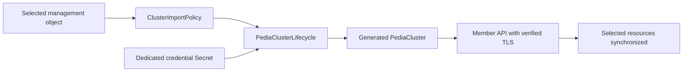

# Auto-Import Managed Clusters with Clusterpedia Policies

Author: [nawazdhandala](https://www.github.com/nawazdhandala)

Tags: Kubernetes, Multi-Cluster, Automation

Description: Build a scoped Clusterpedia import policy, map platform resources to credentials, and understand lifecycle, rotation, and policy-update boundaries.

When another platform already creates and manages clusters, maintaining a second hand-written list of PediaClusters can become repetitive. A `ClusterImportPolicy` can translate platform objects into Clusterpedia imports and keep endpoint or credential changes synchronized.

The integration is a mapping between APIs, not a universal "import everything" switch. Cluster API, Karmada, and vCluster expose different source objects, credential layouts, and readiness signals. This guide uses **Clusterpedia v0.9.0** with a concrete **Cluster API v1.9.0 / v1beta1 source contract**. That older contract is explicit so the template can be reviewed; it is not a recommendation to downgrade an existing management platform.

## Identify the source and reference objects

Clusterpedia ships tagged examples for these platforms:

| Platform | Source used by its example | Credential mapping to verify |
| --- | --- | --- |
| Cluster API | `clusters.cluster.x-k8s.io` | A same-namespace Secret containing a kubeconfig |
| Karmada | `clusters.cluster.karmada.io` | The Secret referenced by `spec.secretRef`, with token and CA fields |
| vCluster | A selected Secret | Encoded kubeconfig and certificate data, with a reachable service endpoint |

Review the actual [Cluster API](https://github.com/clusterpedia-io/clusterpedia/blob/v0.9.0/kustomize/clusterimportpolicy/cluster_api.yaml), [Karmada](https://github.com/clusterpedia-io/clusterpedia/blob/v0.9.0/kustomize/clusterimportpolicy/karmada.yaml), and [vCluster](https://github.com/clusterpedia-io/clusterpedia/blob/v0.9.0/kustomize/clusterimportpolicy/vcluster.yaml) examples against your installed platform. A Secret naming convention or readiness shape from one release is not a compatibility guarantee for another.

The source and reference objects must be visible through the API watched by the Clusterpedia controller manager. Installing Clusterpedia in an unrelated cluster does not automatically give it discovery and Secret access in a remote management plane.



The [policy concept documentation](https://clusterpedia.io/docs/concepts/cluster-import-policy/) explains the intermediate lifecycle object and its relationship to the generated PediaCluster.

## Prepare a dedicated import credential

The upstream Cluster API example reads `<cluster>-kubeconfig`. However, Cluster API's [control-plane contract](https://release-1-9.cluster-api.sigs.k8s.io/developer/providers/contracts/control-plane) says its management kubeconfig should not be shared with other applications. Provision a separate, appropriately scoped identity for Clusterpedia instead.

For this example, prepare a kubeconfig with verified member CA trust, a reachable server address, and permissions for the selected resources plus required discovery. Arrange credential renewal separately. Store it under a custom, documented name such as `demo-clusterpedia-kubeconfig`, in the same namespace as the Cluster API object:

```bash
kubectl --context MANAGEMENT_CONTEXT -n platform-pilot create secret generic \
  demo-clusterpedia-kubeconfig \
  --from-file=value=/protected/path/clusterpedia-reader.kubeconfig
```

Replace the context, cluster name prefix, and protected file path. The Secret must not already exist for this create command. The file should be self-contained and usable by the controller environment; an interactive login or local workstation file reference is not sufficient.

The [Secret creation command](https://kubernetes.io/docs/reference/kubectl/generated/kubectl_create/kubectl_create_secret_generic/) stores the file under `value`; Kubernetes encodes that Secret data. The policy copies that encoded value into the byte-valued PediaCluster kubeconfig field once. It does not base64-encode it again. Restrict read access to generated PediaClusters too, because the credential is copied into that resource rather than remaining solely behind a Secret reference.

## Create an opt-in pilot policy

Save this as `capi-pilot.yaml`. It watches only v1beta1 Cluster objects in `platform-pilot` that carry `monitoring.example.com/import=true`:

```yaml
apiVersion: policy.clusterpedia.io/v1alpha1
kind: ClusterImportPolicy
metadata:
  name: capi-pilot
spec:
  source:
    group: cluster.x-k8s.io
    resource: clusters
    versions: [v1beta1]
    selectorTemplate: |
      {{ if eq .source.metadata.namespace "platform-pilot" }}
        {{ if .source.metadata.labels }}
          {{ eq (index .source.metadata.labels "monitoring.example.com/import") "true" }}
        {{ end }}
      {{ end }}
  references:
    - group: ""
      resource: secrets
      versions: [v1]
      namespaceTemplate: '{{ .source.metadata.namespace }}'
      nameTemplate: '{{ .source.metadata.name }}-clusterpedia-kubeconfig'
      key: reader
  nameTemplate: 'capi-{{ .source.metadata.namespace }}-{{ .source.metadata.name }}'
  template: |
    spec:
      kubeconfig: '{{ .references.reader.data.value }}'
      syncResources:
        - group: ""
          resources: [pods]
        - group: apps
          resources: [deployments]
  creationCondition: |
    {{ range .source.status.conditions }}
      {{ if eq .type "ControlPlaneInitialized" }}
        {{ if eq .status "True" }} true {{ end }}
      {{ end }}
    {{ end }}
```

The generated name includes the source namespace because two namespaces may each contain a Cluster named `demo`. Review your complete naming scheme for collisions and Kubernetes name-length limits before expanding the pilot.

The creation condition follows the pinned Cluster API [condition definition](https://github.com/kubernetes-sigs/cluster-api/blob/v1.9.0/api/v1beta1/condition_consts.go). It establishes that the control plane initialized; it does not prove Clusterpedia can authenticate or synchronize. A newer source API with different conditions needs a reviewed template adaptation.

## Validate and opt in one source

Ensure the policy CRDs and controller manager are installed, the source API is served, and the controller can read the selected sources and reference Secrets. Also check for an existing policy managing the same sources.

```bash
kubectl --context MANAGEMENT_CONTEXT apply --dry-run=server -f capi-pilot.yaml
kubectl --context MANAGEMENT_CONTEXT apply -f capi-pilot.yaml
kubectl --context MANAGEMENT_CONTEXT -n platform-pilot label \
  clusters.cluster.x-k8s.io demo monitoring.example.com/import=true
```

Run the persisted apply and label commands only as the reviewed pilot change. The label command intentionally omits overwrite: investigate an existing conflicting value instead of silently replacing it. Server dry-run checks API acceptance, not template execution against every possible source object.

Inspect the three stages without printing credential-bearing specifications:

```bash
kubectl --context MANAGEMENT_CONTEXT get clusterimportpolicy capi-pilot \
  -o jsonpath='{.status.conditions}{"\n"}'
kubectl --context MANAGEMENT_CONTEXT get pediaclusterlifecycle capi-platform-pilot-demo \
  -o jsonpath='{.status.conditions}{"\n"}'
kubectl --context MANAGEMENT_CONTEXT get pediacluster capi-platform-pilot-demo \
  -o jsonpath='{.status.conditions}{"\n"}{.status.syncResources}{"\n"}'
```

A policy validation success, a created lifecycle, and a healthy imported cluster are different milestones. Missing references, unmet creation conditions, and member authorization errors require different fixes.

## Understand updates and removal before broad rollout

In v0.9.0, the creation condition gates initial creation; it does not suspend updates to an existing import. The lifecycle controller refreshes endpoint and authentication fields, but it does not generally overwrite existing metadata and resource selections from later template edits. The [tagged controller implementation](https://github.com/clusterpedia-io/clusterpedia/blob/v0.9.0/pkg/controller/pediaclusterlifecycle/pediaclusterlifecycle_controller.go) makes those boundaries explicit.

Consequently, changing the template's Pod/Deployment list is not a reliable fleet-wide selection migration. Review and manage existing PediaCluster selections separately. For credential rotation, update the dedicated Secret through its owner, then confirm that the import continues to synchronize with the replacement credential before retiring the old one.

Deletion is also lifecycle management, not merely removing a label from a search. The generated PediaCluster has an owner relationship to its lifecycle. Test source deletion, selector removal, and policy removal in a disposable pilot, and document which generated objects disappear. Do not use deletion as an improvised pause mechanism.

The local checks for this policy cover schema validity, source selection, condition evaluation, naming, and credential copying with synthetic data. A production acceptance test still needs real endpoint reachability, trust, permissions, rotation, and deletion behavior. Expand only after that single-source path is understood.
