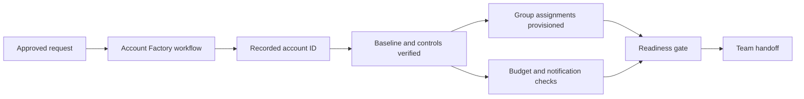

# Automate AWS Account Vending with Access, Budgets, and Controls

Author: [nawazdhandala](https://www.github.com/nawazdhandala)

Tags: AWS, Cloud Automation, IAM

Description: Build an AWS account-vending workflow that verifies Control Tower governance, Identity Center access, budget notifications, and readiness before handoff.

Account vending is the process of turning an approved request into an AWS account that a team can safely use. Creating an account is only one step. A team also needs the right access, a cost owner, working notifications, and a verified governance baseline.

The most useful handoff is therefore a readiness record, not just a twelve-digit account ID. This tutorial describes that workflow and provides a locally tested example for observing asynchronous IAM Identity Center assignment provisioning. No AWS accounts were created during validation.

## Choose one account-provisioning authority

For an organization already using AWS Control Tower, Account Factory for Terraform (AFT) provides a Terraform-based provisioning and customization pipeline. It requires an existing Control Tower landing zone and uses a dedicated AFT management account, separate from the Control Tower management account. See the [official AFT overview](https://docs.aws.amazon.com/controltower/latest/userguide/aft-overview.html).

A landing zone is the organization's governed multi-account foundation. Do not treat deploying AFT as a substitute for establishing that foundation, or create a second account-creation path alongside AFT without deciding which system owns reconciliation.

For an existing AFT installation, submit requests through its reviewed account-request repository. Pin the AFT module and Terraform versions in that installation's release process. This article does not supply a generic module block: the installation's supported version and customization repositories determine its exact contract.

Keep one durable request identity throughout approval, provisioning, customization, and handoff. Record the approved request revision and resulting account ID. A worker restart must resume that request, not silently create a replacement account because a later access step failed.

## Define the handoff contract before provisioning

Collect the workload owner, billing contact, environment classification, requested organizational unit (OU), required Regions, access groups, permission sets, and budget policy. An OU groups accounts under common governance.

Use stable identity-store group IDs after resolving and reviewing the requested groups. A group display name is useful for humans but should not be the sole identifier in an execution record. Validate group membership ownership and the permissions the selected permission set grants.



Each arrow should have an observable completion condition. “Request accepted” is a useful checkpoint, but it is not the same as “ready for a team.”

| Gate | Evidence to retain |
| --- | --- |
| Account provisioning | Request identity, account ID, target OU, completed workflow |
| Baseline | Customization revision, required controls and deployment results |
| Access | Group ID, permission set ARN, assignment result, sign-in check |
| Cost management | Budget scope, thresholds, recipients, delivery-path verification |
| Handoff | Owner acknowledgment and links to operating procedures |

An Amazon Resource Name (ARN) identifies an AWS resource such as a permission set. Keep these identifiers in the record rather than reconstructing them from names later.

## Observe Identity Center assignment completion

`CreateAccountAssignment` assigns a user or group to an account through a permission set. Its response includes an asynchronous request status. AWS instructs callers to use `DescribeAccountAssignmentCreationStatus` afterward. A successful assignment also provisions the permission set to the account; later permission-set changes require separate provisioning. See [CreateAccountAssignment](https://docs.aws.amazon.com/singlesignon/latest/APIReference/API_CreateAccountAssignment.html).

The example below uses Python 3.11 with Boto3 **1.40.76**, the version used in local tests. It performs one observation per call so a workflow can checkpoint and schedule another attempt without holding a process open.

Prerequisites are an authorized `sso-admin` client in the Identity Center instance's Region and a persisted checkpoint containing the original request ID and expected assignment fields. `InstanceArn`, `PermissionSetArn`, `PrincipalId`, and `TargetId` must come from your reviewed request. Use `PrincipalType: GROUP` and `TargetType: AWS_ACCOUNT` for the group-assignment path described here. The request ID must come from the actual creation response, not a generated placeholder.

```python
def observe_assignment(client, checkpoint):
    result = client.describe_account_assignment_creation_status(
        InstanceArn=checkpoint['InstanceArn'],
        AccountAssignmentCreationRequestId=checkpoint['RequestId'],
    )['AccountAssignmentCreationStatus']
    if result.get('RequestId') != checkpoint['RequestId']:
        raise RuntimeError('Unexpected assignment request ID')
    status = result['Status']
    if status == 'IN_PROGRESS':
        return 'pending'
    if status == 'FAILED':
        raise RuntimeError(result.get('FailureReason', 'Assignment failed'))
    if status != 'SUCCEEDED':
        raise RuntimeError(f'Unknown assignment status: {status}')
    for key in ('TargetId', 'TargetType', 'PrincipalId',
                'PrincipalType', 'PermissionSetArn'):
        if result.get(key) != checkpoint[key]:
            raise RuntimeError(f'Assignment mismatch: {key}')
    return 'assignment-provisioned'
```

`pending` means reschedule observation with backoff and a bounded overall deadline. `assignment-provisioned` means the completed operation matches the expected account, principal, and permission set. A failed operation, mismatched result, or permission error stops this gate. The request and response fields follow [DescribeAccountAssignmentCreationStatus](https://docs.aws.amazon.com/singlesignon/latest/APIReference/API_DescribeAccountAssignmentCreationStatus.html).

Persist the creation response before advancing. If the response was lost, reconcile the desired assignment instead of repeatedly granting access without checking. [ListAccountAssignments](https://docs.aws.amazon.com/singlesignon/latest/APIReference/API_ListAccountAssignments.html) lists assignments for an account and permission set; follow every pagination token and match the principal ID and type. An existing desired assignment can establish current state, but does not reconstruct a lost request's history.

Finally, test actual access through a designated test member of the intended group. Successful provisioning does not prove identity-provider sign-in, group synchronization, or effective workload permissions. Use a harmless allowed operation and a deliberately prohibited operation appropriate to the role.

## Configure budgets as alerts, not hard spending caps

Decide where budgets are centrally owned and how they identify the new account. Record the monthly amount, currency, cost scope, actual and forecast thresholds, and recipients. Re-read that configuration as part of the readiness gate so an accidentally organization-wide budget cannot masquerade as an account-specific one.

AWS Budgets updates are delayed rather than continuous. A budget alert is therefore not a real-time spending ceiling. AWS documents its update cadence and supported cost types in [Managing your costs with AWS Budgets](https://docs.aws.amazon.com/cost-management/latest/userguide/budgets-managing-costs.html).

Verify the notification path and recipient ownership separately from budget creation. For an SNS destination, check the topic policy and subscription state; an accepted configuration is not proof that a human receives alerts. Any automated budget action also needs its own permissions and impact review. Follow the [AWS Budgets best practices](https://docs.aws.amazon.com/cost-management/latest/userguide/budgets-best-practices.html) rather than assuming a threshold automatically stops all spending.

## Verify the controls that actually apply

Control Tower calls governance rules controls; older material calls them guardrails. Their behavior differs: preventive controls disallow covered actions, detective controls identify noncompliance, and proactive controls evaluate supported resources through CloudFormation hooks. Proactive checks do not imply every direct API call is intercepted. See [control behavior and guidance](https://docs.aws.amazon.com/controltower/latest/controlreference/control-behavior.html).

Build an explicit baseline for the installed landing-zone version, OU, and governed Regions. Check enabled controls and customization results instead of assuming the product name guarantees every desired restriction. In particular, the current documentation notes a change to default mandatory-control application beginning with landing zone 4.0; review your version's configuration directly.

Use small, approved acceptance checks for logging, required security integrations, permitted Regions, and representative restrictions. Keep platform recovery access available through its separately governed procedure. Do not broaden a team's permission set merely to make a baseline test pass.

## Recover partial failures without discarding the account

If the account exists but an assignment or budget step fails, retain the account ID and retry only the unresolved step after correcting its cause. Keep workload handoff blocked while baseline evidence is incomplete. Do not automatically close the account as a generic rollback action.

Publish the final readiness record with the account, owner, approved access, budget configuration, baseline revision, and outstanding exceptions. That record makes subsequent changes reviewable and lets operators distinguish an account that merely exists from one that is ready to use.
