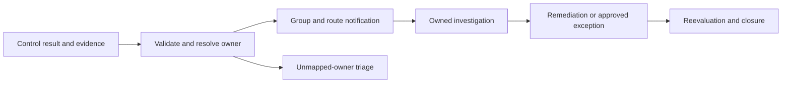

# Route Automated Control Failures Without Creating Alert Fatigue

Author: [nawazdhandala](https://www.github.com/nawazdhandala)

Tags: Compliance, Monitoring, Alertmanager

Description: Turn automated control failures into owned, deduplicated work with tested alert routing, explicit exception expiry, and evidence-based closure.

A scanner finds 300 resources with the same configuration problem. Sending 300 messages to a shared channel does not create 300 useful decisions. It creates a queue that nobody can confidently own.

Separate the finding, the notification, and the work item. A finding records what the control observed. A notification tells someone that action is needed. A work item tracks investigation, remediation, or a time-limited exception. Grouping notifications must not erase the underlying findings.

This tutorial uses Alertmanager 0.28.1 as a reproducible routing example. The configuration and four routing cases were tested locally with its matching `amtool` binary. The version is pinned for the example, not presented as the latest production release. No webhook delivery or ticket creation was tested.

## Decide whether this is a finding or missing evidence

A failed control and a failed collector are different events. If a collector cannot read a resource, its unknown result should go to the collection owner. It should not silently become either a compliant resource or a confirmed configuration violation.

For a genuine finding, retain the control identifier, affected resource, account or tenant, observed state, observation time, and evidence reference. Then enrich it with ownership and urgency. A short-lived deployment state may justify a grace period, but the grace period needs a documented reason and limit.

Do not assign paging urgency solely from a framework control number. Consider current exposure, affected data, production impact, and how quickly the responsible team must act. Monitoring guidance recommends actionable symptom-focused alerts with tolerance for small transient blips. [Prometheus alerting practices](https://prometheus.io/docs/practices/alerting/)

## Resolve ownership before choosing a receiver

Maintain an authoritative mapping from resource or service identity to an accountable team. Use resource tags as inputs only when their ownership and accuracy are controlled. A missing tag must create an ownership problem, not a dropped notification.

A useful normalized event has stable routing labels such as `owner`, `control_id`, `scope`, and `severity`. Keep the detailed explanation and evidence link in the event content. Avoid changing identity labels on every scan by inserting the scan timestamp or a random run identifier.

Define a stable finding key using the control, resource, scope, and relevant policy version. That lets a downstream work system update an existing item instead of opening another issue every time the scanner reports the same state. Decide explicitly whether a later recurrence reopens the item or starts a linked recurrence.



The fallback path must have a real owner and response expectation. Otherwise it becomes a second unowned queue with a better name.

## Test a small routing tree

Save the following as `alertmanager.yml` in a staging working directory. It is a standalone example, not a replacement for an existing production routing tree. The webhook URLs are deliberate `.invalid` placeholders. Replace them with your authenticated notification gateway endpoints and configure the gateway's required authentication before deployment.

```yaml
route:
  receiver: compliance-triage
  group_by: [owner, control_id, scope, severity]
  group_wait: 1m
  group_interval: 10m
  repeat_interval: 12h
  routes:
    - matchers:
        - 'owner="platform"'
      receiver: platform-workqueue
      routes:
        - matchers:
            - 'severity="critical"'
          receiver: platform-oncall
          group_wait: 15s
          repeat_interval: 1h
receivers:
  - name: compliance-triage
    webhook_configs:
      - url: https://alerts.example.invalid/compliance-triage
        send_resolved: true
  - name: platform-workqueue
    webhook_configs:
      - url: https://alerts.example.invalid/platform-workqueue
        send_resolved: true
  - name: platform-oncall
    webhook_configs:
      - url: https://alerts.example.invalid/platform-oncall
        send_resolved: true
```

Routine platform findings go to a work queue. Critical platform findings take the child route to the on-call receiver. Unknown or missing owners fall back to compliance triage. Extend the tree with reviewed owner mappings instead of allowing arbitrary labels to select arbitrary destinations.

The grouping keys keep different owners, controls, scopes, and severities apart. Resource identifiers remain available in the alert group but do not create a separate notification group for every resource. Your webhook consumer must preserve those members when building or updating work items.

`group_wait` allows related alerts to arrive before the first notification; `group_interval` controls subsequent group updates; `repeat_interval` controls reminders for continuing alerts. These example intervals are operational choices, not remediation deadlines. Review them against the urgency of your controls. [Alertmanager 0.28.1 configuration](https://raw.githubusercontent.com/prometheus/alertmanager/v0.28.1/docs/configuration.md)

With the matching 0.28.1 `amtool` on your PATH, run these commands from the directory containing the file:

```bash
amtool check-config alertmanager.yml

amtool config routes test --config.file=alertmanager.yml \
  --verify.receivers=platform-workqueue \
  owner=platform severity=warning control_id=storage-encryption scope=prod

amtool config routes test --config.file=alertmanager.yml \
  --verify.receivers=platform-oncall \
  owner=platform severity=critical control_id=storage-encryption scope=prod

amtool config routes test --config.file=alertmanager.yml \
  --verify.receivers=compliance-triage \
  severity=warning control_id=storage-encryption scope=prod
```

Expect configuration validation to succeed, followed by the three named receivers. These tests use the local file; they do not send alerts or contact the placeholder endpoints. A fourth local check with `owner=unmapped` also selected triage. The official tooling supports testing receiver selection independently of a running Alertmanager. [Alertmanager 0.28.1 tooling](https://raw.githubusercontent.com/prometheus/alertmanager/v0.28.1/README.md)

Receiver selection is only one acceptance check. In a separate staging delivery test, confirm that the gateway accepts the event, preserves all affected resources, deduplicates repeated delivery, and routes the resulting work item to a real queue. Also test the fallback queue and failed delivery path.

## Keep exceptions separate from silences

A silence suppresses notifications matching its criteria for a period. It does not establish that a risk has been reviewed or accepted. Alertmanager supports silencing and inhibition, but neither replaces an exception register. [Alertmanager overview](https://raw.githubusercontent.com/prometheus/alertmanager/v0.28.1/README.md)

Use a separate exception record with the exact affected scope, rationale, accountable owner, approver, compensating measures, review date, and expiry. Link it to the findings and preserve changes to the decision. Do not automatically approve an exception because an alert has been acknowledged.

If an approved exception also needs a notification silence, make the silence no broader and no longer-lived than that exception. Keep evaluating the control and collecting evidence while it is silenced. Before expiry, create an actionable review task; on expiry, resume the required workflow unless a new approval exists.

Avoid suppressing genuine resource findings just because their connector is unhealthy. An unhealthy collector can make new observations uncertain, but it does not prove that previously observed violations have disappeared.

## Close the work with a new observation

Acknowledgment means someone has accepted responsibility. It does not mean remediation succeeded. A resolved notification is also not sufficient by itself: a source can disappear, a rule can be removed, or an exporter can stop reporting.

Require a successful reevaluation of the intended resource and policy before closing a remediated finding. Record the new evidence reference and observation time. For accepted exceptions, close or transition the work item according to the exception workflow without rewriting the underlying control result as a pass.

Measure the workflow over time: time to ownership, time to first action, overdue items, expired exceptions, fallback volume, and repeat notifications per unresolved issue. Use those measures to improve ownership and grouping. Reducing the message count is useful only when the remaining messages lead to clearer decisions and the complete finding history remains available.
