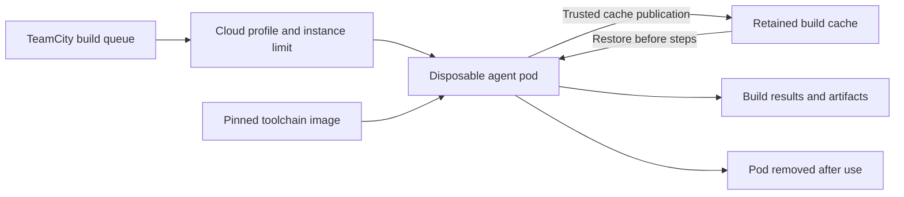

# Autoscale TeamCity Kubernetes Agents Without Losing Build Caches

Author: [nawazdhandala](https://www.github.com/nawazdhandala)

Tags: Kubernetes, CI/CD, DevOps

Description: Scale disposable TeamCity agents on Kubernetes while keeping reusable dependency caches outside pods, with clear trust boundaries and cold-start checks.

An ephemeral agent disappears when its useful work ends. Its replacement should not need the previous pod's filesystem to produce a correct build. Yet downloading the same dependencies for every replacement wastes time and makes a busy build queue slower.

The practical solution is to separate three things: the agent image, the disposable workspace, and reusable dependency data. Keep the toolchain in a pinned image, recreate the workspace for each agent, and restore an optional cache from storage that survives pod removal.

This tutorial uses TeamCity's regular Kubernetes cloud-agent integration and its Build Cache feature. It does not describe the separate Kubernetes executor mode. The configuration references TeamCity 2026.2 documentation and the Build Cache Kotlin DSL API served as 2026.2.2; check the DSL generated by your installed server before adopting it.

## Give one controller ownership of agents

With regular cloud agents, TeamCity selects compatible capacity for queued builds and starts instances within configured limits. Available agent licenses still constrain concurrency. A Kubernetes node autoscaler can provide additional machines for pending pods, but it cannot make an incompatible TeamCity agent accept a build. [TeamCity cloud-agent lifecycle](https://www.jetbrains.com/help/teamcity/teamcity-integration-with-cloud-solutions.html).

Start with a dedicated project cloud profile, agent namespace, and pool. Configure the Kubernetes API address, its trusted certificate authority, and credentials with narrowly scoped permissions. Add an agent image with a small initial instance limit, such as two. Select a reviewed agent image by digest and record its TeamCity agent and toolchain versions. The integration supports a custom pod template for resource requests, limits, and other pod settings. [Kubernetes integration settings](https://www.jetbrains.com/help/teamcity/setting-up-teamcity-for-kubernetes.html).

Do not add an independent CPU-based autoscaler to manage these same agent pods. Let TeamCity manage their lifecycle. Size the node pool separately, and measure registration time as well as image download time. An image that starts quickly but spends minutes updating its agent software still delays the queue.



Removing the pod must leave the cache and required build artifacts intact. These are separate outputs with separate retention decisions.

## Decide what deserves persistence

Use this inventory before adding a volume to every agent:

| Data | Suggested location | Reason |
| --- | --- | --- |
| Agent software, Node, compiler | Versioned agent image | Reproducible starting environment |
| Checked-out source and temporary files | Disposable workspace | Avoid accidental reuse of another build's files |
| Downloaded package content | Optional retained cache | Can be downloaded again when absent |
| Release packages and reports | Build artifacts with retention | Required outputs must outlive agents |
| Registry tokens and signing keys | Separate secret delivery | They must not enter cache archives |

A cache is an optimization, not a backup or a release artifact. Establish a maximum useful size. If uploading and restoring a cache takes longer than downloading dependencies, a nearby package repository may be the better investment.

## Cache npm downloads instead of installed modules

For a concrete example, use an agent image containing your approved Node version and npm 11.10.0. The following shell step starts in the repository checkout directory and requires committed, matching `package.json` and `package-lock.json` files:

```sh
set -eu
npm ci --cache "$PWD/.npm-cache" --prefer-offline
npm test
```

The first command installs the locked dependency tree. `npm ci` rejects a manifest/lockfile mismatch and removes an existing `node_modules` directory before installation. Consequently, restoring `node_modules` immediately before this command is usually wasted work. Preserve the download cache instead. [npm ci behavior](https://docs.npmjs.com/cli/v11/commands/npm-ci/).

`--prefer-offline` favors cached content but allows missing packages to be fetched. It is not an offline guarantee. Install scripts can also contact other services, and native packages can need additional toolchains. Keep those requirements in your agent-image inventory. npm treats its cache as disposable and checks cached content integrity; do not use it as your only package archive. [npm cache](https://docs.npmjs.com/cli/v11/commands/npm-cache/).

Add this feature inside the build configuration's existing Kotlin DSL. The cache name is an example convention, not an automatic platform selector:

```kotlin
import jetbrains.buildServer.configs.kotlin.buildFeatures.buildCache

// Inside the existing buildType { ... } block:
features {
    buildCache {
        name = "web-npm11-linux-amd64-trusted-v1"
        rules = ".npm-cache"
        use = true
        publish = true
        publishOnlyChanged = true
    }
}
```

The directory is relative to the checkout. The feature restores it before build steps and can publish changed contents for future runs. The properties above are documented by the [Build Cache DSL API](https://teamcity.jetbrains.com/app/dsl-documentation/buildFeatures/build-cache-feature/index.html). This is a fragment to merge into an existing configuration, not a complete settings project.

Add `.npm-cache/` to the repository's ignore rules. Keep authentication configuration outside that directory, and inspect a sample archive for unexpected files. A cache containing private package contents also deserves restricted access, even if it contains no credentials.

TeamCity exposes these archives as hidden `.teamcity.build_cache` artifacts. Confirm their presence on the completed build's Artifacts tab and check the next build's cache-download log. Artifact size limits apply. Publisher and consumer configurations sharing a cache belong in the same TeamCity project. [Build Cache setup and inspection](https://www.jetbrains.com/help/teamcity/build-cache.html).

## Separate cache writers by trust

Do not let arbitrary pull-request code publish a cache consumed by a privileged release build. A descriptive name does not enforce that boundary. Control who can change the publishing configuration, which branches it builds, and which agents and credentials it receives.

For a shared cache, use a trusted publisher with `publish = true`. Give consumer configurations the same cache name but `publish = false` and `use = true`. Avoid multiple competing publishers until their concurrency behavior has been rehearsed. For release builds requiring a clean environment, leave this feature disabled; the DSL documentation explicitly cautions against it for that use case.

If the cache includes compiled output rather than downloaded package content, also separate incompatible operating systems, architectures, compiler versions, and build options. Treat a toolchain change as an opportunity to create a new cache namespace and retire the old one after observation.

## Know what a persistent volume does not solve

A persistent volume claim requests storage, but it does not provide package-manager locking or a safe multi-writer cache protocol. Kubernetes `ReadWriteOnce` means one node, not necessarily one pod; multiple pods on that node may access the volume. `ReadWriteOncePod` provides single-pod access where supported, which can serialize an otherwise parallel agent fleet. [Persistent-volume access modes](https://kubernetes.io/docs/concepts/storage/persistent-volumes/#access-modes).

Use per-agent volumes only when you also have a deliberate identity, attachment, cleanup, and permissions strategy. Sharing the whole agent work directory across interchangeable pods creates avoidable ownership and collision problems. For disposable agents, a restored private cache directory per pod is easier to reason about than a universally writable filesystem.

## Rehearse replacement, concurrency, and absence

Run this acceptance exercise in a staging project before raising the instance limit:

1. Start a build with no previous cache. It must succeed from the package source and publish the expected cache.
2. Let TeamCity retire the idle agent, then run the same build on a replacement. Record the different pod identity and cache-download evidence.
3. Run two builds concurrently on separate agents. Confirm independent workspaces and inspect cache publication outcomes.
4. Change a dependency and commit the updated lockfile. Confirm the new package is fetched and tests still run.
5. Use a fresh cache name with no published archive. The build must remain correct; only its timing should change.

Measure queue delay, pod scheduling, image pull, agent registration, cache transfer, dependency installation, and test execution separately. A faster installation cannot compensate for a saturated artifact server or an agent stuck Pending.

The desired result is predictable replacement: agents can disappear without losing required results, and caches shorten builds without becoming a prerequisite for correctness.
