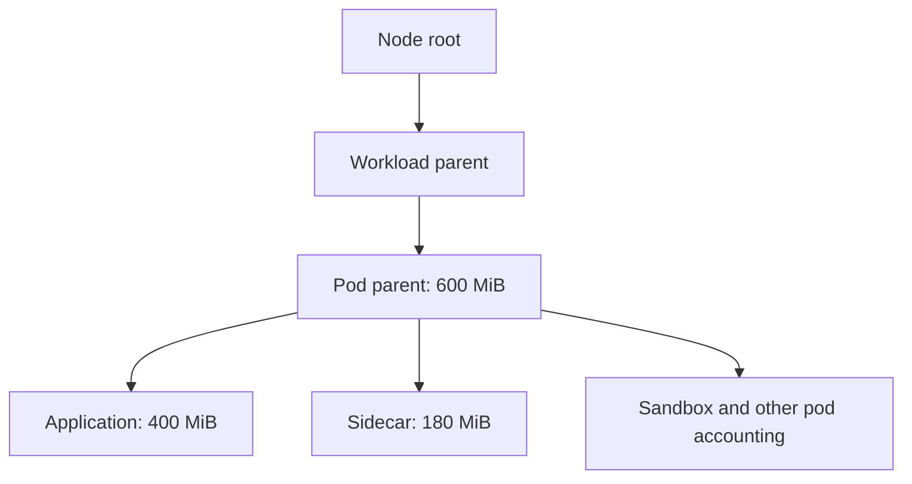

# Avoid Double-Counting Parent Cgroups in cAdvisor Memory Queries

Author: [nawazdhandala](https://www.github.com/nawazdhandala)

Tags: Kubernetes, Linux, Prometheus, Monitoring

Description: Choose a single cgroup accounting level for memory totals, exclude overlapping parents, and test cAdvisor queries against realistic label fixtures.

A node has 16 GiB of RAM, but a dashboard says its containers use 30 GiB. Before investigating a memory leak, inspect the query. It might be adding the node root, workload parent groups, pod groups, and individual containers together.

A cgroup, short for control group, organizes Linux processes for resource accounting and control. These groups form a hierarchy. A parent can account for memory already represented by its descendants, so different series are not necessarily independent quantities. The [Linux cgroup v2 documentation](https://www.kernel.org/doc/html/latest/admin-guide/cgroup-v2.html) explicitly defines `memory.current` as memory used by the cgroup and its descendants.

The solution is to choose one accounting level before summing. Removing only `id="/"` does not establish that the remaining groups are independent.

## See the overlap before changing the query

Consider this illustrative hierarchy. Values are simplified memory-usage examples, not measurements from a cluster:



Adding the pod's 600 MiB to the application's 400 MiB and sidecar's 180 MiB produces 1,180 MiB. That is an overlapping sum. It is not evidence that the pod consumed 1,180 MiB.

Do not expect every parent to equal the sum of the visible children exactly. Collection times, omitted descendants, and accounting categories can differ. Working-set calculations introduce another distinction: cAdvisor derives working set by subtracting inactive file memory, with a floor at zero. Review the [cAdvisor 0.55.1 memory conversion](https://github.com/google/cadvisor/blob/v0.55.1/container/libcontainer/handler.go) when comparing fields. A mismatch between two accounting levels is a reason to inspect them, not to add them together.

## Define the population your panel should represent

Write one sentence describing the intended total. For example: “Sum the working sets of application and sidecar containers reported by each kubelet, grouped by pod.” That excludes the pod parent and sandbox container. It also does not promise total node RAM use.

Other valid questions need different populations:

| Question | Population to select |
|---|---|
| How much memory does each application container report? | Individual application container cgroups |
| What does the pod parent report? | One identified parent cgroup per pod |
| How much memory is the host using? | A host-memory measurement with its own documented meaning |
| How much memory do all application containers report? | Verified nonoverlapping application container groups |

Do not combine these populations in one total. Also keep the memory definition consistent: usage, working set, and resident anonymous memory are not interchangeable.

## Inspect identities without aggregation

The following examples assume a Kubernetes scrape job named `kubelet-cadvisor`. Change that job name to match your configuration. Start with raw rows:

```promql
container_memory_working_set_bytes{job="kubelet-cadvisor"}
```

Inspect `instance`, `id`, `namespace`, `pod`, and `container` in Prometheus's table view. Identify one known pod and determine which rows describe its parent, application, sidecar, and sandbox. Kubernetes 1.35.0's [cAdvisor label mapping](https://github.com/kubernetes/kubernetes/blob/v1.35.0/pkg/kubelet/server/server.go) can attach pod and namespace names to a pod cgroup. Therefore, requiring only `pod!=""` does not necessarily exclude parents.

Keep `id` during this investigation. Two rows with the same pod label might describe different cgroups rather than duplicate scrapes. Conversely, two series with the same cgroup identity may be duplicate collection paths differentiated by a scrape label.

## Select application containers explicitly

For an endpoint whose inspected labels follow the expected Kubernetes convention, this query selects named application containers, excluding the conventional `POD` sandbox name:

```promql
sum by (instance, namespace, pod) (
  container_memory_working_set_bytes{
    job="kubelet-cadvisor",
    namespace!="",
    pod!="",
    container!="",
    container!="POD"
  }
)
```

The nonempty `container` condition matters. `container!="POD"` alone also matches series where the label is absent. Prometheus explains empty-label matching in its [querying basics](https://prometheus.io/docs/prometheus/latest/querying/basics/).

This is a population-specific recipe, not an automatic leaf-cgroup detector. Confirm how your kubelet and runtime label sandbox rows. If the endpoint uses different conventions, adapt the selector from observed identities. Do not add `image!=""` merely to remove parent rows: that can silently discard real application containers whose image metadata is missing.

In a multi-cluster data source, retain your established cluster identity in selectors and grouping too. An `instance` value is not guaranteed to be globally unique across clusters.

## Separate hierarchy overlap from duplicate collection

The application selector can still count one container twice if the same exporter is ingested through two paths. Before trusting the total, check multiplicity within the selected job:

```promql
count by (instance, id) (
  container_memory_working_set_bytes{
    job="kubelet-cadvisor",
    namespace!="",
    pod!="",
    container!="",
    container!="POD"
  }
) != 1
```

An empty result means every selected identity has one series under these grouping assumptions. It does not prove the selector includes all applications. A result of two or more warrants inspection of the full label sets: duplicated targets, replica labels, or extra ingestion paths may explain it.

Do not automatically replace `sum` with `max` to conceal duplication. Different cgroup identities can legitimately share a pod name, and taking the maximum would discard actual containers. Fix the collection path or apply your metrics backend's explicit replica-deduplication policy. The [Prometheus aggregation reference](https://prometheus.io/docs/prometheus/latest/querying/operators/) describes how grouping changes the output identity.

## Test the selector with a counterexample

A useful test fixture contains a root, workload parent, pod parent, application, sidecar, and sandbox. Give the application 400 MiB and the sidecar 180 MiB. The application-total query should return 580 MiB, regardless of the pod parent's 600 MiB value.

Then remove the application's `image` label: the result should stay 580 MiB. Remove its `container` label instead: the result will drop, demonstrating that metadata completeness is a prerequisite. Finally, duplicate the application's series under a second scrape label. The multiplicity query should identify it rather than letting the extra 400 MiB pass unnoticed.

These cases were evaluated locally with Prometheus 3.7.3's rule-testing tool. They verify query behavior on synthetic inputs; they do not certify the label contract of a live cluster.

When rolling out the repaired panel, show the raw identities alongside the total temporarily. Confirm several pods, including one with a sidecar, and document the chosen memory field and exclusions in the panel description. A defensible total has a clear population and accounting level, not merely a plausible number.
