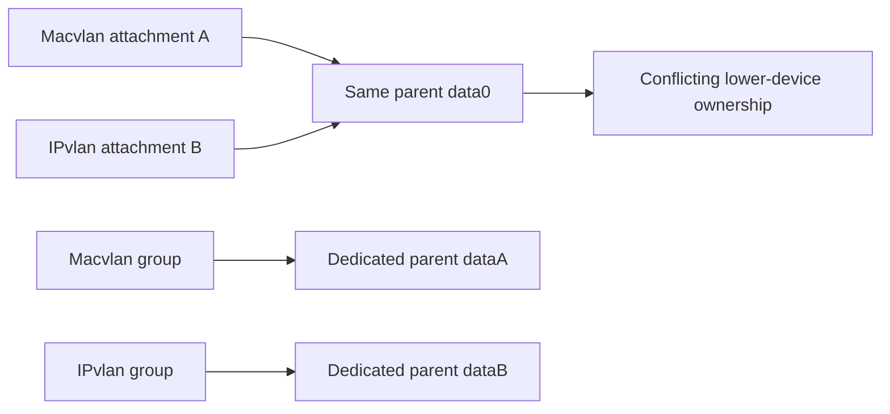

# Avoid Macvlan and IPvlan Parent Conflicts in Multus

Author: [nawazdhandala](https://www.github.com/nawazdhandala)

Tags: Multus, Kubernetes, Troubleshooting

Description: Identify macvlan and ipvlan attachments sharing a parent, distinguish kernel ownership conflicts from IP conflicts, and migrate workloads without deleting active network devices.

An ipvlan attachment fails with a busy-device error on a node where macvlan Pods already run. Retrying the Pod, changing its IP address, or renaming the NetworkAttachmentDefinition does not fix it. Both plugins may be trying to use the same parent network device in incompatible ways.

A parent is the Linux interface named by a plugin's `master` field. That interface is a shared node resource even when each Pod has its own network namespace and a different secondary interface name. Review parent ownership before allowing different attachment types onto the same node.

This guide uses **CNI plugins v1.8.0**, **Multus v4.3.1**, and **Linux v6.12 source** to explain the behavior. The inspection examples were syntax-checked; no kernel-device creation or live cluster migration was tested.

## Understand the conflict boundary

The [macvlan CNI documentation](https://www.cni.dev/plugins/current/main/macvlan/) explicitly notes that one master cannot be enslaved by both macvlan and ipvlan. These are two different kernel mechanisms, not interchangeable naming choices.

In the reviewed Linux source, both drivers register receive handling on the lower device. The [ipvlan implementation](https://github.com/torvalds/linux/blob/v6.12/drivers/net/ipvlan/ipvlan_main.c) rejects a busy receive handler when establishing a new ipvlan port; [macvlan](https://github.com/torvalds/linux/blob/v6.12/drivers/net/macvlan.c) checks for that conflict too. A busy-device message can have other causes, so use the error together with the actual topology rather than treating its text as a complete diagnosis.



The upper part is the conflicting design; the lower part shows separate-parent ownership. It does not imply that any arbitrary pair of interfaces will have the required external connectivity.

Different Kubernetes namespaces do not separate this ownership. Neither do different IP subnets or different Pod interface names such as `net1` and `net2`. The important identity is the actual parent device on the actual node, in the namespace where the plugin finds it.

## Inventory the definitions and their consumers

Collect the definitions with an authorized Kubernetes client:

```bash
kubectl get network-attachment-definitions.k8s.cni.cncf.io -A -o yaml
kubectl -n REPLACE_NAMESPACE describe pod REPLACE_POD
kubectl -n REPLACE_NAMESPACE get pod REPLACE_POD -o yaml
```

Review each relevant `spec.config`, including nested `plugins` lists. Record plugin type, parent, mode, namespace, definition name, and consuming workloads. Also inspect the primary network and automatically attached networks; a conflict need not come from two explicit Pod annotations.

These two diagnostic fragments illustrate a collision candidate:

```json
{
  "type": "macvlan",
  "master": "data0",
  "mode": "bridge"
}
```

```json
{
  "type": "ipvlan",
  "master": "data0",
  "mode": "l2"
}
```

They are comparison fragments, not complete installable CNI configurations. If both are used on one node against the same host device, their different modes do not remove the parent conflict. The [ipvlan reference](https://www.cni.dev/plugins/current/main/ipvlan/) documents its `master` and `mode` fields.

An omitted `master` deserves particular attention. These plugins can select a default-route interface rather than the data interface you intended. Explicitly naming the parent makes the configuration reviewable, but still requires matching that name to each node's real topology.

## Inspect the node and Pod namespaces

On the affected host, use read-only inspection first:

```bash
ip -d link show dev REPLACE_PARENT
ip -d link show type macvlan
ip -d link show type ipvlan
bridge link show
```

The [ip-link manual](https://man7.org/linux/man-pages/man8/ip-link.8.html) documents detailed link output and type filtering. Bridge membership can reveal another owner that also matters to the design. Record interface indices and lower-link relationships instead of relying only on familiar names.

A host listing may not show children that have been moved into Pod network namespaces. Inspect known consumers as well, using a diagnostic container that already has iproute2:

```bash
kubectl -n REPLACE_NAMESPACE exec REPLACE_RUNNING_POD -- ip -d link show
```

Correlate this with the Pod's node, network annotations, plugin configuration, and creation time. If the failed Pod has no running container, use the existing running consumers and node-side CNI/runtime logs as evidence. Do not infer that an empty host type listing proves the parent is unused.

Also check for non-Kubernetes users: another container runtime, a host-side macvlan interface, or manually provisioned devices. A plugin's ownership assumptions can be wrong even when every Kubernetes definition looks consistent.

## Choose a topology that can coexist

There are three common directions, each needing its own review:

| Direction | What changes | What still needs validation |
| --- | --- | --- |
| Standardize one plugin family per parent | Move workloads onto one attachment design | MAC policy, multicast, addressing and routing |
| Use separate dedicated parents | Give each family its own lower interface | Physical connectivity, switch configuration and scheduling |
| Separate node pools | Keep each parent design on different nodes | Capacity, placement constraints and maintenance coverage |

Do not convert macvlan to ipvlan by changing only `type`. Macvlan gives child interfaces distinct MAC addresses, while ipvlan shares the parent's MAC. IPvlan L3 also has different routing and multicast behavior. The [kernel ipvlan guide](https://www.kernel.org/doc/html/latest/networking/ipvlan.html) explains that children of one parent share the selected mode and that L3 children do not receive broadcast or multicast traffic.

Distinct preconfigured VLAN devices can be separate lower-device identities in a reviewed topology, but their existence is not a universal workaround. Validate driver support, parent relationships, switch VLANs and address ownership. Renaming the same device or creating another network definition does not create independent ownership.

## Migrate through workload lifecycle operations

Prepare the replacement parent and attachment on a staging node before moving consumers. Use a new definition name so the old and new desired configurations remain distinguishable. Test interface creation, addressing, application traffic and deletion cleanup with one disposable workload.

For a same-parent conversion, remove or relocate the old consumers through their owning controllers and wait for their sandbox cleanup. A rolling update that overlaps old macvlan Pods with new ipvlan Pods on the same parent can reproduce the conflict by design. Plan placement or maintenance so the incompatible generations do not coexist there.

Never delete the host parent to force a successful retry. That can disconnect every child and unrelated host traffic. Do not delete CNI allocation records merely because the error says busy; address allocation state is a separate concern.

After cleanup, inspect again before declaring the parent available. If ownership remains, identify the remaining device and its lifecycle owner. Prefer the owning runtime's cleanup path to manual removal of an unidentified link.

## Make ownership visible before the next rollout

Keep a node-network inventory that maps parent identity to plugin family, allowed modes, network definitions and responsible team. Couple that inventory to placement constraints so a workload cannot silently land on an incompatible node pool.

Acceptance should include both the new workload and a retained workload on any supposedly independent parent. Verify that the new attachment succeeds, the existing one still communicates, and a later recreation follows the same result. The durable fix is a consistent ownership plan, not a retry that happened to run when the conflicting Pod was absent.
