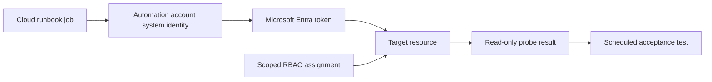

# Move Azure Automation Runbooks to Managed Identity with Scoped RBAC

Author: [nawazdhandala](https://www.github.com/nawazdhandala)

Tags: Azure, Automation, IAM

Description: Replace Azure Automation Run As authentication with managed identity, choose the correct principal, grant narrow permissions, and verify scheduled execution before cleanup.

Replacing a Run As connection with `Connect-AzAccount -Identity` is only one part of an Azure Automation migration. The new identity has a different principal, needs its own permissions, and may behave differently on a Hybrid Runbook Worker. Copying the old account's broad roles can make the migration appear successful while preserving unnecessary access.

Microsoft retired Automation Run As accounts on 30 September 2023. The [migration guidance](https://learn.microsoft.com/en-us/azure/automation/migrate-run-as-accounts-managed-identity) directs users to managed identities. Treat remaining Run As references as legacy dependencies to remove, not a reason to build a new certificate-based Run As setup.

This guide stages a read-only resource-group probe before moving operational runbooks. It uses an Automation cloud job with a system-assigned identity. Hybrid execution and user-assigned identities require the separate decisions explained below.

## Inventory the old authentication and permissions

Search runbook source for `AzureRunAsConnection`, `Get-AutomationConnection`, certificate thumbprints, application identifiers, and service-principal login calls. Include child runbooks, imported helper modules, schedules, webhooks, and deployment scripts. Record the execution location and runtime environment for each job.

Create an access map from actual operations, not just the legacy role list:

| Runbook operation | Permission question |
|---|---|
| Read resource-group metadata | Which resource group needs control-plane read access? |
| Start one virtual machine | Which compute actions and resource scope are required? |
| Read a secret or blob | Which data-plane role or resource access policy is required? |
| Query Microsoft Graph | Which separate application permissions are required? |

Role-based access control, or RBAC, grants actions at a defined scope. Azure resource-management permissions do not automatically authorize every data-plane operation. In particular, the built-in [Reader role](https://learn.microsoft.com/en-us/azure/role-based-access-control/built-in-roles/general#reader) grants control-plane reads and has no data actions. Do not interpret a successful resource-group read as permission to retrieve secrets.

## Choose the principal that will actually run the job

A system-assigned managed identity belongs to the Automation account. A user-assigned identity is a separate Azure resource that can be associated with supported workloads. Record the identity's principal/object ID, its client ID where relevant, and the tenant. These identifiers are not interchangeable.

Enable the system-assigned identity through the Automation account's Identity settings after reviewing its existing jobs. Microsoft documents the [enablement process](https://learn.microsoft.com/en-us/azure/automation/enable-managed-identity-for-automation). Enabling authentication does not transfer the old Run As principal's role assignments.

For Hybrid Runbook Workers, stop and check the identity-selection rules first. An Automation account-level system identity can override the VM-level system identity previously used by hybrid jobs. The Automation account's user-assigned identity is not supported as the identity for those hybrid jobs. See the [Hybrid Runbook Worker execution guidance](https://learn.microsoft.com/en-us/azure/automation/automation-hrw-run-runbooks). A successful cloud-job test therefore does not validate a hybrid migration.



The identity obtains a token; the target evaluates authorization. A login failure and an authorization failure need different repairs.

## Give the probe a deliberately small scope

For the initial probe, grant Reader on one test resource group. Run this as an authorized provisioning operator, outside the runbook. Replace all three placeholders with reviewed identifiers:

```powershell
$subscriptionId = "00000000-0000-0000-0000-000000000000"
$resourceGroup = "rg-automation-probe"
$principalId = "11111111-1111-1111-1111-111111111111"
$scope = "/subscriptions/$subscriptionId/resourceGroups/$resourceGroup"

New-AzRoleAssignment -ObjectId $principalId `
    -RoleDefinitionName "Reader" -Scope $scope
```

This creates a real permission assignment when executed. The principal ID is the managed identity's object ID, not the old application ID. Verify the operator's tenant and subscription context beforehand. The [New-AzRoleAssignment reference](https://learn.microsoft.com/en-us/powershell/module/az.resources/new-azroleassignment) documents the object and scope parameters.

The probe runbook itself should not receive permission to grant roles. For each production operation, add only the reviewed action set at the smallest practical scope, then test it. Reader is suitable for this probe; it is not a claim that every operational runbook can use Reader.

## Pin the runtime and replace the login path

Create a separate test runbook and runtime environment. The example targets PowerShell 7.4 with [Az.Accounts 5.3.0](https://www.powershellgallery.com/packages/Az.Accounts/5.3.0) and [Az.Resources 8.1.0](https://www.powershellgallery.com/packages/Az.Resources/8.1.0). The latter declares Az.Accounts 5.2.0 or later as a dependency, which the selected version satisfies. This is a source-checked example set, not a claim of a live Azure compatibility test.

Import the approved packages into the [runtime environment](https://learn.microsoft.com/en-us/azure/automation/runtime-environment-overview) before running jobs. Do not install changing module versions from the internet every time a schedule fires.

```powershell
param(
    [Parameter(Mandatory = $true)][string]$SubscriptionId,
    [Parameter(Mandatory = $true)][string]$TenantId,
    [Parameter(Mandatory = $true)][string]$ResourceGroupName
)

$ErrorActionPreference = "Stop"
Import-Module Az.Accounts -RequiredVersion 5.3.0
Import-Module Az.Resources -RequiredVersion 8.1.0
$null = Disable-AzContextAutosave -Scope Process

$login = Connect-AzAccount -Identity
$context = Set-AzContext -SubscriptionId $SubscriptionId `
    -DefaultProfile $login.Context

if ($context.Subscription.Id -ne $SubscriptionId -or
    $context.Tenant.Id -ne $TenantId) {
    throw "Unexpected subscription or tenant context"
}

$group = Get-AzResourceGroup -Name $ResourceGroupName `
    -DefaultProfile $context

Write-Output ([pscustomobject]@{
    SubscriptionId = $context.Subscription.Id
    TenantId = $context.Tenant.Id
    ResourceGroup = $group.ResourceGroupName
    Location = $group.Location
})
```

Disabling context autosave at process scope avoids relying on a saved Az context. The runbook captures its login context, explicitly selects the subscription, checks tenant and subscription, and passes that context to the resource read. These patterns follow Microsoft's [managed-identity runbook tutorial](https://learn.microsoft.com/en-us/azure/automation/learn/powershell-runbook-managed-identity). The [Get-AzResourceGroup reference](https://learn.microsoft.com/en-us/powershell/module/az.resources/get-azresourcegroup) supports the explicit profile parameter.

Expect a small metadata object, not a token or secret. A successful login alone is not the result: the target read must succeed in the expected context. Authentication still depends on execution-host support, and resource access still depends on network paths and authorization.

## Validate the same execution path that production uses

First run the read-only probe manually, then publish the intended revision and run it through a test schedule with the same parameters and execution location. Confirm the runtime packages, principal, tenant, subscription, and resource scope for both jobs. A test-pane success does not prove that a scheduled job uses the same published code or worker.

Rehearse the real runbook operation against a disposable target. Check both expected access and a safe negative case outside the granted scope. If authorization fails after a recent assignment, account for propagation and inspect the principal and scope; do not immediately grant subscription-wide Contributor.

Record the old and new principal IDs, approved role assignments, job identifiers, runtime versions, and results. Review token audience or data-plane permissions separately when a management read works but a secret or storage operation fails.

## Cut over schedules, then retire the legacy credentials

Move one runbook at a time. Prevent the old and new schedules from both performing the same mutation, and verify the new published job through an agreed observation window. Preserve a known code revision and a recovery procedure that uses supported authentication; a retired Run As path is not a dependable rollback plan.

Only after dependency review should you remove unused Run As connection assets, certificate material, and obsolete role assignments. Check whether the associated application or service principal is shared before deleting it. Do not disable and recreate a managed identity as routine troubleshooting, because identity changes can invalidate existing access assignments.

These snippets were reviewed against official documentation and pinned package metadata, but were not executed or parsed by PowerShell. Azure login, RBAC evaluation, module loading, hybrid behavior, and scheduled execution remain acceptance tests for your environment.
