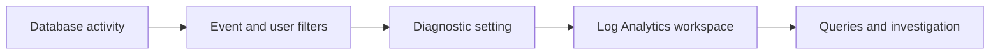

# Send Useful Azure MySQL Audit Logs to Log Analytics

Author: [nawazdhandala](https://www.github.com/nawazdhandala)

Tags: Azure, MySQL, Logging, Security

Description: Route Azure MySQL audit events to Log Analytics, verify a known event, and measure volume while preserving the audit coverage your team actually needs.

Turning on every database audit event can produce a large stream that nobody has time to investigate. Turning on too little can leave the one missing event you need during an incident. The useful middle ground starts with an explicit question: which actions must you be able to explain later?

This tutorial uses Azure Database for MySQL Flexible Server and the `AzureDiagnostics` route documented in Microsoft's audit tutorial. The queries are documentation-reviewed examples, not results from a live workspace. They use Kusto Query Language, or KQL, the language used to search and summarize Log Analytics data.

## Define coverage before changing parameters

Write a short coverage statement with the system owner. For example: “Record connection attempts and administrative schema or permission changes for this service. Investigate application data access separately when required.” This is an example of a limited scope, not a universal audit policy.

Azure exposes event categories including `CONNECTION_V2` for connection attempts with error information, `DDL` for data definition operations, and `DCL` for permission operations. `DML_SELECT` covers reads; `DML_NONSELECT` covers inserts, updates, and deletes. `GENERAL` is broader and includes multiple statement categories. See the [audit configuration reference](https://learn.microsoft.com/en-us/azure/mysql/flexible-server/concepts-monitor-mysql).

DDL means data definition language, such as creating a table. DCL means data control language, such as granting access. DML means data manipulation language, the statements that read or change application records.

For the limited scope above, start by evaluating `CONNECTION_V2`, `DDL`, and `DCL` in a nonproduction environment. Do not claim that this selection records every data access or business transaction. If individual reads are required evidence, excluding SELECT events is a coverage decision that the owner must explicitly accept.

## Enable collection and routing as separate steps

You need an existing Flexible Server, a Log Analytics workspace, and permissions to change the server parameters and diagnostic settings and query the destination.

Under **Settings > Server parameters**, enable `audit_log_enabled` and select the agreed `audit_log_events`. Inspect `audit_log_include_users` and `audit_log_exclude_users` before saving. An empty include list includes all users subject to filtering; an explicit include entry takes precedence over an overlapping exclusion. Preserve intentional existing exclusions rather than clearing them without review. These rules are documented in the [server audit settings](https://learn.microsoft.com/en-us/azure/mysql/flexible-server/concepts-monitor-mysql).

Then open **Monitoring > Diagnostic settings**, add or review a setting, select `MySqlAuditLogs`, and send it to the intended Log Analytics workspace. Save the setting and record the destination resource ID. Microsoft's [audit tutorial](https://learn.microsoft.com/en-us/azure/mysql/flexible-server/tutorial-configure-audit) describes both steps and notes that logs can take up to ten minutes to appear.



Each arrow is a separate thing to verify. An enabled audit parameter does not prove routing works, and a diagnostic setting does not prove the database emitted your selected event.

## Confirm the table before copying a query

The [supported-log category reference](https://learn.microsoft.com/en-us/azure/azure-monitor/reference/supported-logs/microsoft-dbformysql-flexibleservers-logs) maps the documented `MySqlAuditLogs` route to `AzureDiagnostics`. Microsoft also publishes a separate [MySqlAuditLogs table schema](https://learn.microsoft.com/en-us/azure/azure-monitor/reference/tables/mysqlauditlogs), with different field names such as `User` and `EventClass`.

Inspect the actual destination table and schema. The following examples deliberately target `AzureDiagnostics`; do not paste them unchanged into the resource-specific table. Availability and routing must be confirmed in your workspace rather than inferred from a table reference alone.

Generate a fresh connection with a designated nonproduction test account that your filters include. Record its username, server resource ID, and UTC test time. Do not use a production password-failure loop to generate test evidence.

Replace the resource ID below with the full server ID and `audit_probe` with that account's MySQL username. Run this in the destination workspace after allowing for delivery time:

```kusto
let ServerId = "/subscriptions/SUBSCRIPTION_ID/resourceGroups/RESOURCE_GROUP/providers/Microsoft.DBforMySQL/flexibleServers/SERVER_NAME";
AzureDiagnostics
| where TimeGenerated > ago(30m)
| where Category == "MySqlAuditLogs"
| where _ResourceId =~ ServerId
| where user_s == "audit_probe"
| project TimeGenerated, event_time_t, event_class_s,
          event_subclass_s, user_s, ip_s
| order by TimeGenerated desc
| take 50
```

Expect records matching the account and test interval. Examine the class and subclass rather than assuming one login creates exactly one record. The projected fields follow the [audit tutorial's query schema](https://learn.microsoft.com/en-us/azure/mysql/flexible-server/tutorial-configure-audit). The query intentionally leaves out SQL text because verifying arrival does not require exposing statements.

If the table or fields are absent, inspect the workspace schema and routing first. `AzureDiagnostics` adds service-specific fields as data arrives, and its column-limit behavior can place additional fields in `AdditionalFields`. Microsoft's [AzureDiagnostics reference](https://learn.microsoft.com/en-us/azure/azure-monitor/reference/tables/azurediagnostics) explains that behavior.

## Measure which events create volume

After collecting a representative period, summarize events by class and user. Use the same resource ID replacement as above:

```kusto
let ServerId = "/subscriptions/SUBSCRIPTION_ID/resourceGroups/RESOURCE_GROUP/providers/Microsoft.DBforMySQL/flexibleServers/SERVER_NAME";
AzureDiagnostics
| where TimeGenerated > ago(24h)
| where Category == "MySqlAuditLogs"
| where _ResourceId =~ ServerId
| summarize Events = count() by event_class_s, user_s
| order by Events desc
| take 20
```

This returns the busiest class/account combinations in the selected interval. `summarize` groups matching rows and calculates the aggregate, as described in the [KQL reference](https://learn.microsoft.com/en-us/kusto/query/summarize-operator?view=microsoft-fabric).

Counts help identify noisy sources but are not a bill estimate: records have different sizes. Compare ingestion volume and retention requirements in the workspace's usage and cost views. Log Analytics charges depend on factors including ingested volume and retention; use the current [cost documentation](https://learn.microsoft.com/en-us/azure/azure-monitor/logs/cost-logs) for the selected workspace configuration.

A query-time filter only changes the result you see. It does not undo collection or reduce bytes already ingested. Likewise, removing SQL text with `project` is not an ingestion-time privacy control.

## Reduce noise without hiding important activity

Classify the top contributors before changing filters:

| Contributor | Useful question |
| --- | --- |
| Frequent connection events | Is connection churn expected, or is pooling failing? |
| Deployment account | Are repeated schema changes legitimate and attributable? |
| High-volume application reads | Is individual read auditing required for this workload? |
| Monitoring account | Which operations does it perform, and what would exclusion hide? |

Avoid excluding an entire shared application account merely because it is busy. That can remove both routine operations and the suspicious actions you hoped to investigate. Improve account separation or narrow the agreed event categories where appropriate.

Apply one reviewed filter change at a time. Repeat the known-event test for an included account and, when safe, verify the intended exclusion with a separate nonproduction account. Retain the previous settings so the team can explain a change in event volume.

## Close the loop on coverage

Limit access to the destination because audit records can contain identifiers, addresses, and statement content. Keep credentials and sensitive test values out of SQL used to generate sample events. Decide retention according to your evidence requirements, not simply the shortest available setting.

Watch for unexpected silence as well as excessive volume. A quiet audit stream may mean a quiet application, a filter change, a disabled diagnostic setting, or a delivery problem. Compare it with independently observed activity before declaring success.

Your acceptance record should show the selected events and users, destination workspace, known-event evidence, measured collection volume, and acknowledged coverage gaps. That makes the stream useful during an investigation without pretending that a narrower audit policy captures everything.
