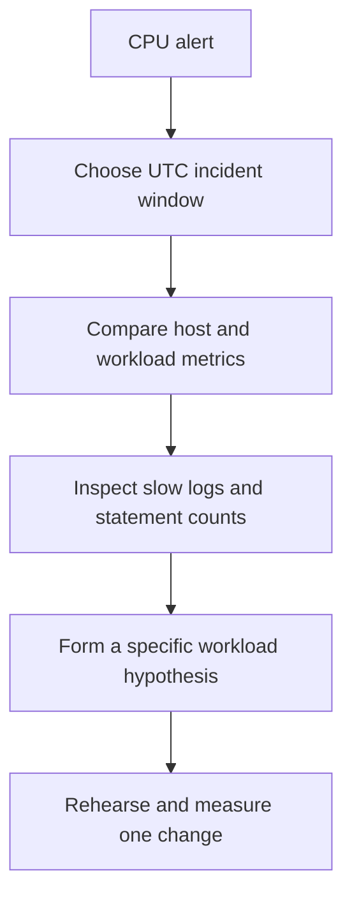

# Diagnose Azure MySQL CPU Spikes with Query Insight and Slow Logs

Author: [nawazdhandala](https://www.github.com/nawazdhandala)

Tags: Azure, MySQL, Performance, Troubleshooting

Description: Investigate Azure MySQL CPU spikes by aligning host metrics, slow logs, and statement counts without confusing query elapsed time with CPU consumption.

A CPU alert fires at 10:07. Query Performance Insight shows a query that took 40 seconds. It is tempting to declare that query responsible, but it might have spent most of those seconds waiting. Meanwhile, thousands of short queries could be consuming the processor without crossing your slow-log threshold.

A useful investigation connects three observations: when the server was busy, which work arrived, and what changed. This walkthrough uses Azure Database for MySQL Flexible Server, the AzureDiagnostics log schema documented by Microsoft, and MySQL 8.0 SQL examples. It does not assume that a slow query is a CPU profile.

## Establish the window before changing anything

Record the server resource, a start and end time in UTC, the affected application, and recent deployments or scheduled jobs. Compare the incident with a similar healthy interval. Preserve the original charts before changing compute size or logging settings.

In Azure Monitor, inspect Host CPU Percent (`cpu_percent`) with one-minute granularity and compare average with maximum. This metric covers the whole host, including database and Azure MySQL processes. It cannot directly attribute CPU to an application query. Add connections and I/O metrics to the same timeline. On a Burstable server, also inspect CPU credits; that credit model does not apply to every compute tier. Microsoft documents the metric scopes and sampling intervals in its [monitoring reference](https://learn.microsoft.com/en-us/azure/mysql/flexible-server/concepts-monitor-mysql-reference).



For example, “the new dashboard doubled database calls per request” is a testable hypothesis. “MySQL is slow” is not. Look for the beginning of the change, not just the largest point on the chart.

## Make sure slow-query evidence actually exists

Query Performance Insight uses slow-query logs routed to Log Analytics and displayed through workbooks. Enable `slow_query_log` in the server's **Server parameters**, and configure a diagnostic setting that sends slow-query logs to the intended workspace. Then open **Monitoring > Workbooks > Query Performance Insight**. The [official tutorial](https://learn.microsoft.com/en-us/azure/mysql/flexible-server/tutorial-query-performance-insights) describes this path and its AzureDiagnostics fields.

Choose a bounded collection period and a threshold appropriate for the incident. Setting `long_query_time` to zero on a busy production server can produce much more data than intended. Broad logging of queries that do not use indexes can also be expensive and noisy. Record the previous configuration and decide when to restore it.

An important trap is connection reuse. Azure documents that changed `long_query_time` values apply to new connections; existing sessions retain their session value. This read-only MySQL 8.0 query shows the global setting and the value used by the connection running it:

```sql
SELECT @@GLOBAL.slow_query_log AS logging_enabled,
       @@GLOBAL.long_query_time AS new_connection_threshold_seconds,
       @@SESSION.long_query_time AS this_connection_threshold_seconds;
```

Different thresholds explain why a new diagnostic session and an old application pool might produce different evidence. A query in your administrator session does not inspect every application session. If recycling application connections is necessary, do it gradually through the application's normal maintenance process. See Microsoft's [slow-log configuration guidance](https://learn.microsoft.com/en-us/azure/mysql/flexible-server/concepts-monitor-mysql).

An empty workbook is not proof of an idle database. Check routing, workspace selection, collection start time, ingestion delay, and the workbook's filters. Logging enabled after an incident cannot reconstruct missing history.

## Correlate logged executions with the spike

The following Kusto Query Language query groups logged executions into one-minute buckets. Kusto is the query language used in Log Analytics. Replace `SERVER_NAME` and both UTC timestamps. Run it in the workspace receiving this server's slow logs, with the portal time range broad enough to include the retrieval window.

```kusto
let window_start = datetime(2026-11-20T10:00:00Z);
let window_end = datetime(2026-11-20T10:15:00Z);
AzureDiagnostics
| where TimeGenerated >= window_start - 15m
    and TimeGenerated < window_end + 30m
| where Category == "MySqlSlowLogs"
| where LogicalServerName_s == "SERVER_NAME"
| where start_time_t >= window_start and start_time_t < window_end
| summarize LoggedExecutions = count(),
    TotalLoggedElapsedSeconds = sum(query_time_d)
    by bin(start_time_t, 1m)
| order by start_time_t asc
```

The expected output is a timestamp, a count, and summed elapsed seconds for each populated minute. The wider retrieval window allows some delay, but it is not a guarantee against arbitrarily late records. This query selects statements starting inside the incident window; investigate statements starting earlier separately if they overlap the spike.

The field names follow Microsoft's workbook example. The aggregation uses documented [summarize](https://learn.microsoft.com/en-us/kusto/query/summarize-operator?view=microsoft-fabric) and [bin](https://learn.microsoft.com/en-us/kusto/query/bin-function?view=microsoft-fabric) behavior. Check the actual table schema before adapting this to another destination.

Treat summed duration as **logged elapsed time**, not CPU seconds. Concurrent queries overlap, so the sum can exceed the length of the window. Inspect individual query examples in the workbook, but restrict access to raw SQL because literals can contain sensitive values.

## Look for frequent queries below the threshold

Slow logs describe statements that qualify for logging. A large number of individually fast executions can be missing from that view. MySQL's [slow-log documentation](https://dev.mysql.com/doc/refman/8.0/en/slow-query-log.html) explains the selection rules; absence from the log does not establish low total workload.

For MySQL 8.0, an account permitted to read Performance Schema can inspect statement summaries. Performance Schema is MySQL's built-in instrumentation system. Replace `appdb` with the application database:

```sql
SELECT SCHEMA_NAME, DIGEST, DIGEST_TEXT, COUNT_STAR,
       SUM_TIMER_WAIT / 1000000000000 AS total_elapsed_seconds,
       SUM_ROWS_EXAMINED
FROM performance_schema.events_statements_summary_by_digest
WHERE SCHEMA_NAME = 'appdb' AND DIGEST IS NOT NULL
ORDER BY SUM_TIMER_WAIT DESC
LIMIT 10;
```

A digest groups statements with the same normalized structure. The output helps identify repeated work, execution counts, and rows examined. These are cumulative summaries, not automatically measurements of your incident window. See the [statement-summary reference](https://dev.mysql.com/doc/refman/8.0/en/performance-schema-statement-summary-tables.html).

For interval analysis, collect two complete relevant snapshots and compare matching schema/digest pairs. Do not subtract only two independently selected top-ten lists: a statement can enter or leave that ranking. Confirm that a restart or reset did not invalidate the comparison. Do not truncate shared diagnostic tables merely to make your analysis easier.

Timer values are normalized to picoseconds, hence the conversion to seconds. Timing also depends on enabled instrumentation. These elapsed timers still do not measure query CPU directly; consult the [Performance Schema timing documentation](https://dev.mysql.com/doc/refman/8.0/en/performance-schema-timing.html).

## Turn the evidence into one controlled change

Use the findings to narrow the next experiment:

| Observation | Next investigation |
|---|---|
| Many more executions after a deployment | Compare database calls per application request |
| More rows examined for a familiar query | Compare predicates, data growth, and execution plans |
| Long duration with modest CPU | Investigate waiting and contention before blaming computation |
| CPU rise without matching captured SQL | Recheck capture coverage and other server work |

Start plan inspection with ordinary `EXPLAIN` on a reviewed statement. `EXPLAIN ANALYZE` actually executes it; use a controlled environment with representative data and an acceptable execution budget. The distinction is explicit in the [MySQL 8.0 EXPLAIN reference](https://dev.mysql.com/doc/refman/8.0/en/explain.html).

Rehearse one change, then compare equivalent workloads: request rate, CPU, tail latency, executions per request, and rows examined. A quieter traffic period is not evidence that an index fixed the problem. Keep the incident window, capture settings, query identifiers, and before/after measurements together so another engineer can reproduce the reasoning. Restore temporary logging settings when the agreed investigation period ends.
