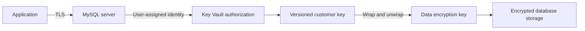

# Enable and Rotate Customer-Managed Keys for Azure MySQL

Author: [nawazdhandala](https://www.github.com/nawazdhandala)

Tags: Azure, MySQL, Azure Key Vault, Security

Description: Configure customer-managed encryption for Azure MySQL, rotate to an explicit key version, and verify access and recovery before retiring older keys.

A customer-managed key gives your security team control over a database's encryption dependency. That control also creates an availability responsibility: a healthy MySQL server still needs access to its encryption key.

Treat enabling encryption and rotating its key as two reviewed changes. First establish the identity, permissions, and recovery process. Then rehearse a rotation on staging, keeping the previous key available until you have evidence that it is safe to retire.

## Understand what the key protects

Azure MySQL already encrypts stored data. A customer-managed key changes who controls the key protecting the service's data encryption key. The customer key is often called a key encryption key, or KEK; it wraps the data encryption key, or DEK. This is separate from TLS, which protects application connections.

MySQL accesses Key Vault using a user-assigned managed identity: an Azure identity that you create and attach to the server. The vault and server must share a region and Microsoft Entra tenant. Supported keys are RSA or RSA-HSM with 2048, 3072, or 4096 bits. They must be enabled, already active if an activation date exists, and configured without an expiration date under the documented MySQL requirements. See [MySQL customer-managed encryption](https://learn.microsoft.com/en-us/azure/mysql/security/security-customer-managed-key).



Changing the key does not replace certificate validation, database passwords, or application permissions.

## Prepare the vault and separate responsibilities

Use a dedicated staging vault before touching production. Set soft-delete retention to 90 days when creating it and enable purge protection. Soft delete is enabled by default on new vaults, despite older instructions that describe enabling it manually. Its retention interval cannot be changed after creation. A vault created with an unsuitable interval needs a planned replacement, not an assumed in-place retention update. These behaviors are documented in the [Key Vault soft-delete guide](https://learn.microsoft.com/en-us/azure/key-vault/general/soft-delete-overview).

Keep the database identity separate from the human or automation identity that rotates keys:

| Identity | Responsibility |
|---|---|
| MySQL user-assigned identity | Use the key to protect and recover the data encryption key |
| Key administrator | Create versions and maintain the key lifecycle |
| Database operator | Select the approved key and verify database health |
| Recovery operator | Recover deleted resources and restore required access |

For a vault using Azure role-based access control, assign the MySQL identity the **Key Vault Crypto Service Encryption User** role at the approved scope. An access-policy vault instead needs Get, List, Wrap Key, and Unwrap Key permissions. Follow the permission model already selected for the vault; changing that model can affect other users. The [MySQL portal guide](https://learn.microsoft.com/en-us/azure/mysql/security/security-how-to-data-encryption-portal) documents these alternatives.

A resource-management role alone does not establish permission to use the key. Key Vault distinguishes its management interface from its key-access interface, as explained in [Key Vault authorization](https://learn.microsoft.com/en-us/azure/key-vault/general/rbac-guide). Network access is another independent requirement. Confirm the database service can reach the vault under your chosen firewall configuration; a successful administrator command is not proof that the database identity can do so.

## Capture the starting point

The following commands are source-reviewed for **Azure CLI 2.80.0**. They are a staging example, not a claim of execution against Azure. Use an existing server with **no read replicas, no geo-redundant backup, and no additional identity requirements**. Broader configurations need a dependency-specific change plan.

Sign in through your approved process, select the intended subscription, and replace all uppercase placeholder values. The identity value is its Azure resource ID, not its client ID or principal ID.

```bash
set -euo pipefail
umask 077

MYSQL_RG='REPLACE_RESOURCE_GROUP'
MYSQL_SERVER='REPLACE_STAGING_SERVER'
MYSQL_VAULT='REPLACE_VAULT_NAME'
MYSQL_KEY='REPLACE_KEY_NAME'
MYSQL_IDENTITY='/subscriptions/REPLACE_SUBSCRIPTION/resourceGroups/REPLACE_IDENTITY_RG/providers/Microsoft.ManagedIdentity/userAssignedIdentities/REPLACE_IDENTITY'

az mysql flexible-server show \
  --resource-group "$MYSQL_RG" --name "$MYSQL_SERVER" \
  --output json > mysql-before-key-change.json

az keyvault key show \
  --vault-name "$MYSQL_VAULT" --name "$MYSQL_KEY" \
  --output json > approved-key.json
```

Review the server's identity, encryption, backup, and state fields. Inspect the key's enabled status, dates, type, and identifier. The key response contains public information and metadata, not an export of the private key. Protect these records because they identify security dependencies. The [Key Vault key command reference](https://learn.microsoft.com/en-us/cli/azure/keyvault/key?view=azure-cli-latest) describes the inspection operation.

## Enable the approved version

Choose a specific version from the reviewed key record. A versioned identifier ends with the key's version; a versionless identifier stops at its name. This procedure deliberately uses an explicit version so the reviewed target is unambiguous.

```bash
APPROVED_KEY_URI='https://REPLACE_VAULT.vault.azure.net/keys/REPLACE_KEY/REPLACE_VERSION'

az mysql flexible-server update \
  --resource-group "$MYSQL_RG" --name "$MYSQL_SERVER" \
  --key "$APPROVED_KEY_URI" \
  --identity "$MYSQL_IDENTITY"

az mysql flexible-server show \
  --resource-group "$MYSQL_RG" --name "$MYSQL_SERVER" \
  --query '{state:state,encryption:dataEncryption,identity:identity}' \
  --output json
```

The first command changes the server configuration. The second reads it back; confirm the expected identity and versioned key URI, then test a fresh application connection and a controlled read/write operation. Record the operation result and time instead of treating command submission as completion. Microsoft documents `--key` and `--identity` in the [encryption CLI walkthrough](https://learn.microsoft.com/en-us/azure/mysql/security/security-how-to-data-encryption-cli).

Do not apply this minimal update blindly to a more complex server. The [2.80.0 implementation](https://github.com/Azure/azure-cli/blob/azure-cli-2.80.0/src/azure-cli/azure/cli/command_modules/mysql/custom.py) also sends encryption updates to existing replicas. Its [encryption helper](https://github.com/Azure/azure-cli/blob/azure-cli-2.80.0/src/azure-cli/azure/cli/command_modules/mysql/_util.py) builds identity and encryption settings from the supplied arguments. Inventory replica, backup, and other identity dependencies before selecting an update method for production.

## Rotate without retiring the previous version

On-demand rotation creates a new version of the existing key. It requires rotation privileges for the caller; those are different from the database identity's wrap/unwrap permissions. Inspect the current rotation policy first, especially any expiry setting applied to newly created versions. The [Key Vault rotation documentation](https://learn.microsoft.com/en-us/azure/key-vault/keys/how-to-configure-key-rotation) describes both policies and on-demand rotation.

```bash
az keyvault key rotation-policy show \
  --vault-name "$MYSQL_VAULT" --name "$MYSQL_KEY" \
  --output json

# Run only after reviewing the policy and approving a new version.
az keyvault key rotate \
  --vault-name "$MYSQL_VAULT" --name "$MYSQL_KEY" \
  --output json > rotated-key.json
```

Inspect `rotated-key.json` and approve its new versioned identifier. Set `APPROVED_KEY_URI` to that identifier and repeat the explicit server update and readback above. Keep the previous version enabled throughout.

Creating a key version and changing the database's configured key are separate steps in this workflow. Do not assume a Key Vault rotation policy alone changes an explicitly pinned MySQL key URI. Automatic adoption depends on service integration and identifier behavior; this procedure does not rely on an undocumented MySQL polling interval.

## Prove recovery before retiring a key

A successful application query is useful evidence, but it is not a complete key-retirement test. Maintain a dependency register covering each database, replica, retained recovery point, and recovery-region configuration. Mark which versions remain required or have not yet been proven unnecessary.

Perform a restore rehearsal to a separate server, selecting the intended identity and key in the restore workflow. Confirm the restored server can use its key and read representative data. The [portal restore instructions](https://learn.microsoft.com/en-us/azure/mysql/security/security-how-to-data-encryption-portal) expose this encryption configuration explicitly. Geo-redundant configurations also require their backup-region identity/key settings; the [CLI walkthrough](https://learn.microsoft.com/en-us/azure/mysql/security/security-how-to-data-encryption-cli) documents the separate backup arguments.

Retirement needs a separate approval after recovery obligations and all consumers are accounted for. Avoid a fixed rule such as “disable yesterday's version after one successful query.” Keep key backups under your security team's approved recovery process; a database backup does not substitute for preserving encryption dependencies.

If the server becomes inaccessible, compare the recent key, identity, permission, and vault-network changes. Restore access to the required existing key rather than generating unrelated key material with the same name. MySQL's [key-access recovery guidance](https://learn.microsoft.com/en-us/azure/mysql/security/security-customer-managed-key) calls for recovering lost key resources and revalidating encryption. If a vault was deleted, also restore its required role assignments: recovering the vault alone does not restore those integrations. Keep normal application traffic controlled until fresh connections and representative operations succeed.
