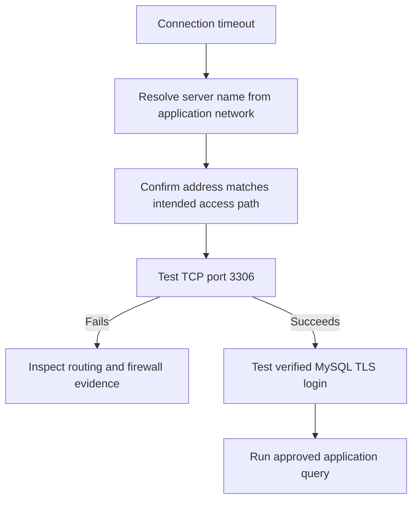

# Fix Azure MySQL Error 10060: DNS, Firewall, and Port 3306

Author: [nawazdhandala](https://www.github.com/nawazdhandala)

Tags: Azure, MySQL, Networking, Troubleshooting

Description: Diagnose Azure MySQL Flexible Server connection timeouts by checking the actual client path, DNS resolution, TCP reachability, and verified TLS login.

A MySQL client on Windows reports error 10060 while connecting to Azure Database for MySQL Flexible Server. Changing the password does nothing. Increasing the connection timeout only makes the failure take longer.

Windows defines 10060 as `WSAETIMEDOUT`: the remote party did not respond within the expected time. It can occur while connecting or on an established connection, so capture the complete error and the stage at which it occurs. It does not, by itself, identify a particular Azure firewall rule. See Microsoft's [Winsock error definitions](https://learn.microsoft.com/en-us/windows/win32/winsock/windows-sockets-error-codes-2).

For a connection-establishment timeout, work through DNS, the network path, TCP port 3306, and then the MySQL/TLS handshake. Each successful step narrows the problem without broadening access unnecessarily.

## Start from the failing client

Record the server's fully qualified domain name, or FQDN, the application host, connection timestamp, and whether the client is on a VPN. Copy the server name from its Azure resource rather than guessing it from a friendly display name.

Run tests from the same network location as the application. A successful test from your laptop does not establish that an App Service instance, container, or corporate desktop can connect. Likewise, a test from a diagnostic VM is useful comparison evidence, but not a substitute for checking the application path.

Confirm the server is running and identify its networking configuration. Public access, VNet integration, and a Private Link endpoint require different troubleshooting. Azure's [connection troubleshooting guide](https://learn.microsoft.com/en-us/azure/mysql/flexible-server/how-to-troubleshoot-common-connection-issues) separates these network and authentication causes.



## Check DNS before changing firewall rules

On a Windows host with the DnsClient PowerShell module, replace the placeholder and run:

```powershell
$dbName = 'SERVER_NAME.mysql.database.azure.com'
Resolve-DnsName -Name $dbName -Type A -DnsOnly
```

This asks DNS for IPv4 address information. It does not open a database connection. Inspect the answer and any aliases in the response. A lookup failure points toward the hostname, resolver, or DNS configuration before MySQL credentials become relevant. Microsoft's [Resolve-DnsName reference](https://learn.microsoft.com/en-us/powershell/module/dnsclient/resolve-dnsname?view=windowsserver2025-ps) documents the command.

For a private connection, check that the application's resolver returns the expected private destination. An answer obtained from a public resolver may not reflect the private DNS configuration available inside your network. Do not replace the application's DNS server globally just to make one lookup succeed; inspect the intended forwarding and zone links.

Keep the FQDN in application connection settings. Hardcoding an observed IP can hide the immediate DNS symptom while breaking later address changes or certificate identity checks.

## Test TCP separately from authentication

On Windows with the NetTCPIP module, use the same variable:

```powershell
Test-NetConnection -ComputerName $dbName -Port 3306 -InformationLevel Detailed
```

Inspect `RemoteAddress`, `SourceAddress`, and `TcpTestSucceeded`. A true TCP result means a connection to that address and port was established during this test. It does not verify the MySQL user, CA trust, or database permissions. A failed ping is not decisive when TCP succeeds; ping and database traffic are different probes. See [Test-NetConnection](https://learn.microsoft.com/en-us/powershell/module/nettcpip/test-netconnection?view=windowsserver2025-ps).

The source address shown here is the address selected locally. If network address translation, or NAT, occurs later, it is not necessarily the public address Azure sees. Confirm that address through the approved network configuration or firewall logs, rather than allowlisting your laptop's private address.

## Follow the correct network branch

For **public access**, compare the actual outbound public IPv4 address with the server's allowed IP ranges. Azure documents that firewall changes can take up to five minutes to take effect. Retest after the documented propagation interval rather than repeatedly adding rules.

The “Allow public access from Azure services and resources within Azure” option is broader than your subscription: it can admit connection attempts from other customers' Azure resources. Do not enable it as a default diagnostic shortcut. Authentication still applies, but the network boundary changes. These details and the FQDN recommendation are in the [public networking documentation](https://learn.microsoft.com/en-us/azure/mysql/flexible-server/concepts-networking-public).

For **VNet-integrated private access**, inspect the private route, network security groups, and DNS configuration between the client and the delegated database subnet. VNet means virtual network; peering can connect suitable networks, but DNS configuration remains a separate dependency. Microsoft's [private networking overview](https://learn.microsoft.com/en-us/azure/mysql/flexible-server/concepts-networking-vnet) describes this deployment model.

For **Private Link**, inspect the private endpoint and its DNS path. This is not the same resource arrangement as a delegated database subnet. On-premises clients need an appropriate private connection, such as VPN or ExpressRoute, to reach that endpoint. See the [Private Link overview](https://learn.microsoft.com/en-us/azure/mysql/flexible-server/concepts-networking-private-link).

For every branch, verify the client's outbound policy permits TCP 3306 through the intended route. A corporate web proxy allowing HTTPS does not establish that native MySQL traffic is permitted. Ask for evidence for the specific source, destination, port, and timestamp rather than requesting that an entire firewall be disabled.

## Move to verified TLS only after reachability works

Once TCP succeeds, use a MySQL **8.4 client** to distinguish TLS and login failures from the original timeout. The following PowerShell example assumes `mysql.exe` is installed, the approved Azure CA bundle is already available, and you have a permitted database account. Replace the username and file path:

```powershell
mysql.exe --host=$dbName --port=3306 --protocol=TCP --user=APP_USER --password --ssl-mode=VERIFY_IDENTITY --ssl-ca=C:/certs/azure-mysql-ca.pem --connect-timeout=10
```

`--password` without a value prompts for the password instead of placing it on the command line. `VERIFY_IDENTITY` checks the certificate chain and hostname. Use the current trust material recommended by Azure's [TLS connection guidance](https://learn.microsoft.com/en-us/azure/mysql/security/security-tls-how-to-connect).

The MySQL [connection options](https://dev.mysql.com/doc/refman/8.4/en/connection-options.html) and [client options](https://dev.mysql.com/doc/refman/8.4/en/mysql-command-options.html) document these flags. The connection timeout is not a deadline for every query you subsequently run.

A certificate verification error means you have reached a different diagnostic stage; investigate trust and hostname configuration without disabling verification. An access-denied response calls for checking the account and authentication setup. Once login succeeds, run an approved read using the application's intended database and identity.

## Record the boundary that changed

Keep a compact incident record containing the tested host, DNS answer, selected remote address, TCP result, and final client error. After correcting one layer, repeat the same test from the original application network. This makes it possible to distinguish a genuine fix from a successful test on a different path.

These PowerShell examples were syntax-checked locally and reviewed against official command documentation. The Windows networking commands and MySQL client were not executed against an Azure server; no live firewall, DNS, or authentication change was made.
