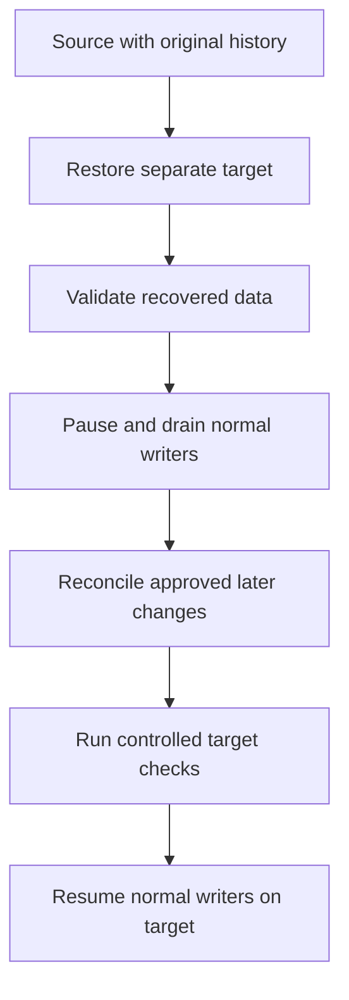

# Restore Azure MySQL to a New Server and Cut Over Safely

Author: [nawazdhandala](https://www.github.com/nawazdhandala)

Tags: Azure, MySQL, Backup, Disaster Recovery

Description: Restore Azure MySQL to a separate server, verify the recovery point, reconcile later writes, and move applications without overwriting the original server.

An accidental update corrupts orders at 14:05. At 14:20, you discover the problem. Restoring to 14:04 can recover the earlier order data, but it also excludes valid changes committed after that time. Switching the application immediately would exchange one problem for another.

Azure Database for MySQL Flexible Server point-in-time restore creates a separate server. It does not rewind the running source in place. That separation gives you room to inspect the recovered data and decide what should become authoritative. A safe cutover needs both a restore procedure and a plan for writes made after the chosen recovery point.

## Choose the recovery outcome first

Point-in-time restore, or PITR, reconstructs a server at a selected time using available backups. For Flexible Server, PITR creates the new server in the source region. Recovery depends on the actual retained backup window; it is not an arbitrary historical query. Microsoft's [backup and restore overview](https://learn.microsoft.com/en-us/azure/mysql/flexible-server/concepts-backup-restore) describes those boundaries.

Write down three times in UTC: the earliest known bad change, the selected recovery point, and the time normal writers will stop. Also identify the evidence behind the first timestamp. An application exception may be recorded after the damaging transaction committed.

Choose the desired outcome:

| Outcome | What happens after restore |
|---|---|
| Recover a few damaged records | Extract and reconcile those records through a reviewed repair process |
| Replace the whole server with an earlier state | Account for every acceptable later change before cutover |
| Rehearse recovery | Keep the restored environment isolated from production writers and side effects |

A full-server replacement is not automatically the safest repair for a small mistake. Do not merge data by blindly copying entire tables over newer production state.

## Prepare an isolated recovery target

Reserve a unique server name and confirm subscription, resource group, regional capacity, permissions, and the network path that recovery operators will use. Keep the source resource and its backups available. Record its configuration and application endpoint before any changes.

Isolation needs deliberate design. A new server name does not guarantee a private recovery environment. Review firewall rules, virtual-network access, private endpoints, DNS links, and any automation that discovers servers by tags. Microsoft's [CLI restore guide](https://learn.microsoft.com/en-us/azure/mysql/flexible-server/how-to-restore-server-cli) explicitly requires checking network access and permissions after recovery.

Inventory scheduled jobs before restoring. Application workers must not discover the clone and start sending messages or processing payments. Database events also deserve review; do not assume a restored scheduler is disabled. With appropriate permissions, this MySQL 8.0 statement lists events in the example application database:

```sql
SHOW EVENTS FROM appdb;
```

Replace `appdb`. The output includes event status and scheduling details; it does not change them. Review event definitions and arrange containment for any side effects before creating the clone. See the [SHOW EVENTS reference](https://dev.mysql.com/doc/refman/8.0/en/show-events.html). An empty result from an account without the necessary visibility is not a complete inventory.

## Create the new server at an explicit time

The portal offers Latest, Custom, and Fastest restore-point choices. For an accidental data change, select a **Custom restore point** before the error. Fastest restore uses a full-backup point and is not a shortcut to the same arbitrary timestamp. The [portal procedure](https://learn.microsoft.com/en-us/azure/mysql/flexible-server/how-to-restore-server-portal) shows where to enter the new server name.

The following Bash example uses Azure CLI 2.80.0 command syntax. It is a source-verified example, not a record of an executed restore. It creates a billable server. Use it only after reviewing the target's network configuration and recovery plan. The example keeps the source and target in the same subscription and resource group; all uppercase values are placeholders.

```bash
subscription_id='SUBSCRIPTION_ID'
resource_group='RESOURCE_GROUP'
source_name='SOURCE_SERVER_NAME'
target_name='UNIQUE_RECOVERY_SERVER_NAME'
restore_time='2026-11-20T14:04:00Z'

source_id="/subscriptions/${subscription_id}/resourceGroups/${resource_group}/providers/Microsoft.DBforMySQL/flexibleServers/${source_name}"

az mysql flexible-server restore \
  --subscription "$subscription_id" \
  --resource-group "$resource_group" \
  --name "$target_name" \
  --source-server "$source_id" \
  --restore-time "$restore_time"
```

Replace the illustrated timestamp with an approved time inside the available recovery window. `--name` identifies the new target; `--source-server` identifies the backup source. `--restore-time` makes the requested point explicit. The argument definitions are in the [Azure CLI 2.80.0 tagged source](https://github.com/Azure/azure-cli/blob/azure-cli-2.80.0/src/azure-cli/azure/cli/command_modules/rdbms/_params.py).

Do not treat command submission as application recovery. After the operation completes, inspect the new resource:

```bash
az mysql flexible-server show \
  --subscription "$subscription_id" \
  --resource-group "$resource_group" \
  --name "$target_name" \
  --output json
```

This read-only command returns the target's details. Record its resource ID, state, and fully qualified domain name. Check the [CLI reference](https://learn.microsoft.com/en-us/cli/azure/mysql/flexible-server?view=azure-cli-latest#az-mysql-flexible-server-show) for the supported command options. A provisioning result establishes resource status, not business-data correctness.

## Validate the target without admitting normal writers

Connect from the intended application network using the new Azure hostname and certificate verification. Do not substitute a raw IP address or invent a hostname alias without checking certificate-name compatibility. For a MySQL 8.4 client, this example prompts for the password:

```bash
mysql --host='RECOVERY_SERVER.mysql.database.azure.com' \
  --user='VALIDATION_USER' --password \
  --database='appdb' \
  --ssl-mode=VERIFY_IDENTITY \
  --ssl-ca='/absolute/path/to/approved-azure-ca-bundle.pem'
```

Use a validation account with only the required access and an approved CA bundle. `VERIFY_IDENTITY` checks the certificate chain and hostname, as documented in the [MySQL client connection options](https://dev.mysql.com/doc/refman/8.4/en/connection-options.html).

Verify business invariants: known-good records exist, the damaging change is absent, schema migrations match the intended application version, and related records remain consistent. Compare bounded samples and relevant totals against independent evidence. A matching row count alone cannot prove that values are correct.

Also inspect users, authentication configuration, time zone, scheduled events, monitoring, and backup settings. Azure documents that restored servers are non-HA even when the source had high availability. Decide whether restoring that protection is a prerequisite for traffic. Do not assume every operational setting survived because the databases are present.

## Move the write boundary deliberately



Before the final reconciliation, stop normal application writers, workers, schedulers, and import jobs, then drain in-flight transactions. Record the final source boundary. Preserve later valid changes through an application-specific, reviewed process that excludes the damaging operation. If loss is accepted instead, document exactly what the business is accepting.

Update application configuration to the target endpoint and replace old pooled connections under controlled admission. A DNS update does not redirect an already-open database session. Test a small, identifiable transaction on the target and its downstream effects before resuming normal writers. Confirm that no old application instances can continue writing to the source.

Once the target accepts new writes, pointing applications back to the source is not a complete rollback. The two histories have diverged. Reverting requires another write pause and a reconciliation decision, not just restoring an old connection string.

Keep the source protected and retained for the agreed investigation period. Close the recovery only when normal traffic, scheduled work, alerts, and backups are verified on the target, and the recovery record explains the chosen timestamp, reconciled changes, and any accepted data loss.
