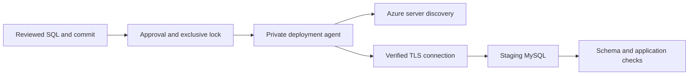

# Run Azure MySQL Schema Migrations from Azure Pipelines

Author: [nawazdhandala](https://www.github.com/nawazdhandala)

Tags: Azure, MySQL, Azure Pipelines, Database Migration

Description: Run reviewed MySQL schema changes through Azure Pipelines with private connectivity, verified TLS, deployment gates, and a clear partial-failure recovery process.

A database deployment needs more than a successful connection. You need to know which change ran, whether another deployment can run beside it, and what remains if the connection disappears halfway through.

`AzureMysqlDeployment@2` can execute a SQL file against Azure Database for MySQL Flexible Server. It is a script runner, so build your release process around an explicit migration record and recovery decision. This walkthrough uses a small, additive staging migration before explaining how to promote the same reviewed change.

## Establish the deployment boundary

Use a dedicated self-hosted Linux agent with a route to the server's private address. Install the Oracle MySQL client before the deployment; the task expects `mysql` on the agent's search path. The example assumes client 8.0.46 and a staging server running MySQL 8.0.46. Rehearse against your actual server patch before adapting it. The task's supported inputs and prerequisites are listed in the [official task reference](https://learn.microsoft.com/en-us/azure/devops/pipelines/tasks/reference/azure-mysql-deployment-v2?view=azure-pipelines).

Prepare these separately:

| Requirement | What to establish before running SQL |
|---|---|
| Azure service connection | Authorization to discover the Flexible Server through Azure Resource Manager |
| Database account | Only the database privileges required by the reviewed migration |
| Network | Private DNS resolution, routing, and TCP port 3306 connectivity from the agent |
| Trust bundle | Current trusted certificate authorities installed at a protected agent path |
| Deployment environment | Approval and exclusive-lock checks owned by the environment administrators |
| Recovery plan | A verified recovery point, application compatibility plan, and responsible operator |

Azure permissions and MySQL permissions are different. The service connection finds the server; the SQL username executes database statements. The reviewed implementation lists Flexible Servers within the subscription and matches the supplied fully qualified hostname, so verify that discovery works with the connection's assigned scope. See the [server lookup implementation](https://github.com/microsoft/azure-pipelines-tasks/blob/e6922cbeb9bbaf49f4f9b406ce6c539eb545d908/Tasks/AzureMysqlDeploymentV2/operations/MysqlServerOperations.ts).



The Azure management connection does not create the agent's private network path. Keep network troubleshooting separate from SQL troubleshooting.

## Pin the task you reviewed

This example examines task **2.283.1**, recorded in the [official source at commit e6922cb](https://github.com/microsoft/azure-pipelines-tasks/blob/e6922cbeb9bbaf49f4f9b406ce6c539eb545d908/Tasks/AzureMysqlDeploymentV2/task.json). Confirm that this exact version exists in your Azure DevOps organization before using the pipeline.

The common `@2` reference permits automatic minor-version updates. A full version such as `@2.283.1` selects that specific version; availability still depends on your organization. Upgrade the pin through a staging review, rather than silently assuming the source examined here matches every future run. Microsoft documents this distinction in [task version selection](https://learn.microsoft.com/en-us/azure/devops/pipelines/process/tasks?view=azure-devops).

## Keep the first migration small

For this example, `appdb.orders` already exists and is an InnoDB table. Save the following as `database/migrations/20261120_01_add_fulfillment_note.sql` in the repository:

```sql
ALTER TABLE appdb.orders
  ADD COLUMN fulfillment_note VARCHAR(255) NULL,
  ALGORITHM=INSTANT;
```

The column is nullable, allowing the existing application to continue inserting orders without providing a value. This is the expansion step: deploy compatible application code afterward, backfill only if needed, and postpone restrictive changes until old application versions are gone.

`ALGORITHM=INSTANT` requests a metadata-only operation where supported. It fails for unsupported table conditions instead of silently falling back to a table-copy operation. It does not promise zero waiting: metadata locks and table-specific limitations still matter. Check those conditions in the [MySQL online DDL documentation](https://dev.mysql.com/doc/refman/8.0/en/innodb-online-ddl-operations.html).

Do not run this file twice merely because the second run appears harmless. An existing-column error should prompt you to compare the deployed definition and migration record with the reviewed change.

## Configure the pipeline

Create a variable group named `mysql-staging-migration`. Store `mysqlMigrationPassword` as a secret. Set `mysqlServerFqdn`, `mysqlMigrationUser`, and `mysqlCaBundle` to the staging hostname, scoped database username, and an existing absolute CA-bundle path. Use the Flexible Server username without appending `@servername`.

Replace the example pool, environment, and service-connection names below with your preprovisioned resources. Authorize this pipeline to use them and the variable group. Configure the environment's approval and exclusive-lock checks in Azure DevOps; `sequential` expresses how queued deployments should obtain the lock. These resource checks are managed outside the YAML, as described in [approvals and checks](https://learn.microsoft.com/en-us/azure/devops/pipelines/process/approvals?view=azure-devops).

```yaml
trigger: none

variables:
- group: mysql-staging-migration

stages:
- stage: MigrateStaging
  lockBehavior: sequential
  jobs:
  - deployment: ApplyReviewedMigration
    pool:
      name: mysql-private-linux
    environment: mysql-staging
    strategy:
      runOnce:
        deploy:
          steps:
          - checkout: self
          - task: AzureMysqlDeployment@2.283.1
            displayName: Add nullable fulfillment note
            inputs:
              azureSubscription: mysql-staging-service-connection
              ServerName: '$(mysqlServerFqdn)'
              SqlUsername: '$(mysqlMigrationUser)'
              SqlPassword: '$(mysqlMigrationPassword)'
              TaskNameSelector: SqlTaskFile
              SqlFile: '$(Build.SourcesDirectory)/database/migrations/20261120_01_add_fulfillment_note.sql'
              SqlAdditionalArguments: >-
                --ssl-mode=VERIFY_IDENTITY
                --ssl-ca="$(mysqlCaBundle)"
                --connect-timeout=15
              IpDetectionMethod: AutoDetect
              DeleteFirewallRule: true
```

This deliberately omits `DatabaseName`. In the reviewed task, providing that input runs `CREATE DATABASE IF NOT EXISTS` before executing the file. Fully qualifying `appdb.orders` avoids that implicit database-creation step. The [SQL client implementation](https://github.com/microsoft/azure-pipelines-tasks/blob/e6922cbeb9bbaf49f4f9b406ce6c539eb545d908/Tasks/AzureMysqlDeploymentV2/sql/MysqlClient.ts) also supplies encryption-only `REQUIRED` when no SSL mode is specified; the explicit argument above replaces that default.

`VERIFY_IDENTITY` checks both the certificate chain and hostname. Keep the canonical server hostname in the variable, and update the trusted CA bundle through your normal certificate-maintenance process. Do not replace this mode with disabled verification to make a deployment pass. See [MySQL TLS connection options](https://dev.mysql.com/doc/refman/8.0/en/connection-options.html).

The task masks the password in logs but passes it to the client process. Restrict access to the agent host and avoid shared untrusted workloads there.

## Understand the firewall behavior

There is no documented `None` firewall mode. With `AutoDetect`, the task probes connectivity and can attempt to create a firewall rule based on an address found in an error. With working private connectivity, it should not need a new public firewall rule. The behavior is visible in [FirewallOperations.ts](https://github.com/microsoft/azure-pipelines-tasks/blob/e6922cbeb9bbaf49f4f9b406ce6c539eb545d908/Tasks/AzureMysqlDeploymentV2/operations/FirewallOperations.ts).

Do not grant firewall-write privileges simply to work around a failed private connection. Inspect the original DNS, certificate, authentication, or routing error first. `DeleteFirewallRule` requests cleanup for a rule the task creates; agent termination can still prevent cleanup. Review unexpected rules after interrupted runs.

## Verify the result and handle partial failure

After the staging run, inspect the column through an approved SQL session:

```sql
SELECT COLUMN_NAME, COLUMN_TYPE, IS_NULLABLE
FROM information_schema.COLUMNS
WHERE TABLE_SCHEMA = 'appdb'
  AND TABLE_NAME = 'orders'
  AND COLUMN_NAME = 'fulfillment_note';
```

Expect one row showing `varchar(255)` and `YES`. This query reports evidence; it does not itself make the pipeline fail on an unexpected result. Add an explicit assertion in your deployment test harness, then test an old application write and the new field's read/write behavior.

Record the migration identifier, file checksum, commit, target, task version, result, and verification evidence. The task does not provide a migration history ledger or checksum reconciliation. For a growing migration sequence, use a migration system that provides those controls instead of repeatedly pointing the task at an accumulating SQL file.

A failed job does not imply an unchanged database. MySQL DDL statements such as `ALTER TABLE` cause implicit commits; wrapping multiple changes in a transaction does not give the whole deployment a rollback boundary. See [statements causing implicit commits](https://dev.mysql.com/doc/refman/8.0/en/implicit-commit.html).

Leave automatic task retries and `--force` out of this workflow. On failure, stop dependent releases, inspect actual schema state, and decide whether to complete the intended change or prepare a reviewed correction. A database restore is a separate recovery operation with implications for writes made since the recovery point. Promote the staging-tested artifact only after that decision process, ownership, and recovery evidence are clear.
