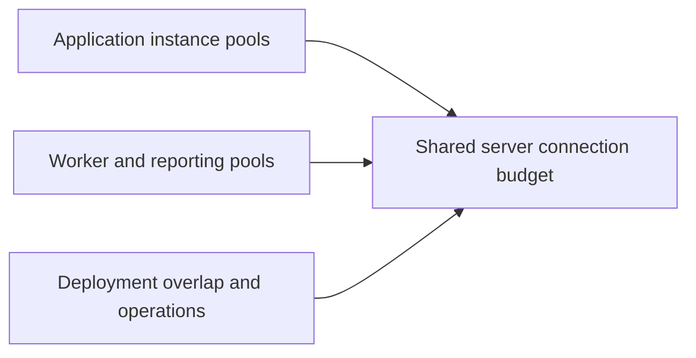

# Fix Azure MySQL Timeouts from Connection Limits and Pool Sizing

Author: [nawazdhandala](https://www.github.com/nawazdhandala)

Tags: Azure, MySQL, Performance, Troubleshooting

Description: Separate pool waits, MySQL connection limits, and expired idle sessions, then size application pools against the full Azure MySQL connection budget.

A database timeout does not always mean the database failed to answer a query. The application might still be waiting to borrow a connection. It might be opening a new connection after MySQL has reached its limit. Or it might be reusing a socket that expired during a quiet period.

Those failures need different fixes. Increasing every timeout can turn a short failure into a long queue while leaving the original problem intact. Start by identifying the stage that failed, then inspect the server and the application together.

This guide targets Azure Database for MySQL Flexible Server. The read-only SQL examples use MySQL 8.0. The Java tuning example is scoped to HikariCP 6.3.0 on Java 17 and must be adapted to measured limits.

## Identify which clock expired

Capture the complete exception chain, timestamp, application instance, and operation. Avoid recording passwords, tokens, or sensitive query values. Measure connection acquisition separately from query execution.

| Evidence | Likely investigation |
|---|---|
| Pool acquisition timeout with every connection borrowed | Long holds, leaks, or inadequate admission control |
| MySQL reports “Too many connections” | Aggregate connections across every application and job |
| First request after inactivity fails, then a fresh connection succeeds | Idle-session expiry or a network idle limit |
| Opening a fresh connection also times out | DNS, routing, firewall, server availability, or handshake |
| Connection was acquired but SQL takes too long | Query plan, locks, server load, or statement deadline |

MySQL documents [too many connections](https://dev.mysql.com/doc/refman/8.0/en/too-many-connections.html) as a server connection-limit condition. A pool timeout alone does not establish that condition. Azure's [connection troubleshooting guidance](https://learn.microsoft.com/en-us/azure/mysql/flexible-server/how-to-troubleshoot-common-connection-issues) also identifies network, authentication, and resource limits as separate causes.

Preserve that separation in dashboards. A single “database latency” measurement hides whether time was spent waiting in your process or inside MySQL.

## Measure the server limit and current pressure

Run these queries through an authorized diagnostic connection. They read configuration and status without changing server settings:

```sql
SELECT @@GLOBAL.max_connections AS server_connection_limit,
       @@GLOBAL.wait_timeout AS default_idle_seconds,
       @@SESSION.wait_timeout AS this_session_idle_seconds;

SHOW GLOBAL STATUS
WHERE Variable_name IN (
    'Threads_connected',
    'Threads_running',
    'Max_used_connections',
    'Connection_errors_max_connections',
    'Uptime'
);
```

`Threads_connected` counts currently open connections; `Threads_running` counts threads that are not sleeping. `Max_used_connections` is a high-water mark, not current demand. Compare `Connection_errors_max_connections` at two times to see whether refusals increased. Record uptime so a restart does not make counters appear to improve. Definitions are in the [MySQL status-variable reference](https://dev.mysql.com/doc/refman/8.0/en/server-status-variables.html).

Use the actual `max_connections` value rather than a remembered default. Azure's supported values depend on server memory and configuration. Raising the setting may admit more work than the server can run efficiently; it is not a substitute for capacity analysis. Review [Azure server-parameter limits](https://learn.microsoft.com/en-us/azure/mysql/flexible-server/concepts-server-parameters) before making changes.

If the server has headroom while one pool is exhausted, investigate that pool first. A connection held across an HTTP call, a slow transaction, or an error path that fails to return it can exhaust a small pool even when other application instances are idle.

## Budget for every process and deployment overlap

Suppose a reviewed connection budget allocates 160 connections to one service. The service can run eight instances, with two additional instances during deployment. A maximum of 16 connections per instance consumes the entire allocation at that ten-instance peak.

That is an upper bound, not a recommended pool size. Start smaller if the workload meets its latency target. Account separately for background workers, migration jobs, reporting tools, and operational headroom. Multiple pools inside one process also count separately.



Calculate using the maximum permitted instance count, not today's count. Otherwise, application autoscaling can create a database outage precisely when traffic increases. Budget read-replica pools against their actual destinations rather than treating the topology as one interchangeable endpoint.

As a starting estimate, connection demand depends on request rate multiplied by time holding a connection. That estimate does not capture bursts or long-tail transactions. Measure pool wait time, borrowed connections, database CPU, and completed requests under representative concurrency before choosing the final cap.

## Separate idle sessions from abandoned transactions

A sleeping session can be a healthy connection waiting in a pool. Do not automatically kill it. Inspect whether it also has an open InnoDB transaction:

```sql
SELECT p.ID, p.USER, p.COMMAND, p.TIME AS state_seconds,
       t.TRX_STARTED, t.TRX_STATE
FROM information_schema.PROCESSLIST AS p
LEFT JOIN information_schema.INNODB_TRX AS t
  ON t.TRX_MYSQL_THREAD_ID = p.ID
WHERE p.USER = 'app_user'
ORDER BY p.TIME DESC;
```

Replace `app_user` with the application's database username. The transaction table requires the `PROCESS` privilege. Use an authorized diagnostic account; restricted process-list visibility must not be mistaken for no activity. A sleeping row with transaction details deserves investigation with the application owner. The query intentionally omits SQL text.

The columns and visibility rules are documented for [PROCESSLIST](https://dev.mysql.com/doc/refman/8.0/en/information-schema-processlist-table.html) and [INNODB_TRX](https://dev.mysql.com/doc/refman/8.0/en/information-schema-innodb-trx-table.html). These are changing snapshots, so repeat observations before drawing conclusions. `PROCESSLIST` is also deprecated in later MySQL 8.0 releases; use your supported monitoring alternative when preparing a longer-lived monitoring integration.

MySQL's `wait_timeout` governs inactivity on noninteractive connections. A session initializes its value when connecting; changing a global default does not rewrite every existing session. See the [system-variable documentation](https://dev.mysql.com/doc/refman/8.0/en/server-system-variables.html). Check values through the application connection when possible, not only an administrator's interactive client.

## Apply a measured pool policy

Here is a small HikariCP 6.3.0 configuration helper. Call it before constructing the pool, on a configuration that already contains the verified database endpoint, credentials, and TLS settings. It changes no authentication or certificate policy.

```java
import com.zaxxer.hikari.HikariConfig;

public final class PoolBudget {
    public static void apply(HikariConfig config) {
        config.setMaximumPoolSize(8);
        config.setMinimumIdle(2);
        config.setConnectionTimeout(5_000);
        config.setValidationTimeout(2_000);
        config.setIdleTimeout(60_000);
        config.setMaxLifetime(240_000);
        config.setKeepaliveTime(60_000);
    }
}
```

These are illustrative values for a staging exercise where the shortest verified idle or connection-age limit is at least 300 seconds and a five-second pool wait fits the request budget. They are not Azure defaults. The setter names and validation constraints are in the [tagged HikariConfig source](https://github.com/brettwooldridge/HikariCP/blob/HikariCP-6.3.0/src/main/java/com/zaxxer/hikari/HikariConfig.java).

`connectionTimeout` bounds waiting for a pooled connection. `idleTimeout` can shrink this pool because its minimum is below its maximum, but does not remove the minimum idle connections. Keepalive pings apply only to idle connections. `maxLifetime` does not terminate a borrowed connection; retirement waits until it is returned. See the [HikariCP 6.3.0 configuration documentation](https://github.com/brettwooldridge/HikariCP/blob/HikariCP-6.3.0/README.md).

Do not confuse those settings with the driver's physical connection and socket timeouts. Connector/J documents `connectTimeout` and `socketTimeout` separately in its [networking properties](https://dev.mysql.com/doc/connector-j/en/connector-j-connp-props-networking.html). Coordinate their values with the overall request deadline; one setting does not bound every stage.

## Verify under quiet periods and peak load

In staging, exercise a quiet interval longer than the previous failure interval, followed by a new request. Separately test peak concurrency and rolling deployment overlap. Record pool waits, connection creation, server refusals, and transaction duration.

Success means requests complete within their budget, server connections remain below the reviewed allocation, and a quiet period does not produce repeated stale-connection failures. Retry only operations whose outcome and idempotency are understood: a timeout after a write is not proof that the write failed. Roll out the measured policy gradually, and retain the earlier configuration for a controlled reversal if latency or connection churn worsens.
