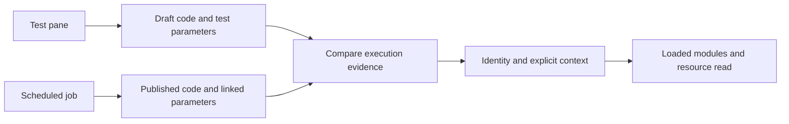

# Fix Azure Runbooks That Pass Tests but Fail on Schedule

Author: [nawazdhandala](https://www.github.com/nawazdhandala)

Tags: Azure, Automation, Troubleshooting

Description: Compare published code, schedule parameters, worker identity, Azure context, and loaded modules to find why a runbook succeeds manually but fails on schedule.

A runbook succeeds in the Test pane and fails overnight. It is tempting to retry the schedule or expand permissions, but the two executions may not be running the same code, parameters, or environment. Start by proving what each execution actually used.

This guide builds a small read-only diagnostic runbook and a comparison process. It targets PowerShell 7.4 with Az.Accounts 5.3.0 and Az.Resources 8.1.0. The local checks used PowerShell 7.4.6, real module imports, and mocked Azure calls; they did not execute an Azure scheduled job.

## Confirm that a job was created

Separate a schedule that never launched a job from a job that launched and failed. Check the linked schedule's enabled state, start time, timezone, expiry, and runbook association. A schedule is a reusable object: it can be linked to multiple runbooks, and one runbook can have several links. Inspect the specific link rather than guessing from a familiar schedule name.

If a job exists, save its identifier, start time, status, execution location, and first useful error. If no job exists, begin with scheduling configuration rather than debugging a script that never started. Microsoft's [schedule documentation](https://learn.microsoft.com/en-us/azure/automation/shared-resources/schedules) explains the associations and the parameters saved with them.

## Compare draft code with published code

The Test pane executes the draft. Normal execution uses the published runbook, which remains unchanged when you edit the draft. Microsoft documents this distinction in [runbook management](https://learn.microsoft.com/en-us/azure/automation/manage-runbooks).

Add a release identifier to a diagnostic copy and emit it at entry. Compare that identifier in the test output and scheduled job history. This is a practical witness of which revision ran, provided your release process updates it consistently. For a stronger deployment record, retain the source hash with the published release.

Do not publish an unreviewed draft simply to see whether the error disappears. First determine whether the scheduled code differs, review the intended change, and use a dedicated test runbook and one-time schedule to reproduce it. The Test pane performs real actions; it is not a simulation of production mutations.



## Check the parameters and execution location

Compare values supplied manually in the Test pane with values stored on the schedule link. Include subscription ID, tenant ID, resource names, optional switches, and input types. An updated default in the script does not explain away an explicit older value saved with the schedule.

Next compare Azure cloud execution with the selected Hybrid Runbook Worker group. The Test pane supports choosing a Hybrid Worker; it is not necessarily using the same location as the scheduled job. Hosts can differ in network access, filesystem paths, installed modules, and identity selection.

For managed identity, identify the principal used by the job. Being signed into the portal as an administrator does not make the runbook execute with your personal rights. On Hybrid Workers, Automation-account and VM identity rules matter; consult the [Hybrid Worker execution guidance](https://learn.microsoft.com/en-us/azure/automation/automation-hrw-run-runbooks) before changing role assignments.

## Capture a narrow diagnostic record

Create this as a separate read-only probe, with the pinned modules already installed in its runtime environment. Supply real test subscription, tenant, and resource-group values through parameters. The intended identity needs permission to read that group:

```powershell
param(
    [Parameter(Mandatory = $true)][string]$SubscriptionId,
    [Parameter(Mandatory = $true)][string]$TenantId,
    [Parameter(Mandatory = $true)][string]$ResourceGroupName
)
$ErrorActionPreference = 'Stop'
$revision = 'diagnostic-20261120-01'
Write-Output (@{
    Stage = 'entry'
    Revision = $revision
    PowerShell = $PSVersionTable.PSVersion.ToString()
    RequestedSubscription = $SubscriptionId
    RequestedResourceGroup = $ResourceGroupName
} | ConvertTo-Json -Compress)

Import-Module Az.Accounts -RequiredVersion 5.3.0
Import-Module Az.Resources -RequiredVersion 8.1.0
Get-Module Az.Accounts,Az.Resources |
    Select-Object Name,@{Name='Version';Expression={$_.Version.ToString()}} |
    ConvertTo-Json -Compress | Write-Output

$null = Disable-AzContextAutosave -Scope Process
$login = Connect-AzAccount -Identity
$context = Set-AzContext -Subscription $SubscriptionId -DefaultProfile $login.Context
if ($context.Subscription.Id -ne $SubscriptionId -or
    $context.Tenant.Id -ne $TenantId) {
    throw 'Selected context does not match requested tenant and subscription'
}
Write-Output (@{
    Stage = 'context-selected'
    Subscription = $context.Subscription.Id
    Tenant = $context.Tenant.Id
} | ConvertTo-Json -Compress)

$group = Get-AzResourceGroup -Name $ResourceGroupName -DefaultProfile $context
Write-Output (@{
    Stage = 'resource-read-complete'
    Revision = $revision
    ResourceGroup = $group.ResourceGroupName
} | ConvertTo-Json -Compress)
```

The first record appears before module import, so it helps distinguish entry and parameter handling from package-loading failures. The next output lists the modules actually loaded. The context record appears only after tenant and subscription checks pass. The final record means the resource-group read completed.

This probe deliberately writes structured diagnostic objects to the output stream. Keep it separate from business runbooks whose parent jobs consume a particular output schema. Do not dump access tokens, complete credential objects, environment variables, or secret parameters into job history.

Azure records output and error streams differently from verbose and debug messages. Verbose logging requires the appropriate runbook settings; debug output is not a substitute for durable diagnostics. See Microsoft's [output and message stream guidance](https://learn.microsoft.com/en-us/azure/automation/automation-runbook-output-and-messages).

## Diagnose the first boundary that fails

| Last reliable evidence | Investigate next |
|---|---|
| No job created | Schedule state, association, time, expiry, and launch configuration |
| Job exists but no entry record | Published revision, parameter binding, runtime startup, or logging retrieval |
| Entry record only | Required module availability and import failure |
| Module versions printed | Managed-identity authentication and context selection |
| Context selected | Target scope, resource name, authorization, and network access |
| Resource read complete | The later business operation and its separate permissions |

Use the first relevant error, not only the final status. A nonterminating PowerShell error may allow later commands to run, making the last message misleading. The probe sets `$ErrorActionPreference = 'Stop'` to stop at errors instead of producing a false completion record.

## Stop relying on the default Azure context

An Azure context contains the account, tenant, subscription, environment, and authentication information used for commands. Microsoft warns that runbooks sharing a process can affect one another when they rely on the default context. The recommended pattern is to disable context autosave at process scope, capture the context, and pass it explicitly. See [context switching in Azure Automation](https://learn.microsoft.com/en-us/azure/automation/context-switching).

The probe follows that pattern through the resource read. Apply it to helper functions and subsequent operations too; fixing login while leaving a later call dependent on the default context can preserve the original bug. Recheck the context whenever the runbook intentionally changes subscriptions.

A wrong-subscription error can look like a missing resource or insufficient permissions. Confirm the actual target before granting broader access. Conversely, a correct context does not establish data-plane permissions or network reachability to a private endpoint.

## Compare installed modules with loaded modules

`Get-Module` reports imported modules. `Get-Module -ListAvailable` reports modules discoverable for import. Those are different questions, as the [PowerShell reference](https://learn.microsoft.com/en-us/powershell/module/microsoft.powershell.core/get-module) explains. A module existing somewhere on a Hybrid Worker does not prove the job loaded that version.

The example explicitly imports [Az.Accounts 5.3.0](https://www.powershellgallery.com/packages/Az.Accounts/5.3.0) and [Az.Resources 8.1.0](https://www.powershellgallery.com/packages/Az.Resources/8.1.0). Record the runtime environment association and dependency versions as part of the release. Review shared runtime changes because other runbooks can use the same [runtime environment](https://learn.microsoft.com/en-us/azure/automation/runtime-environment-overview).

Avoid updating every module during diagnosis. Reproduce the failure with a controlled package set, change one cause, then run the same scheduled probe again. When authentication succeeds but a cmdlet parameter is missing, inspect the loaded command/module version before treating it as an RBAC problem.

## Verify the repair through the schedule

After the probe passes, test the intended business operation against a disposable target using the same published revision, parameter values, execution location, and runtime. Compare the resulting evidence with the earlier failing job.

Run the scheduled path again after the fix; a successful manual rerun alone does not close the incident. If jobs can overlap, include an overlap rehearsal and verify that explicit contexts prevent one job from changing another's target. Keep mutation retries behind idempotency checks so diagnosis does not repeat completed work.

Retain the failing and passing job identifiers, source revision, context, module versions, and specific change that resolved the difference. The useful conclusion is a demonstrated execution mismatch and its repair, not simply that the next attempt happened to succeed.
