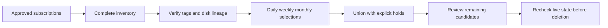

# Automate Tagged Azure Snapshot Retention Across Subscriptions

Author: [nawazdhandala](https://www.github.com/nawazdhandala)

Tags: Azure, Backup, Cloud Automation

Description: Design daily, weekly, and monthly snapshot retention using explicit subscription scope, ownership tags, overlapping retention sets, and conservative deletion gates.

Deleting every snapshot older than seven days is easy. Keeping seven daily restore points, four weekly points, and twelve monthly points is a different problem. Some snapshots satisfy more than one tier, and a failed backup run must not cause the cleanup job to remove your last useful recovery point.

Separate retention planning from deletion. Inventory the approved subscriptions, verify ownership and disk lineage, calculate the union of restore points to preserve, then review candidates against current state. Tags identify the policy; they do not prove that a snapshot is restorable or safe to delete.

## Define the policy before writing the cleanup job

This example policy, `d7-w4-m12-v1`, retains the newest successful snapshot in each of the seven most recent occupied UTC days, four most recent occupied ISO weeks, and twelve most recent occupied calendar months. An occupied period contains at least one eligible snapshot. The retained set is the union of those selections, plus explicit holds.

This is intentionally not “delete everything after 365 days.” Sparse histories can retain older points. Missing periods require a backup-health alert; retaining an older point does not repair a missing backup. ISO weeks include the ISO year, which matters around New Year.

Use a small tag contract on the snapshots themselves:

| Tag | Example | Meaning |
|---|---|---|
| `ManagedBy` | `snapshot-service-v1` | Automation owner |
| `RetentionPolicy` | `d7-w4-m12-v1` | Versioned policy identifier |
| `RetentionHold` | `false` | Explicit hold decision; `true` prevents deletion |
| `BackupSet` | `orders-disk-a` | Human-readable grouping label |

Azure tag names are case-insensitive for operations, while values are case-sensitive. Resources do not automatically inherit tags from their resource group or subscription. Normalize names carefully, require the exact expected values, and quarantine missing or conflicting metadata. Tags are plaintext, so put no credentials or sensitive customer information in them. [Azure tagging rules](https://learn.microsoft.com/en-us/azure/azure-resource-manager/management/tag-resources).

Do not use `BackupSet` alone as the technical grouping key. For incremental snapshots, verify both `SourceResourceId` and `SourceUniqueId`: recreating a disk under the same resource name changes its unique identity. Include the subscription in your grouping. Azure documents this lineage and the same-subscription restrictions in its [incremental snapshot guide](https://learn.microsoft.com/en-us/azure/virtual-machines/disks-incremental-snapshots).

## Inventory an explicit subscription list

Use a dedicated read identity for planning. The following PowerShell inventory assumes an already authenticated session authorized for the listed tenant and subscriptions. Replace the GUID placeholders. It uses Az.Accounts 5.3.0 and [Az.Compute 9.0.0](https://www.powershellgallery.com/packages/Az.Compute/9.0.0), whose command metadata was checked locally under PowerShell 7.4.6.

```powershell
$ErrorActionPreference = 'Stop'
Import-Module Az.Accounts -RequiredVersion 5.3.0
Import-Module Az.Compute -RequiredVersion 9.0.0
Disable-AzContextAutosave -Scope Process | Out-Null
$tenantId = 'REPLACE-TENANT-GUID'
$subscriptions = @('REPLACE-SUBSCRIPTION-A-GUID', 'REPLACE-SUBSCRIPTION-B-GUID')

$inventory = @(
    foreach ($subscription in $subscriptions) {
        $context = Set-AzContext -Tenant $tenantId -Subscription $subscription -Scope Process
        if ($context.Subscription.Id -ne $subscription) { throw 'Context mismatch' }
        Get-AzSnapshot -DefaultProfile $context | ForEach-Object {
            [pscustomobject]@{
                Subscription = $subscription
                Id = $_.Id
                TimeCreated = $_.TimeCreated
                State = $_.ProvisioningState
                Incremental = $_.Incremental
                SourceResourceId = $_.CreationData.SourceResourceId
                SourceUniqueId = $_.CreationData.SourceUniqueId
                Tags = $_.Tags
            }
        }
    }
)
$inventory | ConvertTo-Json -Depth 10 | Set-Content -Encoding utf8 './snapshot-inventory.json'
```

This queries snapshots without deleting them. Explicit profiles avoid accidentally relying on whichever subscription was last selected. An inventory error stops the script; do not treat an inaccessible subscription as an empty one. Keep the output in a fresh run directory so an older file cannot masquerade as a successful inventory. See [Get-AzSnapshot](https://learn.microsoft.com/en-us/powershell/module/az.compute/get-azsnapshot), [Set-AzContext](https://learn.microsoft.com/en-us/powershell/module/az.accounts/set-azcontext), and [process-scoped context autosave](https://learn.microsoft.com/en-us/powershell/module/az.accounts/disable-azcontextautosave).

Before calculating retention, select only snapshots owned by this service, with the recognized policy, explicit hold value, verified lineage, and successful provisioning. Keep unknown or incomplete snapshots out of automatic deletion. Check any disk-type-specific copy readiness before counting a snapshot as usable. A disk snapshot also does not establish application-consistent recovery across several disks; that requires a coordinated backup design and restore testing. [Managed disk snapshot guidance](https://learn.microsoft.com/en-us/azure/virtual-machines/snapshot-copy-managed-disk).

## Calculate what stays, not just what expires



The Python 3.11 function below operates on one verified disk family. Its normalized rows contain `id`, an ISO timestamp in `created`, and a Boolean `hold`. Convert the Azure inventory deliberately after the checks above; this function is not an Azure inventory parser or deletion executor.

Save it as `retention.py`:

```python
from datetime import datetime, timedelta, timezone


def plan(rows, now):
    """One verified disk family; normalized rows, never Azure delete calls."""
    if now.tzinfo is None:
        raise ValueError('now must include a time zone')
    now = now.astimezone(timezone.utc)
    parsed = []
    ids = set()
    for row in rows:
        if not isinstance(row['id'], str) or not row['id'] or row['id'] in ids:
            raise ValueError('Missing or duplicate snapshot ID')
        if type(row['hold']) is not bool:
            raise ValueError('Hold must be an explicit Boolean')
        created = datetime.fromisoformat(row['created'].replace('Z', '+00:00'))
        if created.tzinfo is None or created > now:
            raise ValueError('Invalid creation time')
        created = created.astimezone(timezone.utc)
        ids.add(row['id'])
        parsed.append((created, row['id'], row['hold']))
    if not parsed:
        return {'keep': [], 'candidates': [], 'status': 'NO_SNAPSHOTS'}
    parsed.sort(reverse=True)
    if now - parsed[0][0] > timedelta(hours=26):
        return {'keep': sorted(ids), 'candidates': [], 'status': 'STALE_BACKUP'}
    keep = {ident for _, ident, hold in parsed if hold}
    rules = [(7, lambda t: t.date()),
             (4, lambda t: t.isocalendar()[:2]),
             (12, lambda t: (t.year, t.month))]
    for limit, bucket in rules:
        seen = set()
        for created, ident, _ in parsed:
            key = bucket(created)
            if key not in seen and len(seen) < limit:
                keep.add(ident)
                seen.add(key)
    return {'keep': sorted(keep), 'candidates': sorted(ids - keep), 'status': 'REVIEW'}
```

The 26-hour freshness threshold is an example for a daily schedule with some tolerance. A stale latest snapshot causes the function to retain every supplied snapshot. Set a workload-appropriate threshold rather than copying it into a weekly-only backup system.

The algorithm sorts newest first, chooses one representative per occupied period, and combines the results. A snapshot selected for both the weekly and monthly tier appears once in the keep set. Explicitly held snapshots are retained regardless of age. Ties use the snapshot ID for deterministic selection.

Python's [datetime documentation](https://docs.python.org/3.11/library/datetime.html) defines the UTC conversion and ISO calendar behavior used here. Reject timestamps without a timezone; interpreting them as the cleanup host's local time can move snapshots into the wrong day or week.

For a minimal local check:

```python
from datetime import datetime, timezone
from retention import plan

rows = [{"id": "snapshot-a", "created": "2026-11-20T10:00:00Z", "hold": False}]
print(plan(rows, datetime(2026, 11, 20, 12, tzinfo=timezone.utc)))
```

The result keeps `snapshot-a`, proposes no candidates, and reports `REVIEW`. A 400-snapshot local fixture additionally verified the exact daily/weekly/monthly union and hold handling. No Azure snapshots were created or deleted for these tests.

## Make deletion a separately controlled step

Persist the plan with its inventory timestamp, policy version, subscription IDs, disk family, and reason for every retained or proposed snapshot. Initially run it in report-only mode and have the backup owner review several complete cycles, including a month boundary and a missed backup.

Before deleting a candidate, fetch it again using its recorded subscription context. Recheck ownership, policy, hold, lineage, provisioning, and whether it remains outside the retained set. Abort that disk family's cleanup if its inventory changed unexpectedly. Put a small per-run deletion cap in place and coordinate the snapshot producer with the cleanup worker.

The documented [Remove-AzSnapshot command](https://learn.microsoft.com/en-us/powershell/module/az.compute/remove-azsnapshot?view=azps-15.4.0) supports `-WhatIf` for a preview. A preview is not proof of deletion permission or a successful backup. Do not pipe the original broad inventory directly into removal.

Respect resource locks and operational holds. A lock-related failure should become an exception for review, not trigger automatic lock removal. [Azure resource locks](https://learn.microsoft.com/en-us/azure/azure-resource-manager/management/lock-resources) provide an independent control against deletion.

Schedule the planner after the producer's completion checks, use bounded retries for inventory failures, and alert on stale backups, policy gaps, and unprocessed subscriptions. Track restore-drill results alongside retention reports. The useful outcome is a known set of recovery points with verified ownership and health, not simply a declining snapshot count.
