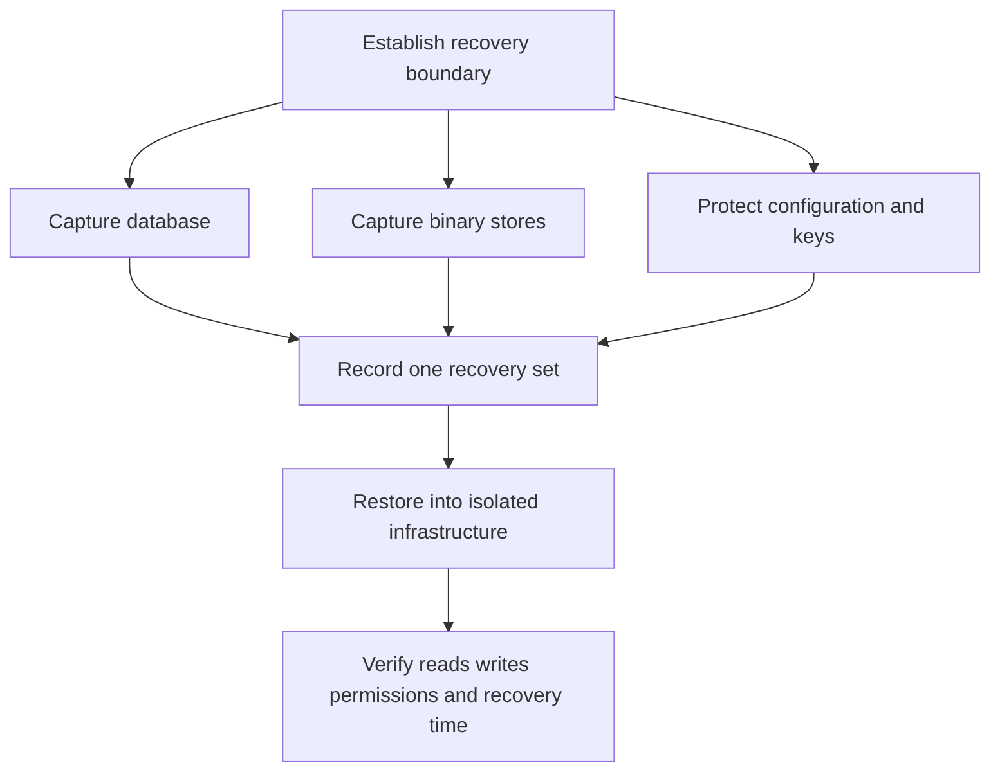

# Back Up Artifact Repositories as a Consistent Recovery Set

Author: [nawazdhandala](https://www.github.com/nawazdhandala)

Tags: Artifact Management, Backup, Disaster Recovery

Description: Coordinate repository databases, artifact storage, configuration and encryption keys, then prove recovery through an isolated restore drill.

A backup can contain every artifact file and still fail to restore a repository. The database may reference files absent from the storage copy. Encrypted credentials may be unreadable without the original key. A restored service may even connect to the production bucket and change the data you meant to protect.

Define the unit of recovery as a complete set: database, binary storage, configuration, required keys and a compatible application version. The goal is a working repository at an explainable recovery point, not a collection of unrelated successful backup jobs.

## Map the state before scheduling backups

A blob store or filestore holds package bytes. The database records relationships such as package paths, versions, permissions and references to those bytes. Configuration determines which database and storage the application actually uses.

Create an inventory with explicit recovery owners:

| Component | What the recovery plan needs |
| --- | --- |
| Database | Backup identifier, recovery point, engine version and restoration method |
| Every binary store | Snapshot or object-version inventory, location and retention period |
| Application configuration | Repository settings, storage providers, trusted certificates and runtime settings |
| Keys and secrets | Protected recovery locations, versions and authorized recovery procedure |
| Application distribution | Exact release and deployment configuration compatible with the backup |

Sonatype's [backup preparation guide](https://help.sonatype.com/en/prepare-a-backup.html) requires coordinating the database with corresponding repository data. Include separately configured blob stores; copying the default data directory is insufficient if content resides elsewhere.

For Artifactory, JFrog describes [component-based backups](https://docs.jfrog.com/installation/docs/backups) covering the database, filestore and application home. Preserve the master key separately under appropriate access control because encrypted credentials depend on it. Record how recovery staff obtain the key without exposing its contents in the backup manifest.

Also inventory external dependencies: database credentials, cloud encryption keys, object-storage access and secret-management services. A reference to a secret is useful only if that secret remains recoverable during the incident you are preparing for.

## Choose a consistency boundary

A consistent database backup does not automatically make the database consistent with an independently copied blob store. Imagine an upload that commits metadata at 10:01, while the storage snapshot contains only files present at 10:00. Recovery can produce a visible package whose download fails.

The simplest baseline drill uses a planned maintenance window: stop application activity, capture the coordinated components, verify that capture completed, then restart the service. For clustered installations, account for every node and background writer. Pausing CI publishers alone does not necessarily stop metadata changes, replication or cleanup.

This matters particularly for Nexus with PostgreSQL. Sonatype states that it has no global read-only mode for these deployments and that downloads can update metadata. For the strongest consistency, its [PostgreSQL backup guidance](https://help.sonatype.com/en/back-up-and-restore-postgresql-backed-deployments.html) recommends stopping Nexus during the backup window.

For a live backup design, document the product-supported ordering and your reconciliation procedure. JFrog recommends taking the database snapshot before copying the filestore, close together. Do not treat that ordering as permission to run destructive cleanup during the copy. Coordinate deletion, compaction and retention jobs so referenced content remains available throughout the capture and recovery window.



For Nexus H2, use the documented H2 procedure rather than PostgreSQL commands. Sonatype recommends [offline backups while Nexus is stopped](https://help.sonatype.com/en/configure-and-run-the-backup-task.html), including corresponding blob stores and required node identity files. Copying an actively changing database directory is not equivalent to a database-aware backup.

## Make database capture explicit

The following is a source-verified PostgreSQL **17** client example for a deployment whose supported database and backup policy allow logical backups. It is not a universal repository backup command. Before running it, establish the application consistency boundary, arrange separate binary-store capture and configure a protected [PostgreSQL connection service](https://www.postgresql.org/docs/17/libpq-pgservice.html) named `artifact_backup`.

That service must select the intended database, use verified TLS where applicable and obtain credentials through your approved mechanism. Do not place passwords directly in the command. Choose a new, private directory for each recovery set:

```bash
set -euo pipefail
umask 077
: "${BACKUP_SET:?Set a new absolute backup directory path}"
mkdir "$BACKUP_SET"
pg_dump --dbname='service=artifact_backup' \
  --format=custom \
  --file="$BACKUP_SET/repository.dump"
pg_restore --list "$BACKUP_SET/repository.dump" \
  > "$BACKUP_SET/repository.contents.txt"
```

`mkdir` intentionally fails if the directory already exists. `pg_dump` writes a custom-format archive; `pg_restore --list` reads its table of contents without connecting to a database. Keep the command's exit status and warnings. Listing an archive proves neither complete readability nor successful restoration.

The [PostgreSQL 17 pg_dump documentation](https://www.postgresql.org/docs/17/app-pgdump.html) explains that a dump covers one database, not cluster-wide roles and tablespaces. Preserve or recreate those through a separately reviewed database recovery plan. The [pg_restore reference](https://www.postgresql.org/docs/17/app-pgrestore.html) documents archive listing and restoration options. This example was syntax-checked and reviewed against those references; it was not executed against a repository database.

Record capture start and finish times, product versions, database backup ID, storage snapshot IDs and key recovery references under one recovery-set identifier. Checksums protect against accidental transfer corruption, but they do not prove that independently captured components represent the same state.

## Restore where mistakes cannot reach production

Provision a separate database and separate restored binary storage. Before starting the repository, inspect the restored configuration and credentials to confirm that they cannot write to production resources. Block production replication targets, outgoing webhooks and scheduled cleanup until the drill explicitly needs them.

Recover the matching configuration and required original keys using the documented product procedure. Do not generate a replacement master key to silence a startup error: newly generated key material does not decrypt existing encrypted values. JFrog's [key management documentation](https://docs.jfrog.com/installation/docs/manage-keys) distinguishes the keys involved; recovery and planned key rotation are different operations.

Use the application's compatible release first. Combining restoration with an upgrade makes it harder to tell whether a failure comes from missing backup data or a schema migration. After recovery succeeds, test upgrades as a separate controlled step.

## Test the service, not just the login page

Use a clean client to download a known release and compare its bytes against retained checksums. Cover old rollback releases, multiple repositories and package formats. Verify signatures or other release evidence when your deployment process depends on them.

Test an authorized upload in a dedicated drill repository, then confirm an unauthorized account cannot publish. Check that users can authenticate and that restored configuration points to the intended storage. Review application logs for missing blobs, decryption failures and database errors.

Measure recovery time from the incident decision through usable client access, including infrastructure provisioning and key retrieval. Record the latest verified recoverable release separately from the backup job's completion time. A recovery drill passes only when the agreed data-loss and downtime targets are met.

If metadata and storage disagree, preserve the evidence and follow the product's documented repair workflow. Reconciliation can repair some relationships; it cannot manufacture artifact bytes missing from every backup. Keep the failed recovery set until its cause is understood, and repeat the drill after correcting the backup design.
