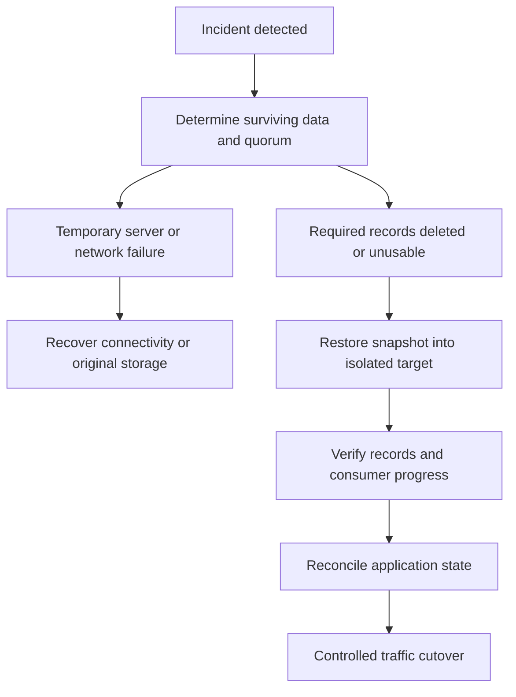

# Recover NATS JetStream with Snapshots and Quorum-Aware Decisions

Author: [nawazdhandala](https://www.github.com/nawazdhandala)

Tags: NATS, Backup, Disaster Recovery, Messaging

Description: Back up JetStream messages and consumer state, rehearse restoration into an isolated target, and distinguish snapshot recovery from quorum and peer maintenance.

A missing server, a deleted stream, and a lost majority are different incidents. Restoring yesterday's snapshot into a healthy cluster does not repair a transient network partition. Removing peers does not recover messages that were deleted from every replica.

Start recovery by identifying what is unavailable, what data still exists, and whether the surviving replicas can agree. Then choose the least disruptive operation that addresses that failure.

This walkthrough pins NATS Server 2.11.4 and the NATS CLI 0.2.2. Backup commands have evolved in newer releases, so these examples intentionally use the command layout verified in [CLI 0.2.2](https://github.com/nats-io/natscli/releases/tag/v0.2.2).

## Separate availability copies from recovery copies

JetStream replication maintains live copies of a stream. A snapshot preserves an earlier state outside the running stream. Replicas help a stream remain available after a server failure; a retained snapshot can help recover from a deletion or application mistake that replicated everywhere.

A useful backup set includes more than message data:

| Artifact | What it restores |
| --- | --- |
| Stream snapshot | Messages and stream configuration at the recovery point |
| Included consumer state | Consumer configuration and saved delivery progress |
| Server and deployment configuration | Storage paths, topology, listeners, and runtime settings |
| Identity and trust material | Account claims, required credentials, certificate trust, and signing-key recovery |
| Application recovery record | How database state and external effects relate to the saved messages |

Keep signing keys and credentials under appropriate encryption and access controls. A stream archive is not a backup of the operator's private signing keys. The [NATS backup overview](https://docs.nats.io/learn/backup-recovery/) separates data, availability, and identity recovery.

## Capture a reproducible recovery point

The lab uses a file-backed stream named `RECOVERY_LAB`, containing three identifiable records and a durable consumer named `reader`. The reader has acknowledged sequence one. Publishers and consumers are paused during the snapshot so the comparison has a clear boundary.

In a real system, decide whether to pause writers or accept a moving recovery point. Independent stream snapshots and database backups do not automatically form a single application transaction. Record the reconciliation procedure before an incident.

With the source server running on the indicated loopback port, use a new backup directory:

```bash
umask 077
backup_root=$(mktemp -d)
backup_dir="$backup_root/recovery-lab"

nats --no-context --server nats://127.0.0.1:14234 \
  stream backup RECOVERY_LAB "$backup_dir" \
  --consumers --check --no-progress
```

These addresses refer only to disposable local servers. For production, use your reviewed connection context or explicitly supplied TLS and credentials for the correct account and JetStream domain.

`--consumers` includes consumer state. `--check` asks for the supported health check during backup; it does not prove that a later restore will work. The [tagged stream command](https://github.com/nats-io/natscli/blob/v0.2.2/cli/stream_command.go) defines these flags.

With the pinned server, the resulting directory contained `backup.json` and `stream.tar.s2`. Keep both files together and transfer the complete directory to independent protected storage. Do not unpack the archive into a live server's store. The [backup and restore documentation](https://docs.nats.io/learn/backup-recovery/stream-backup-restore) describes the snapshot boundary and newer archive formats; do not assume newer offline-inspection commands exist in this older CLI.

## Restore into an empty isolated target first

Use a separate server or account with no existing stream of this name. Keep production publishers and consumers disconnected from it while checking the restore.

```bash
nats --no-context --server nats://127.0.0.1:14235 \
  stream restore "$backup_dir" --no-progress

nats --no-context --server nats://127.0.0.1:14235 \
  stream info RECOVERY_LAB --json

nats --no-context --server nats://127.0.0.1:14235 \
  consumer info RECOVERY_LAB reader --json
```

The first command recreates the saved stream. The following commands inspect its stream and consumer state. They should show the saved sequence range and consumer progress, not merely a stream with the expected name.

Do not delete an existing production stream to make a restore command succeed. In the local test, attempting a second restore into the already-restored stream failed because it existed. That is a useful guard against treating restore as a merge operation.

A snapshot from a replicated stream also carries configuration that needs suitable target capacity. The demonstrated backup came from a one-replica file stream and restored into another single server. Rehearse your actual replica count, placement constraints, account limits, and version compatibility separately.

## Verify data and processing state

Counting messages is necessary but insufficient. In the lab, I checked all three payloads, an identifying header on each record, first and last sequence numbers, and the durable consumer's acknowledgment floor. The acknowledgment floor identifies the progress confirmed by the consumer.

The restored reader resumed at sequence two. Its new acknowledgment did not change the original server's reader, which remained at sequence one. This established that verification was operating on the isolated target.

Consumer progress must still be reconciled with business state. Restoring an older cursor can replay work already committed in a database. Restoring a newer cursor alongside an older database backup can skip work that database no longer contains. Retain stable operation IDs and a tested reconciliation process; do not equate a restored acknowledgment position with restored external side effects.



## Diagnose quorum before changing membership

RAFT is the consensus mechanism JetStream uses to agree on replicated state. A three-replica group needs a majority of two. If two members are unavailable, the remaining member cannot simply declare itself the authoritative majority. Stream, consumer, and metadata groups have different responsibilities; inspect the affected group's state rather than counting all running NATS processes. See [replication and R=3](https://docs.nats.io/learn/clustering/replication-and-r3).

If the missing servers and their data can return, restoring connectivity or repairing the original hosts is often the appropriate first path. Preserve their storage while investigating. A timeout might mean an unreachable leader, missing authorization, a wrong domain, or unavailable quorum; it is not automatically evidence of corrupt data.

## Treat peer removal as a planned membership change

The CLI exposes two different scopes: `stream cluster peer-remove` removes a peer from one stream's group, while `server cluster peer-remove` concerns a server's membership in the JetStream cluster. The latter is implemented in the [tagged server command](https://github.com/nats-io/natscli/blob/v0.2.2/cli/server_cluster_command.go). They are not interchangeable repair shortcuts.

Before removing a permanently lost peer, establish the authoritative surviving state, current quorum, replacement capacity, and the intended server identity. Fence a retired instance so it cannot unexpectedly return as an unmanaged duplicate. Use a reviewed cluster recovery procedure and verify replacement replicas catch up before making another membership change.

A force flag that skips a confirmation prompt is not a mechanism for manufacturing missing consensus or recovering lost data. Peer removal was documentation-reviewed here, not executed. The live checks covered snapshot creation, isolated restoration, consumer resumption, and collision rejection on two disposable servers. They did not simulate quorum loss, permanent disk loss, clustered recovery, or a production cutover. Those scenarios belong in a separate rehearsed recovery exercise before you need them.
