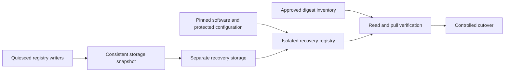

# Back Up and Restore a Registry Without Changing Image Digests

Author: [nawazdhandala](https://www.github.com/nawazdhandala)

Tags: Container Registry, Backup, Disaster Recovery

Description: Plan a consistent registry backup, restore into isolated storage, and verify tags, multi-platform manifests, and blobs before reopening service.

A registry backup is useful only if clients can retrieve the approved images after restoration. Recovering a directory full of layer data is not enough: the registry also needs the repository relationships, manifests, and tags that make those objects discoverable.

The goal is to recover the original content and verify its identity. Rebuilding an application from its source commit is a different operation and may produce a different image digest.

This guide focuses on **Distribution 3.1.2** with filesystem storage. It also explains what changes when the storage backend is an object store. Products that add a metadata database, project permissions, or scanning services need their own coordinated backup procedure; a Distribution filesystem copy does not capture those additional systems.

## Define the recovery boundary

Document the registry version, effective configuration, storage driver, and the exact data root before selecting a backup job. For filesystem storage, `rootdirectory` identifies the tree containing registry data. The process may see that path through a container mount, so record both the configured path and its underlying persistent volume. [Filesystem driver documentation](https://distribution.github.io/distribution/storage-drivers/filesystem/).

Distribution stores content-addressed blobs alongside repository-specific links and tag information. Preserve the whole supported storage tree, not a hand-picked collection of large files. Its internal layout is an implementation detail; use it to understand completeness, not as an invitation to edit links manually. [Distribution 3.1.2 storage paths](https://github.com/distribution/distribution/blob/v3.1.2/registry/storage/paths.go).

Keep these recovery inputs together in the plan:

| Input | Recovery purpose |
|---|---|
| Consistent storage snapshot | Original blobs, manifests, repository links, and tags |
| Pinned registry executable or image | Recreates the version that understood the backup |
| Configuration and mount mapping | Points the service at the intended restored data |
| Protected authentication and TLS material | Restores access without weakening verification |
| External service dependencies | Identifies identity, secret, key-management, and object-store requirements |
| Release digest inventory | Provides an independent acceptance baseline |

Store secrets through the approved secret backup mechanism. A plain-text copy of a configuration file may omit values injected from environment variables or a secret manager.



## Take a consistent snapshot

Choose a maintenance method that prevents changes throughout the snapshot. For the simplest filesystem procedure, stop every registry process that can write to the storage root, and suspend external cleanup or storage lifecycle operations affecting that data. Let in-flight uploads finish or be intentionally abandoned before declaring the snapshot boundary.

A file-by-file copy while writers remain active can combine objects from different moments. A tag can be captured after it changes while its newly referenced content is absent from the copied set. Storage-native snapshots can reduce downtime, but their consistency guarantees still need to match the registry's write pattern and any other involved systems.

Distribution also supports maintenance read-only mode. This configuration fragment belongs under the existing storage section:

```yaml
storage:
  maintenance:
    readonly:
      enabled: true
    uploadpurging:
      enabled: false
```

It is a fragment, not a replacement for the storage-driver configuration. Apply the reviewed maintenance configuration to every replica through your normal rollout mechanism and verify it took effect. Disabling upload purging prevents that background cleanup from modifying the snapshot source. Stop independently scheduled garbage collection and any other writers as well. Read-only API mode alone does not freeze external storage operations. [Pinned maintenance options](https://github.com/distribution/distribution/blob/v3.1.2/docs/content/about/configuration.md#maintenance).

Use the storage platform's supported snapshot or backup procedure once the boundary is established. Record its identifier, timestamp, configuration revision, and verification result. Do not combine a backup with garbage collection or a storage-format migration; each adds another variable to recovery.

## Capture a digest baseline

During the quiesced window, record critical release tags and their digests. Use crane **0.20.6** with approved registry credentials and CA trust. Run this in a new evidence directory and replace the example values:

```bash
set -eu
repo='registry.example.internal/team/api'
tag='approved-release'
crane digest --platform all "$repo:$tag" > expected.digest
expected=$(cat expected.digest)
crane manifest --platform all "$repo@$expected" > expected-manifest.json
```

The digest records the original top-level object, including the full index for a multi-platform release. Retain the repository name and tag with the files. Repeat for the release inventory, including rollback releases and required associated artifacts. A sample of important images is a useful smoke test, but it is not a complete registry inventory. [crane digest command](https://github.com/google/go-containerregistry/blob/v0.20.6/cmd/crane/doc/crane_digest.md).

If tags were allowed to change between inventory capture and snapshot creation, document that mismatch rather than treating the inventory as an exact snapshot catalog.

## Restore into a separate destination

Recover the snapshot into a new storage root or isolated bucket prefix. Preserve the original backup and failed storage for investigation. Check file ownership, permissions, mount mappings, encryption-key access, and available capacity before starting the service.

Start the same registry version with the restored storage in an isolated environment. Keep normal clients, external notification consumers, and automated cleanup away from it. Recreate the documented authentication and TLS behavior; disabling certificate verification would conceal a recovery failure that real clients will encounter.

For an object store, a successful bucket copy is not automatically a coherent restore. Establish which object versions form the recovery point, how deletions and lifecycle rules are handled, and whether the restored registry has the intended prefix and encryption permissions. Use the backend's documented recovery mechanism instead of translating filesystem commands into an unreviewed recursive synchronization.

A registry hostname change does not inherently change a manifest's content-derived digest. It does change client references, certificate names, authorization configuration, and possibly signature-policy expectations. Validate those separately.

## Verify content before opening writes

Using the isolated recovery endpoint, compare the restored release with its baseline:

```bash
set -eu
restored_repo='registry-recovery.example.internal/team/api'
tag='approved-release'
expected=$(cat expected.digest)
actual=$(crane digest --platform all "$restored_repo:$tag")
test "$actual" = "$expected"
crane manifest --platform all "$restored_repo@$expected" > restored-manifest.json
```

A matching digest is necessary but not sufficient. Fetch every required platform manifest, its configuration, and its layers. Validate associated signatures and attestations using the destination's policy. Then use clean staging nodes or clients without cached layers to exercise real pulls and application startup. A cached node can hide missing registry objects.

Record failures precisely: missing tag, missing manifest, unavailable blob, denied access, or TLS failure. Do not rewrite a manifest or retag a different image to make a comparison pass. Recover the missing original content or declare the recovery point incomplete.

For this article, a binary built from Distribution 3.1.2 source served a synthetic AMD64/ARM64 image from a temporary filesystem. The process was stopped, its full storage tree copied into a separate temporary root, and a second registry started against that root. The tag and index digest matched; both platforms' configurations and layers were readable. The test used disposable anonymous loopback HTTP services, not production TLS, permissions, object storage, backups with secrets, or actual container execution.

## Reopen service deliberately

After read verification, use a controlled test writer to check a new upload and pull through the intended endpoint. Keep ordinary writers paused until this succeeds. Restore normal traffic only after the routing, authentication, storage, and recovery evidence are accepted.

Finally, re-enable scheduled work deliberately and retain the recovery report. Include the measured time to restore and the newest recoverable data point. Those observations turn a backup job's success message into evidence that the registry can actually support the next deployment.
