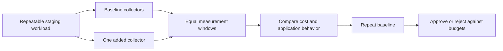

# Benchmark cAdvisor Overhead Before Enabling Expensive Metrics

Author: [nawazdhandala](https://www.github.com/nawazdhandala)

Tags: Docker, Linux, Prometheus, Monitoring

Description: Measure cAdvisor CPU, memory, scrape cost, and workload impact with a controlled staging benchmark before enabling additional metric collectors.

An additional metric can be useful and still cost more than you want on every node. The cost may appear in cAdvisor's CPU usage, its memory, the size of each scrape, or the application sharing the host. A benchmark that checks only whether Prometheus receives the new series misses most of that picture.

This guide describes a repeatable staging experiment for **cAdvisor 0.55.1**. The queries were checked with Prometheus **3.7.3** fixtures. No live cAdvisor performance measurements are claimed, and the example budgets below are planning examples, not published benchmark results.

## Decide what you are buying

Write down the operational question before changing flags. Perhaps you need process counts to investigate worker leaks, or hardware performance events to investigate CPU behavior. Name the alert or investigation that will use the new data. Otherwise, it is hard to decide whether additional resource consumption is worthwhile.

There are three costs to separate:

| Cost | Evidence to collect |
|---|---|
| Periodic collection | cAdvisor CPU and memory under the same workload |
| Exposition and transfer | Scrape duration, response size, successful scrape count |
| Downstream storage and queries | Ingested samples, series growth, Prometheus resource usage |

Also measure application latency, throughput, and errors from an independent source. If the measurement tool misses work while overloaded, its own graphs may look reassuring.



Run the variants sequentially on the same staging host, or use carefully matched hosts. Running two full cAdvisor instances together changes the load being measured and makes attribution harder.

## Freeze the experiment inputs

Record the image digest, kernel, runtime, cgroup version, CPU architecture, container count, and workload generator settings. Preserve the complete deployment manifest, including mounts and permissions. A metric family may require additional kernel facilities or privileges; a failed collector is not a cheap successful collector.

Keep the following unchanged between variants: cAdvisor memory-history duration, label selection, scrape interval, scrape timeout, container lifecycle pattern, and the number of monitoring clients. Close auto-refreshing diagnostic pages and avoid adding a second scraper halfway through the run.

Housekeeping means cAdvisor's periodic collection work. Its interval is separate from Prometheus's scrape interval. The [runtime options](https://github.com/google/cadvisor/blob/v0.55.1/docs/runtime_options.md) describe dynamic housekeeping, which adapts to activity, and the in-memory storage duration.

For an initial comparison, either retain your production housekeeping settings in every variant or use fixed settings in every variant. Do not compare an adaptive baseline with a fixed candidate and attribute the entire difference to the new metric. A fixed-interval experiment should be followed by a rehearsal with the settings you actually intend to deploy.

## Change one collector at a time

These are **argument fragments** for an existing, working staging deployment. They are not complete container launch commands. Keep the approved image, mounts, and security configuration in your manifest.

Example baseline:

```text
--enable_metrics=cpu,memory,network
--housekeeping_interval=1s
--allow_dynamic_housekeeping=false
--storage_duration=2m
```

Example candidate:

```text
--enable_metrics=cpu,memory,network,process
--housekeeping_interval=1s
--allow_dynamic_housekeeping=false
--storage_duration=2m
```

The candidate adds process metrics. This small baseline is deliberate for an isolated experiment; do not replace a production configuration with it and silently lose required disk or other metrics. For a production-representative trial, start with your actual enabled set and add only the proposed family.

In 0.55.1, a nonempty `--enable_metrics` replaces the selection derived from `--disable_metrics`. It does not append to the defaults. The [flag implementation](https://github.com/google/cadvisor/blob/v0.55.1/cmd/cadvisor.go) defines that precedence. Hardware-dependent families may also need configuration beyond inclusion in the set; for example, performance events have a separate configuration file flag.

Before measuring, confirm that the expected new series exist for a workload where they should exist. Check logs for permission and collection errors. Reject the trial if the new collector never becomes functional.

## Measure the cAdvisor process itself

Assume an existing Prometheus target labeled `job="cadvisor-bench"` and `instance="bench-node:8080"`. Replace those selectors with your actual target labels. Run each expression separately in Prometheus.

CPU consumption, in average CPU cores over five minutes:

```promql
rate(process_cpu_seconds_total{job="cadvisor-bench",instance="bench-node:8080"}[5m])
```

Resident memory, in bytes:

```promql
process_resident_memory_bytes{job="cadvisor-bench",instance="bench-node:8080"}
```

These `process_` metrics describe the cAdvisor server process. They are distinct from the optional per-container `process` metric family in the candidate. The standalone server registers a process collector in its [Prometheus handler](https://github.com/google/cadvisor/blob/v0.55.1/cmd/internal/http/handlers.go).

Verify that your endpoint actually supplies these metrics. A kubelet-integrated endpoint or an intermediary can have different instrumentation. Missing process metrics are missing evidence, not zero overhead; use an independently identified host process or container measurement if needed.

A CPU result of `0.08` means roughly eight percent of one CPU core. It does not mean eight percent of an eight-core machine. Prometheus documents how [rate handles counters](https://prometheus.io/docs/prometheus/latest/querying/functions/); do not apply it to the resident-memory gauge.

## Measure scraping without confusing it with collection

Maximum observed scrape duration over a completed ten-minute window:

```promql
max_over_time(scrape_duration_seconds{job="cadvisor-bench",instance="bench-node:8080"}[10m])
```

Largest observed sample count before metric relabeling in that window:

```promql
max_over_time(scrape_samples_scraped{job="cadvisor-bench",instance="bench-node:8080"}[10m])
```

Check the target's `up` series and logs alongside these values. Prometheus's [target metrics](https://prometheus.io/docs/concepts/jobs_instances/) distinguish scrape success, duration, and samples before or after relabeling. A successful scrape is necessary but does not prove every expected container metric is present.

Metric relabeling can reduce stored samples after collection. It does not remove the work cAdvisor already performed to gather and expose the response. Similarly, a slower scrape interval changes how often you request data; it is not the same control as the housekeeping interval.

## Use repeatable windows and explicit rejection rules

For a first staging run, warm up for five minutes, measure for ten, and repeat baseline, candidate, then baseline again. These are starting windows, not universal requirements. Extend them for slow memory growth, large container populations, or periodic workloads. Exclude restart and warm-up boundaries from steady-state rate comparisons, but record restart peaks separately.

Exercise at least steady traffic and container churn, meaning repeated creation and removal of short-lived containers. A quiet host with two containers does not represent a busy host with hundreds. Keep the load generator's completed work comparable, not just its requested rate.

Choose budgets before seeing results. An example team might allow 0.05 additional CPU cores per node, 32 MiB additional resident memory, no missed scrapes, and no more than its agreed application-latency regression. Those numbers are hypothetical. Set your own from capacity and service objectives.

Report absolute changes as well as percentages. Moving from 0.01 to 0.02 cores is a 100 percent increase but only 0.01 additional core. Compare repeated runs and note their spread; if ordinary baseline variation exceeds the candidate difference, gather more evidence before declaring a regression.

Approve the collector only when it produces the intended signal, stays inside the agreed resource budgets, and leaves application behavior acceptable. Keep the baseline manifest ready for rollback, then repeat the measurement on a small production canary before expanding deployment. The deliverable is a defensible decision with retained evidence, not a single attractive overhead number.
