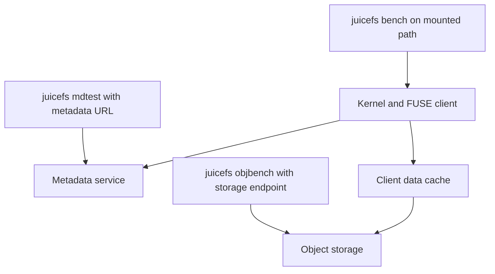

# Separate JuiceFS Metadata and Object-Storage Benchmark Results

Author: [nawazdhandala](https://www.github.com/nawazdhandala)

Tags: JuiceFS, Performance, Storage

Description: Use JuiceFS bench, its metadata test, and objbench to distinguish mounted filesystem performance from metadata operations and object-storage requests.

A slow JuiceFS benchmark does not automatically identify a slow object store. Opening thousands of files stresses a different path from transferring a few large files. A cached read can also look extremely fast while making almost no request to the backend you intended to measure.

Build an experiment with separate observations: application-facing filesystem operations, metadata creation, and direct object-storage operations. Compare them under a recorded configuration, rather than subtracting one headline throughput number from another.

The commands here are scoped to **JuiceFS Community Edition 1.4.2**. They create test data and require an approved staging filesystem or dedicated benchmark storage. Start with small limits; increase them only after understanding the generated load and cleanup behavior.

## Understand the three test paths



FUSE is the interface between the kernel and the userspace JuiceFS process. A mounted-path test includes that interface; a direct backend test does not.

| Test | Useful question | Important limitation |
| --- | --- | --- |
| `juicefs bench PATH` | How does this mounted path perform for the built-in file workload? | Includes multiple layers and cache effects |
| `juicefs mdtest META-URL PATH` | How quickly can this client create a controlled metadata tree? | Hidden, version-specific tool; not a full filesystem benchmark |
| `juicefs objbench ENDPOINT` | How does the configured object backend handle its test requests? | Bypasses the normal mounted filesystem path |

Do not confuse `juicefs mdtest` with the standalone HPC `mdtest` program distributed with IOR. The latter appears in JuiceFS's [published mdtest benchmark](https://github.com/juicedata/juicefs/blob/v1.4.2/docs/en/benchmark/mdtest.md), where it measures several operation classes through a mounted path. Its options are different. This article uses the built-in command and verifies its behavior against [the 1.4.2 implementation](https://github.com/juicedata/juicefs/blob/v1.4.2/cmd/mdtest.go).

## Write down the experiment before running it

Record client version, host CPU and memory, network placement, metadata engine, object endpoint, mount options, concurrency, and background workload. Record cache configuration and whether each run is a first or repeated pass. Choose a representative application measurement to accompany the synthetic results.

A staging directory limits where files are created, but it does not isolate shared metadata capacity, backend request charges, or host memory pressure. Schedule the experiment accordingly. Keep normal Trash protection enabled on shared filesystems; deleted benchmark files may continue consuming retained space.

Save outputs outside the tested mount, with restricted access if endpoint information is sensitive. Treat any error, incomplete stage, or unexpected retry as part of the result. A green-colored output row is a heuristic, not a service-level guarantee.

## Run a bounded mounted-path test

Create a new directory under an already verified staging mount, then run:

```bash
TEST_DIR=$(mktemp -d /mnt/jfs/bench-review.XXXXXX)
SKIP_DROP_CACHES=true juicefs bench \
  --threads 1 \
  --block-size 1M \
  --big-file-size 64M \
  --small-file-size 4K \
  --small-file-count 100 \
  "$TEST_DIR"
```

Replace `/mnt/jfs` with the actual staging mount. Confirm that it is mounted before creating the directory; otherwise you could benchmark the host filesystem by accident. The workload uses one thread, a 64 MiB large file, and 100 small files of 4 KiB each. Output separates large-file throughput, small-file rates, and attribute checks.

The environment setting matters. In this release, `bench` otherwise attempts to clear kernel caches, using a host-wide cache-drop operation on Linux or `purge` on macOS, potentially through `sudo`. `SKIP_DROP_CACHES=true` suppresses that behavior. The [source](https://github.com/juicedata/juicefs/blob/v1.4.2/cmd/bench.go) defines the switch. The command can still print a generic cache-cleaning announcement; look for the subsequent skipped-operation warnings.

This is deliberately a cache-preserving run. Do not label its reads as cold object-storage reads. Even a successful kernel cache drop would not by itself erase the JuiceFS disk cache. For a cold-client experiment, provision an isolated test host and an empty, dedicated cache through your normal deployment procedure; never delete a live cache containing pending writeback data.

## Exercise metadata creation independently

Use a dedicated, already formatted test filesystem. The final argument below is a **path inside JuiceFS**, not a host directory:

```bash
juicefs mdtest \
  --threads 2 \
  --dirs 2 \
  --depth 1 \
  --files 5 \
  --write 0 \
  "$TEST_META_URL" /metadata-review-REPLACE-UNIQUE-ID
```

Supply the approved metadata URL securely and replace the path suffix for every run. This creates a small tree without requiring a FUSE mount. With two branches and one level below the root tree directory, the test uses three tree directories. Two threads creating five files in each produce **30 files**, plus wrapper directories.

The built-in implementation reports directory and file creation rates. It leaves the created tree behind; it does not implement the standalone tool's complete create/stat/remove cycle. Inspect and remove only the exact test tree through the normal filesystem interface after retaining your results.

Keep `--write 0`. In this version, a nonzero value creates metadata slice records directly; it is not a trustworthy way to add representative object upload traffic. Do not use those synthetic files as application data. Because this command is hidden and implementation-specific, recheck it before using a different client release.

## Confirm suspected object-storage problems directly

For an S3-compatible backend, use a dedicated benchmark bucket, never the JuiceFS data bucket. Configure approved credentials in the environment through a protected mechanism; `ACCESS_KEY` and `SECRET_KEY` are documented inputs. If using temporary credentials, review this version's session-token option and your credential handling policy.

```bash
juicefs objbench \
  --storage s3 \
  --threads 1 \
  --big-object-size 64M \
  --small-object-size 4K \
  --small-objects 20 \
  https://REPLACE-BENCHMARK-BUCKET.s3.REPLACE-REGION.amazonaws.com
```

The command performs functional checks and timed object operations, including writes and deletes. Allow the required operations only in the dedicated test bucket, review provider costs, and inspect results for unsupported operations or failures. See the [pinned objbench implementation](https://github.com/juicedata/juicefs/blob/v1.4.2/cmd/objbench.go) and [performance guide](https://github.com/juicedata/juicefs/blob/v1.4.2/docs/en/benchmark/performance_evaluation_guide.md#juicefs-objbench).

A direct request result still includes the test client's network and storage SDK behavior. It is not the provider's internal service latency. Use the same host placement when comparing it with the mounted-path run.

## Interpret differences without inventing a bottleneck

If metadata creation slows while direct object requests remain stable, investigate metadata latency, engine capacity, client CPU, and metadata network placement. If large-file operations and direct object requests both slow, investigate the shared network and object backend first.

If only the mounted-path test regresses, compare its FUSE latency, client cache activity, resource limits, and workload details. Collect `juicefs stats` over the same interval to connect operation rates with backend traffic. Increase concurrency in a separate experiment; concurrency changes queueing and can increase throughput while worsening individual latency.

Local validation for this guide exercised small `bench` and file-backed `objbench` runs, plus the 30-file metadata example using SQLite and local object storage. It verified command behavior, not remote-service performance. Report your own measured environment, repeated runs, errors, and cache conditions before drawing capacity conclusions.
