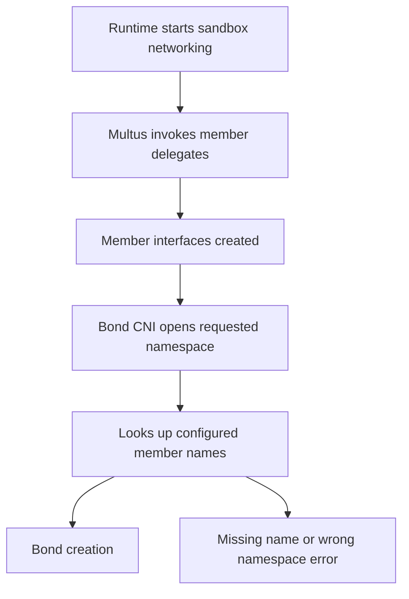

# Diagnose Bond CNI Link Not Found After a Containerd Upgrade

Author: [nawazdhandala](https://www.github.com/nawazdhandala)

Tags: Multus, Kubernetes, Troubleshooting

Description: Trace Bond CNI member lookup failures after a runtime upgrade by checking namespace identity, attachment order, effective CNI paths, and cleanup timing before changing versions.

After upgrading containerd, new Pods fail with a Bond CNI message saying that a member link cannot be found. Existing Pods may still work. The timing points to the upgrade boundary, but it does not identify the cause: configuration selection, binary paths, attachment order, namespace handling, or cleanup can all change what the plugin sees.

The error means a lookup failed in a particular context. Your goal is to identify which link was requested, which sandbox namespace was searched, and whether an earlier delegate had successfully created that link there.

This guide reviews **Bond CNI commit `709b4a474cc543eba3652da2d0206c35620bd82a`**, **Multus v4.3.1**, and **containerd v2.1.5** configuration documentation. These are source references, not a claim that a specific containerd release introduced a known universal bug. Shell examples were syntax-checked; no runtime upgrade or Linux namespace test was performed.

## Preserve the first failure and its identity

Capture the complete error, including the missing interface name, Pod UID, node, sandbox ID, time, and whether it occurred during CNI ADD or DEL. ADD creates the attachment; DEL removes it. A cleanup failure following a failed ADD can obscure the original problem.

```bash
kubectl -n REPLACE_NAMESPACE describe pod REPLACE_POD
kubectl -n REPLACE_NAMESPACE get pod REPLACE_POD -o yaml
```

Collect the same interval from the node's Multus, runtime and kubelet logs through your normal logging system. Keep retries distinct: a second sandbox can have a different namespace even when the Pod name is unchanged. Record the old and new runtime versions and the actual Bond CNI binary identity installed on the affected node.

Do not clear CNI state to make the error disappear. Saved delegate configuration and allocation records can be needed to clean up the failed sandbox correctly.

## Interpret the Bond CNI lookup precisely

In the reviewed source, Bond CNI reads member names from `links`, opens the namespace supplied through the CNI invocation, and looks up the links there. With `linksInContainer` disabled, it first attempts to move configured links from the host. With it enabled, the members are expected to be present in the container namespace already. [Bond creation and lookup source](https://github.com/k8snetworkplumbingwg/bond-cni/blob/709b4a474cc543eba3652da2d0206c35620bd82a/bond/bond.go).



For a Multus setup that supplies `net1` and `net2` first, this is the relevant configuration fragment:

```json
{
  "linksInContainer": true,
  "links": [
    {"name": "net1"},
    {"name": "net2"}
  ]
}
```

It is not a complete NetworkAttachmentDefinition. Compare it with your actual bond definition and the interface names requested by the Pod. A member named `data0` cannot satisfy a lookup for `net1` simply because it is the first secondary interface.

## Verify attachment order before inspecting the runtime

A typical desired list places both member networks before the bond:

```json
[
  {"name": "path-a", "interface": "net1"},
  {"name": "path-b", "interface": "net2"},
  {"name": "redundant-net", "interface": "bond0"}
]
```

Compare the live Pod annotation with the previous working template. Check that the names resolve to the intended NetworkAttachmentDefinitions and that each member delegate succeeded. A missing SR-IOV allocation, absent parent interface, or failed member IPAM operation can leave Bond CNI with nothing to attach.

The Bond CNI integration design depends on interfaces having been supplied before bonding. Do not reorder attachments randomly or add a guessed interface on the host to satisfy the error. [Multus integration example](https://github.com/k8snetworkplumbingwg/bond-cni/blob/709b4a474cc543eba3652da2d0206c35620bd82a/README.md).

## Inspect the exact failed sandbox namespace

On the affected node, use `crictl` configured for the real runtime endpoint:

```bash
sudo crictl pods
sudo crictl inspectp REPLACE_SANDBOX_ID
```

Match the sandbox to the captured Pod identity. Determine its network namespace path using the runtime's actual inspection data or supported diagnostics; do not assume a universal field name. [Kubernetes crictl guide](https://kubernetes.io/docs/tasks/debug/debug-cluster/crictl/).

If the namespace still exists, inspect it without changing it:

```bash
sudo nsenter --net=REPLACE_VERIFIED_NETNS_PATH -- ip -d link show
```

This uses the Linux namespace path explicitly. Inspect the host separately if the configuration expects host-side members. A link in the host namespace does not prove it existed in the sandbox namespace when Bond CNI ran. [nsenter reference](https://man7.org/linux/man-pages/man1/nsenter.1.html).

Be careful with post-failure snapshots. CNI cleanup may already have removed members by the time you inspect the node. Correlate the original ADD logs and timestamps rather than concluding that the members were never created. For a reproducible staging case, collect the lifecycle evidence around each delegate invocation through supported logging.

## Compare effective runtime configuration

A runtime upgrade can also change packaging or configuration migration. Compare the active configuration file selected by the service, its imports, the CRI plugin section, CNI configuration directory, binary search directories, and any runtime-handler overrides. Use the installed release's documentation and your distribution's generated configuration source.

For example, containerd v2.1 documentation uses `bin_dirs` and marks singular `bin_dir` deprecated. Its version-3 configuration uses the `io.containerd.cri.v1.runtime` plugin section; older configuration examples can use `io.containerd.grpc.v1.cri`. Copying a field into the wrong section can leave your intended change ineffective. [containerd v2.1.5 CRI configuration](https://github.com/containerd/containerd/blob/v2.1.5/docs/cri/config.md).

Also inspect per-runtime CNI overrides and the number of configurations loaded. The goal is to confirm which configuration and binaries the failing sandbox actually used, not merely to find a familiar file on disk. Do not replace the whole runtime configuration with defaults as a troubleshooting shortcut.

| Evidence | Likely next investigation |
| --- | --- |
| Member delegate failed first | Allocation, device, parent, or member configuration |
| Names differ between annotation and bond | Explicit interface-name mismatch |
| Members found only on host | `linksInContainer` and intended namespace flow |
| Different CNI files or binaries after upgrade | Runtime configuration or packaging migration |
| Members existed, then disappeared | Cleanup order and original failure timing |
| Reproduction only with one runtime build | Narrow version comparison and upstream evidence |

## Reproduce one variable at a time

Use a disposable staging node with the same approved artifacts and configuration. Keep the network definitions, device pools and workload fixed while comparing the runtime change. If you need to test a different Bond CNI build, make that a separate experiment and retain exact checksums.

A useful upstream report includes the minimal sanitized network definitions, ordered annotation, installed versions, effective CNI paths, sandbox identity and timestamped ADD/DEL evidence. Avoid reporting only the last “link not found” line after cleanup.

Apply the smallest supported correction through the component's owner, then test fresh attachment, traffic, deletion and recreation. Existing traffic alone does not validate the repaired setup. Keep allocation state intact and verify that both old failed sandboxes and newly created ones are cleaned up through their normal lifecycle.
