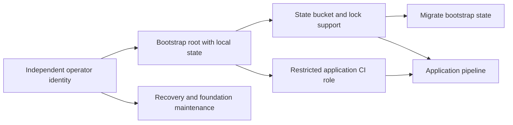

# Bootstrap Terraform State Storage and CI Identity Without a Dependency Loop

Author: [nawazdhandala](https://www.github.com/nawazdhandala)

Tags: Terraform, Cloud Automation, IAM

Description: Create state storage and CI federation with an independent bootstrap identity, migrate state deliberately, and keep application access separate from recovery authority.

Terraform needs somewhere to store state. CI needs credentials to initialize that backend. If the same pipeline is supposed to create both the backend and its own identity before either exists, its first run cannot get started.

Break the dependency with an independently authenticated operator and a small bootstrap root. That root creates the foundation using protected local state. Once the backend is ready, migrate the bootstrap state and hand routine application work to a narrower CI identity.

This example uses Terraform **1.11.4**, AWS provider **6.25.0**, an S3 backend in `eu-west-1`, and GitHub OIDC federation. It is for a new dedicated setup in the standard AWS partition. Existing buckets, roles, or an existing GitHub OIDC provider require an ownership/import decision before using the resource declarations below.

## Keep the initial authority outside the dependency chain

An operator must already be able to authenticate to AWS through an approved administrative identity, such as your existing federated access system. That identity needs the reviewed permissions to create the bucket settings, OIDC provider, role, and policy. Its recovery path must not depend on the CI role being created.



Keep application state separate from foundation state. In this example, the application uses `apps/payments.tfstate`; the bootstrap root will use `platform/bootstrap.tfstate`. Routine CI does not receive access to the bootstrap object or permissions to rewrite its own IAM trust.

Terraform initializes its backend before planning managed resources. Backend settings cannot refer to resource outputs or normal input variables, so `bucket = aws_s3_bucket.state.id` cannot solve this ordering problem. Without a backend block, Terraform uses local state. [Backend initialization rules](https://developer.hashicorp.com/terraform/language/backend).

## Create a small bootstrap root

Use a dedicated directory on a trusted operator machine. Protect the directory and its backups; local state and saved plans can contain sensitive information. Do not commit state, plan files, credentials, or `.terraform/` into source control. Commit configuration and the provider dependency lockfile.

The following complete root creates a versioned bucket with public access blocked, S3-managed encryption, and an application role trusted for one exact GitHub subject. Supply `account_id`, a globally unique `state_bucket` name, and the approved `github_subject` through your reviewed variable file. The subject must match the actual repository/environment OIDC configuration, including its current immutable-ID format if enabled.

```hcl
terraform {
  required_version = "= 1.11.4"
  required_providers {
    aws = {
      source  = "hashicorp/aws"
      version = "= 6.25.0"
    }
  }
}
variable "account_id" { type = string }
variable "state_bucket" { type = string }
variable "github_subject" { type = string }
provider "aws" {
  region              = "eu-west-1"
  allowed_account_ids = [var.account_id]
}
resource "aws_s3_bucket" "state" {
  bucket        = var.state_bucket
  force_destroy = false
  lifecycle { prevent_destroy = true }
}
resource "aws_s3_bucket_versioning" "state" {
  bucket = aws_s3_bucket.state.id
  versioning_configuration { status = "Enabled" }
}
resource "aws_s3_bucket_public_access_block" "state" {
  bucket                  = aws_s3_bucket.state.id
  block_public_acls       = true
  block_public_policy     = true
  ignore_public_acls      = true
  restrict_public_buckets = true
}
resource "aws_s3_bucket_server_side_encryption_configuration" "state" {
  bucket = aws_s3_bucket.state.id
  rule {
    apply_server_side_encryption_by_default { sse_algorithm = "AES256" }
  }
}
resource "aws_iam_openid_connect_provider" "github" {
  url            = "https://token.actions.githubusercontent.com"
  client_id_list = ["sts.amazonaws.com"]
}
resource "aws_iam_role" "application_ci" {
  name = "payments-terraform-ci"
  assume_role_policy = jsonencode({
    Version = "2012-10-17"
    Statement = [{
      Effect    = "Allow"
      Principal = { Federated = aws_iam_openid_connect_provider.github.arn }
      Action    = "sts:AssumeRoleWithWebIdentity"
      Condition = { StringEquals = {
        "token.actions.githubusercontent.com:aud" = "sts.amazonaws.com"
        "token.actions.githubusercontent.com:sub" = var.github_subject
      } }
    }]
  })
}
resource "aws_iam_role_policy" "application_state" {
  name = "payments-state-access"
  role = aws_iam_role.application_ci.id
  policy = jsonencode({
    Version = "2012-10-17"
    Statement = [
      {
        Effect   = "Allow"
        Action   = ["s3:ListBucket"]
        Resource = aws_s3_bucket.state.arn
      },
      {
        Effect   = "Allow"
        Action   = ["s3:GetObject", "s3:PutObject"]
        Resource = "${aws_s3_bucket.state.arn}/apps/payments.tfstate"
      },
      {
        Effect   = "Allow"
        Action   = ["s3:GetObject", "s3:PutObject", "s3:DeleteObject"]
        Resource = "${aws_s3_bucket.state.arn}/apps/payments.tfstate.tflock"
      }
    ]
  })
}
```

The bucket settings use the provider's separate [versioning resource](https://github.com/hashicorp/terraform-provider-aws/blob/v6.25.0/website/docs/r/s3_bucket_versioning.html.markdown), [public-access block](https://github.com/hashicorp/terraform-provider-aws/blob/v6.25.0/website/docs/r/s3_bucket_public_access_block.html.markdown), and [encryption configuration](https://github.com/hashicorp/terraform-provider-aws/blob/v6.25.0/website/docs/r/s3_bucket_server_side_encryption_configuration.html.markdown). This example uses S3-managed AES256 encryption; a customer-managed KMS key adds key-policy and recovery dependencies that must be designed separately.

The [OIDC provider resource](https://github.com/hashicorp/terraform-provider-aws/blob/v6.25.0/website/docs/r/iam_openid_connect_provider.html.markdown) supports omitting thumbprints for GitHub's AWS trust handling in this pinned version. The role uses an exact audience and subject match, following the [GitHub AWS federation guidance](https://docs.github.com/en/actions/how-tos/secure-your-work/security-harden-deployments/oidc-in-aws). Do not create a second unmanaged copy when an account already has the provider registered.

The application policy grants state-object read/write and lockfile read/write/delete, while allowing bucket listing. It grants no deletion of the state object, no bootstrap-state access, and no application deployment permissions yet. Add resource deployment permissions separately after reviewing the application workflow. [S3 backend permission requirements](https://developer.hashicorp.com/terraform/language/backend/s3).

## Review and execute the first bootstrap

With the independent operator credentials active, confirm the target account. The provider's account allowlist is an additional guard, not a substitute for that check. In the bootstrap directory, run:

```bash
umask 077
terraform init
terraform plan -var-file=bootstrap.tfvars -out=bootstrap.tfplan
```

Review every proposed resource and the exact role trust. After approval, applying this saved plan creates AWS resources and writes local state:

```bash
terraform apply bootstrap.tfplan
```

Do not add a backend block before this first creation. Preserve the resulting local state in approved restricted backup storage. If the run partially fails, retain the state and investigate the created resources; starting from an empty directory can lose the management record.

Wait for the foundation to be ready before writing state into the new bucket. AWS's versioning guidance, repeated in the pinned provider documentation, recommends waiting 15 minutes after first enabling versioning before object PUT or DELETE operations. Verify encryption, public-access settings, and versioning through the normal operator checks before migration.

`prevent_destroy` and `force_destroy = false` reduce accidental bucket deletion through this configuration. They are not protection against an administrator deleting resources directly or removing safeguards from code. Restrict foundation changes and maintain backend-native recovery procedures.

## Migrate the bootstrap state once

After confirming the destination key is unused and all writers are stopped, add a partial backend declaration to the bootstrap root:

```hcl
terraform {
  backend "s3" {}
}
```

Create `bootstrap-backend.hcl` with the actual bucket name. These are connection settings, not credentials:

```hcl
bucket       = "REPLACE_WITH_YOUR_STATE_BUCKET"
key          = "platform/bootstrap.tfstate"
region       = "eu-west-1"
encrypt      = true
use_lockfile = true
```

From the original working directory, still containing the local state and initialization metadata, perform the migration interactively:

```bash
terraform init -migrate-state -backend-config=bootstrap-backend.hcl
```

Review the migration prompts and destination. `-migrate-state` attempts to copy existing state; `-reconfigure` instead changes backend configuration without migrating that state. Do not substitute one for the other or suppress confirmation with `-force-copy`. [Initialization migration options](https://developer.hashicorp.com/terraform/cli/commands/init).

Confirm the remote state contains the expected resource addresses and run a fresh plan with the same variables. Preserve the pre-migration backup until the remote copy and recovery procedure are verified. Do not manually upload an arbitrary local JSON file over an existing state object.

The bootstrap root can subsequently maintain its bucket while storing state there, but that does not make it self-recovering during a bucket or IAM outage. The independent operator identity and retained backups remain necessary.

## Hand over only application work

Configure the application root's backend with the same bucket and `key = "apps/payments.tfstate"`, using the `default` workspace and lockfiles. Its CI job authenticates with the new role, not the bootstrap operator credentials.

First verify the assumed account and role, then initialize the application backend and run an appropriately scoped plan. If the application plan needs cloud-read permissions, add those intentionally; the example role only authorizes backend operations. A successful identity exchange alone does not prove state access or provider permissions.

Also verify the negative boundary: the application role must not read or write `platform/bootstrap.tfstate`, modify the bucket's controls, or edit its own trust policy. Test this in a controlled environment and record the results before production handover.

Retain a separate foundation-maintenance process with its own approvals. Do not make a normal application destroy operation responsible for tearing down the bucket, identity provider, or recovery access.

The published bootstrap configuration passed local formatting and schema validation with Terraform 1.11.4 and AWS provider 6.25.0. No AWS resources were created, no federation was configured, and no state migration was executed during this review.
