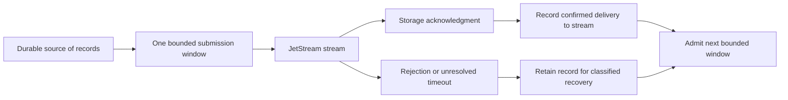

# Bound Async JetStream Publishers with Pending Limits and Publish Acks

Author: [nawazdhandala](https://www.github.com/nawazdhandala)

Tags: NATS, Messaging, Go

Description: Bound asynchronous JetStream publication, inspect every acknowledgment or error, and handle full streams without hiding failures or growing queues forever.

An asynchronous publisher can submit work faster than it can confirm storage. That is useful for throughput, until the application accumulates thousands of unresolved records or treats a completed batch as entirely successful.

There are two separate protections to build. Bound the amount of work waiting inside the publisher, and define what happens when the stream cannot accept more data. A client pending limit cannot reserve disk space or stop other publishers from filling the same stream.

This article uses the `jetstream` package in nats.go 1.42.0 with NATS Server 2.11.4. The examples were checked against a disposable local server. They demonstrate error handling and resource boundaries, not a production throughput target.

## Count unresolved publications, not calls made

A JetStream publication acknowledgment, or PubAck, confirms that the server accepted the publication into a stream. It does not mean downstream consumers processed the record. With asynchronous publishing, the initial call returns a future: an object from which you later obtain an acknowledgment or an error. See the [official publishing guide](https://docs.nats.io/learn/jetstream/publishing).



The source could be a transactional outbox: a database table containing records that still need publishing. Do not delete its rows just because the send call returned without an immediate error.

## Set both a pending limit and an acknowledgment timeout

Given an authenticated NATS connection named `nc`, create a publisher context like this:

```go
js, err := jetstream.New(nc,
    jetstream.WithPublishAsyncMaxPending(32),
    jetstream.WithPublishAsyncTimeout(2*time.Second))
if err != nil {
    return err
}
```

This fragment requires `time` and `github.com/nats-io/nats.go/jetstream`. It belongs in a function returning an error. The values are small lab choices: measure your acknowledgment latency and memory budget before selecting production values.

The pending option concerns outstanding asynchronous publications. The timeout bounds waiting for an acknowledgment; in this pinned version the async acknowledgment timeout is disabled unless configured. A per-publication `WithStallWait` separately bounds waiting when pending capacity is exhausted. These are different clocks, described by the [tagged publisher options](https://github.com/nats-io/nats.go/blob/v1.42.0/jetstream/jetstream_options.go).

Do not launch an unlimited goroutine per record around `PublishAsync`. Calls waiting for a slot still occupy application resources. One owner of a bounded submission window makes the amount of waiting work easier to reason about.

## Return an outcome for every record

The following helper accepts at most 32 records, each with a stable ID and at most 64 KiB of payload. It submits the window, then inspects every future. Add imports for `context`, `fmt`, `time`, and the `jetstream` package.

```go
type Record struct { ID string; Data []byte }
type Outcome struct { ID string; Ack *jetstream.PubAck; Err error }

func publishWindow(ctx context.Context, js jetstream.JetStream,
    subject string, records []Record) ([]Outcome, error) {
    if len(records) > 32 { return nil, fmt.Errorf("window exceeds 32 records") }
    for _, r := range records {
        if r.ID == "" || len(r.Data) > 64*1024 {
            return nil, fmt.Errorf("record needs an ID and at most 64 KiB")
        }
    }
    results := make([]Outcome, len(records))
    futures := make([]jetstream.PubAckFuture, len(records))
    for i, r := range records {
        results[i].ID = r.ID
        if err := ctx.Err(); err != nil {
            results[i].Err = fmt.Errorf("not submitted: %w", err)
            continue
        }
        future, err := js.PublishAsync(subject, r.Data,
            jetstream.WithMsgID(r.ID),
            jetstream.WithStallWait(25*time.Millisecond))
        if err != nil {
            results[i].Err = err
            continue
        }
        futures[i] = future
    }
    for i, future := range futures {
        if future == nil { continue }
        select {
        case ack := <-future.Ok():
            results[i].Ack = ack
        case err := <-future.Err():
            results[i].Err = err
        case <-ctx.Done():
            results[i].Err = fmt.Errorf("outcome unresolved: %w", ctx.Err())
        }
    }
    return results, nil
}
```

Call this helper sequentially, using a context with a deadline. A nil function error means the input passed validation; it does **not** mean every record succeeded. Inspect each returned `Outcome`. Only a non-nil `Ack` confirms storage. An individual `Err` requires classification and recovery.

An expired context stops further submissions and bounds the helper's wait. It does not cancel a publication already sent to the server. Do not mutate payload slices while their futures remain unresolved. Persist enough information to reconcile those records, and allow the configured async timeout to settle outstanding futures before reusing the publisher after an interrupted window.

The helper is deliberately not an outbox implementation. It does not persist results, schedule retries, or decide which business failures are permanent. Those decisions belong to the caller. The [pinned publishing implementation](https://github.com/nats-io/nats.go/blob/v1.42.0/jetstream/publish.go) supplies the future channels and pending/completion behavior used here.

## Completion is a boundary, not a success report

`PublishAsyncComplete()` gives a channel that closes once the publisher has no outstanding asynchronous work. Errors can also remove entries from the pending set. Consequently, waiting on that channel without collecting per-record errors can hide a partially failed batch.

In the local capacity test, the stream allowed one message and used `DiscardNew`. A two-record window produced one successful acknowledgment and one rejection. The completion channel still closed, and `PublishAsyncPending()` became zero. Neither signal meant both records had been stored.

During shutdown, stop accepting new work first. Finish collecting outcomes for the existing window within a deadline, persist unresolved records, and then close the connection. Connection flushing alone is not a replacement for a JetStream storage acknowledgment.

## Separate retryable pressure from unknown outcomes

| Result | Meaning for the caller | Response |
| --- | --- | --- |
| Valid PubAck | Stream accepted this publication | Mark this outbox delivery confirmed |
| `ErrTooManyStalledMsgs` | Pending capacity was unavailable within the stall wait | Slow admissions; retain the record |
| Stream capacity rejection | Stream rejected the publication under its limits | Investigate retention/capacity; avoid a tight retry loop |
| `ErrAsyncPublishTimeout` or caller deadline after submission | Storage outcome is not established by this caller | Reconcile or retry with the same stable ID |

The client errors are defined in [nats.go's tagged error definitions](https://github.com/nats-io/nats.go/blob/v1.42.0/jetstream/errors.go). Do not replace an unknown outcome with an invented success or permanent failure.

A stable message ID helps suppress duplicate publications within the stream's configured deduplication window. It is not a permanent ledger. Reuse the ID for the same logical record, keep its content stable, and retain downstream idempotency where repeated effects would be harmful.

## Protect storage as well as client memory

Choose stream limits and discard behavior explicitly. With `DiscardOld`, continued publishing may replace history the business still needs. With `DiscardNew`, new publications can fail when capacity is reached. Neither choice lets a publisher ignore the server's response. Review the [stream-limits guide](https://docs.nats.io/learn/jetstream/shaping-the-stream) alongside your required replay and outage windows.

The example caps each submission window's payload at two MiB: 32 times 64 KiB. That is not the total process allocation. Futures, headers, protocol buffers, retained source records, and retry bookkeeping consume additional memory. Bound the upstream queue too, including the number of windows waiting to run.

Track acknowledgment latency, pending publications, capacity rejections, unresolved timeouts, and the oldest unpublished source record. If storage latency rises, reduce admissions before simply expanding the pending cap. Rate limiting may also be necessary when several producers share the same stream and storage budget.

## Exercise failure paths before increasing throughput

The local tests checked the exact helper with a successful publication and a capacity rejection, input-size validation, and an already-canceled context. A separate two-slot publisher sent to a controlled subscriber that intentionally did not answer. Its third call reached the stall deadline, and the two outstanding futures later returned acknowledgment-timeout errors and cleared.

That unanswered-subscriber test exercises client timeout handling; it does not simulate slow disks. No disk exhaustion, cluster failover, packet loss, or throughput benchmark was performed. Repeat those relevant scenarios in your staging environment, and verify that rejected or unresolved records remain recoverable before increasing the window size.
