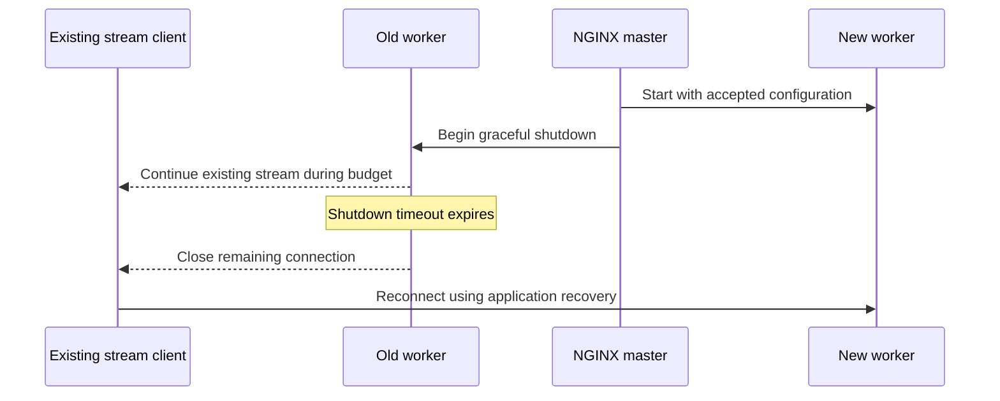

# Bound NGINX Graceful Reloads for WebSocket and SSE Connections

Author: [nawazdhandala](https://www.github.com/nawazdhandala)

Tags: Nginx, WebSocket, Performance

Description: Set an NGINX worker shutdown budget, test long-lived stream draining, and plan WebSocket and SSE recovery without confusing reloads with idle timeouts.

A configuration reload succeeds, new workers appear, and the old workers stay alive for hours. That can be normal when the old generation still owns WebSocket connections or server-sent event streams. Repeating the reload may create more draining generations instead of resolving the original one.

The operational choice is whether to wait indefinitely for those connections or end them after an agreed drain period. NGINX provides a worker shutdown timeout for the latter. The application then needs a recovery strategy for interrupted streams.

This guide uses NGINX 1.30.7. A local server-sent events test verified that an actively streaming connection ended after a configured shutdown budget, the old worker exited, and new requests continued through the replacement worker. WebSocket reconnection was not exercised in that fixture.

## Separate acceptance from completion

On reload, the master checks and applies the configuration, starts a new worker generation, and asks the previous workers to shut down gracefully. Old workers stop listening for new connections while finishing existing clients. That is the process described in [NGINX's reload documentation](https://nginx.org/en/docs/control.html).

A successful reload command therefore does not mean the previous workers have exited. Monitor both events: configuration acceptance and completion of draining. A deployment dashboard that checks only whether the master process is alive cannot distinguish them.

WebSocket is a bidirectional connection established through an HTTP upgrade. Server-sent events, or SSE, keep an HTTP response open so a server can deliver events over time. Neither necessarily has a natural ending soon after a deployment.



The reconnection arrow is an application responsibility. The proxy does not transfer the old connection's state into the new worker.

## Set the budget in the main context

Place this directive at the top level of the NGINX configuration, alongside `worker_processes`, not inside `http`, `server`, or `location`:

```nginx
worker_shutdown_timeout 30s;
```

The value is an example, not a recommended universal deadline. NGINX's [core documentation](https://nginx.org/en/docs/ngx_core_module.html#worker_shutdown_timeout) describes it as the graceful shutdown timeout for worker processes. When it expires, NGINX tries to close open connections to facilitate shutdown. Treat it as a connection-draining control, not an operating-system guarantee that every possible stuck process exits at an exact timestamp.

Choose a budget with the application owner. A thirty-second limit may be fine for a resumable event feed but unacceptable for a long-running operation with no recovery protocol. Inventory other traffic handled by the same workers: the deadline is not limited to the WebSocket location.

There is also a first-rollout detail. Existing workers retain the configuration they were started with. Adding a timeout now does not retroactively give an already-running worker generation that setting. The tagged [worker process code](https://github.com/nginx/nginx/blob/release-1.30.7/src/os/unix/ngx_process_cycle.c) schedules shutdown using its own cycle configuration. Plan the initial adoption separately if old workers have no deadline and persistent connections.

## Do not substitute an idle timeout

A read timeout measures a gap between upstream reads. A continuously active stream can remain alive even with a modest idle timeout. A worker shutdown budget instead starts when graceful shutdown begins.

For a staging SSE endpoint, this location makes the distinction visible:

```nginx
location /events {
    proxy_pass http://stream_origin;
    proxy_buffering off;
    proxy_read_timeout 60s;
}
```

Define `stream_origin` in your existing reviewed upstream configuration. Disabling response buffering helps deliver events promptly. The sixty-second read timeout is an illustrative idle allowance, not a sixty-second maximum response duration. Those behaviors are documented in the [proxy module reference](https://nginx.org/en/docs/http/ngx_http_proxy_module.html#proxy_read_timeout).

For an existing WebSocket service, preserve its upgrade configuration. A typical dedicated location includes:

```nginx
location /socket {
    proxy_pass http://stream_origin;
    proxy_http_version 1.1;
    proxy_set_header Upgrade $http_upgrade;
    proxy_set_header Connection "upgrade";
    proxy_read_timeout 60s;
}
```

The Upgrade and Connection headers require explicit forwarding, as described in [NGINX's WebSocket guide](https://nginx.org/en/docs/http/websocket.html). These settings establish and maintain the tunnel; they do not create a reconnection protocol or preserve application messages after closure.

## Rehearse one reload with an active stream

Use an isolated staging instance with the shutdown timeout present from startup. Have its SSE origin emit a harmless heartbeat frequently enough to stay well inside the read timeout. Open the stream before the reload and record the worker that owns it.

For a manual observation, this bounded command reads a local staging endpoint without client-side output buffering:

```bash
curl --noproxy '*' --no-buffer --connect-timeout 2 --max-time 45 \
  --show-error http://127.0.0.1:8080/events
```

Use the actual staging listener and path. The overall curl limit must exceed the chosen shutdown budget so it does not end the experiment first. An interrupted HTTP stream may make curl report a transfer error; that alone is not proof that draining failed. The flags are documented in the [curl manual](https://curl.se/docs/manpage.html).

Validate the intended configuration, then reload only the staging instance through its normal service mechanism. Record when new workers appear, when the old stream closes, and when the old worker exits. Also issue a separate ordinary request to confirm that the new generation is serving traffic.

The local fixture used a two-second shutdown budget, a thirty-second read timeout, and heartbeats every tenth of a second. After reload, the stream closed in about 2.1 seconds. The old worker disappeared, a new worker remained, and a health request succeeded. Since the origin kept sending data, the result was not explained by an idle read timeout.

## Recover application state deliberately

For SSE, browser EventSource supports reconnection and can send Last-Event-ID when events carry IDs. The server still needs a replay policy that interprets that ID and handles events no longer retained. These mechanics are described in the [HTML server-sent events specification](https://html.spec.whatwg.org/multipage/server-sent-events.html).

For WebSocket, define how a client reconnects, reauthenticates, and restores subscriptions. Add backoff with jitter so thousands of interrupted clients do not all reconnect at once. Decide how acknowledgments and sequence numbers distinguish delivered messages from messages that must be retried. A fresh TCP connection alone does not establish successful recovery.

Before production adoption, test a client that is actively transferring data, one that is idle, and one that reconnects while the new deployment is unhealthy. Check whether reconnecting causes duplicate actions or lost events. The local proxy test did not prove those application behaviors.

Finally, track draining worker count and age across several planned reloads. If old generations accumulate, investigate their configuration and connections instead of repeatedly reloading or killing every NGINX process. A bounded drain is useful when its interruption cost is understood and recovery has been demonstrated.
