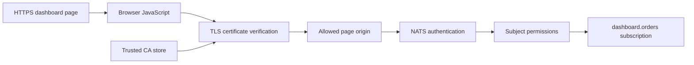

# Connect Browser Clients to NATS with TLS and Origin Controls

Author: [nawazdhandala](https://www.github.com/nawazdhandala)

Tags: NATS, WebSocket, TLS, JavaScript, Security

Description: Configure an authenticated NATS WebSocket listener, restrict browser origins, trust its TLS certificate, and bundle a pinned JavaScript client for a dashboard.

A browser cannot open an ordinary NATS TCP connection. It can connect through a WebSocket listener, where the same NATS operations travel inside WebSocket frames. That extra listener needs three separate controls: a trusted encrypted connection, an allowed website origin, and a NATS identity with narrow permissions.

None substitutes for the others. A trusted certificate does not authorize a dashboard to read every subject. An allowed origin does not authenticate the person using the page. Build and test each boundary independently.

This example pins **NATS Server 2.11.4** and **`@nats-io/nats-core` 3.5.0**. The older `nats.ws` repository is archived and points users to nats.js; the current core package exposes `wsconnect`. See the [official client repository](https://github.com/nats-io/nats.js/blob/v3.5.0/core/README.md) for the WebSocket transport.

## Plan the two public names

Assume the page is served from `https://dashboard.example.internal` and NATS accepts WebSockets at `wss://nats.example.internal:9443`. These are placeholders for names you control, not endpoints to contact as written.

The browser sends the page's origin, `https://dashboard.example.internal`, during the WebSocket handshake. It validates the server certificate against the destination name, `nats.example.internal`. Confusing these two names is a common reason a working TLS connection still fails the origin check.



The certificate's Subject Alternative Name, or SAN, must include the WebSocket destination hostname. Supply the leaf certificate and required intermediate chain on the server. For an internal certificate authority, distribute its root through the organization's managed browser or operating-system trust mechanism. Do not ask users to bypass certificate verification.

## Configure the listener and identity

This configuration excerpt assumes approved certificate files already exist and the server process receives `DASHBOARD_PASSWORD` through your secret-delivery mechanism. The dashboard user is a lab identity; production should issue identities scoped to the actual user or session instead of distributing one shared administrative secret.

```text
listen: "127.0.0.1:4222"

websocket {
  listen: "0.0.0.0:9443"
  same_origin: false
  allowed_origins: ["https://dashboard.example.internal"]
  tls {
    cert_file: "/etc/nats/tls/server-chain.pem"
    key_file: "/etc/nats/tls/server-key.pem"
  }
}

authorization {
  users: [
    {
      user: dashboard
      password: $DASHBOARD_PASSWORD
      permissions: {
        publish: { deny: [">"] }
        subscribe: { allow: ["dashboard.orders"] }
      }
    }
  ]
}
```

The ordinary TCP listener is loopback-only here. Apply network access restrictions to the WebSocket listener as well. The dashboard may subscribe to one subject and cannot publish application messages. Add other identities separately for trusted publishers; do not give their credentials to browser code.

`same_origin` is false because the website and WebSocket endpoint intentionally use different hosts. The explicit allowlist still limits browser origins. Enabling both controls is not a way to express “same origin OR this allowlist”: the [pinned server implementation](https://github.com/nats-io/nats-server/blob/v2.11.4/server/websocket.go) applies both checks when both are configured.

Validate with the matching server binary before starting or reloading the service:

```bash
# Requires the referenced certificates and secret environment variable.
nats-server -t -c /etc/nats/nats.conf
```

A successful configuration check catches parser and certificate-loading problems. It does not prove DNS, firewall access, browser trust, authentication, or origin behavior. The [WebSocket origin guide](https://docs.nats.io/learn/websocket/browsers-and-origins) explains why the Origin header protects browser access without replacing authentication.

## Bundle a pinned browser client

Run these commands in a separate frontend project, not in your NATS server directory. Retain the lockfile and serve the generated bundle from your own website.

```bash
npm install --save-exact @nats-io/nats-core@3.5.0
npm install --save-dev --save-exact esbuild@0.25.5
npx esbuild dashboard.js --bundle --format=esm --platform=browser \
  --outfile=public/dashboard.js
```

Save this as the input `dashboard.js`. It exports a function for your page's authenticated session flow. Replace the destination URL; supply the appropriate user credential in memory and a rendering function `onEvent`.

```javascript
import { wsconnect } from "@nats-io/nats-core";

export async function openDashboard(user, pass, onEvent) {
  const nc = await wsconnect({
    servers: ["wss://nats.example.internal:9443"],
    user, pass,
    name: "orders-dashboard",
    timeout: 5000,
    maxReconnectAttempts: 5,
  });
  const sub = nc.subscribe("dashboard.orders");
  const reader = (async () => {
    for await (const msg of sub) {
      onEvent(msg.string());
    }
  })();
  reader.catch(() => void nc.close());
  return {
    closed: nc.closed(),
    async stop() {
      await nc.drain();
      await reader;
    },
  };
}
```

The function returns lifecycle controls: observe `closed` for terminal errors, and call `stop()` during an intentional page-level disconnect. Handle connection rejection and event-rendering errors in the UI. Render untrusted event text as text, not HTML. A tab being killed cannot reliably finish an asynchronous drain, so do not make browser shutdown responsible for durable business delivery.

Credentials embedded in a downloadable bundle are visible to its users. Keep issuer/signing keys and administrative credentials on a trusted backend. This code accepts credentials to show the transport API; it does not implement issuance, expiration, renewal, or an authenticated backend endpoint.

## Understand what origin checking cannot prove

An origin consists of scheme, host, and port. A development page on another port is a different origin and needs an intentional additional allowlist entry. Do not replace the allowlist with unrestricted access just to accommodate an unexplained development failure.

A non-browser client can omit or fabricate Origin. Server 2.11.4 accepts a missing Origin header through this check, then still performs NATS authentication. That is expected behavior, not evidence that the password requirement disappeared. Origin is useful against unauthorized browser pages; it is not a client identity.

Browser JavaScript also cannot arbitrarily set the handshake's Origin header. Fix the server's intended allowlist or the page's deployment address instead of looking for a client option that spoofs it.

## Diagnose failures in layers

| Observation | Check first |
| --- | --- |
| Certificate error before WebSocket opens | SAN, intermediate chain, client trust and expiry |
| Upgrade rejected for one website | Actual page origin, including scheme and port |
| Socket opens, then NATS rejects connection | Issued identity, credential validity and account |
| Connected but no events | Subject permission, publisher account and exact subject |
| Works initially, fails after reconnect | Advertised addresses reachable by the browser |

If a reverse proxy sits in front, it must support WebSocket upgrades and appropriate idle timeouts. Advertised addresses must point clients at reachable WebSocket endpoints rather than private TCP ports. The [TLS and proxy guide](https://docs.nats.io/learn/websocket/tls-and-proxies) covers that topology; this example terminates TLS directly in NATS.

The local test bundled the exact JavaScript module for browsers and exercised the pinned client's WebSocket transport from Node. Trusted TLS, an allowed origin, authentication, and message delivery succeeded. A disallowed origin, wrong password, and untrusted certificate were rejected. A missing Origin succeeded with valid authentication. No real browser session, reverse proxy, or production identity service was tested; include those in deployment acceptance before exposing the dashboard.
