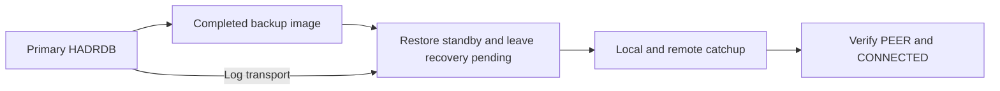

# Build a Db2 HADR Pair from Backup to PEER State

Author: [nawazdhandala](https://www.github.com/nawazdhandala)

Tags: Database, SQL, High Availability

Description: Initialize a Db2 HADR standby from backup, configure reciprocal endpoints, start the pair safely, and verify PEER state with monitoring evidence.

Db2 High Availability Disaster Recovery, or HADR, sends database logs from a primary database to a standby that replays them. Getting the two servers to connect is only one milestone. A useful setup procedure also establishes compatible database copies, correct endpoints, and evidence that catchup has completed.

This guide uses **Db2 LUW 11.5**, two separate hosts, one database partition, and one principal standby. It covers manual initialization through `PEER` state. Automatic failover, client routing, and takeover testing are separate work.

## Define the pair before running commands

The examples use the following placeholders:

| Setting | Primary | Standby |
| --- | --- | --- |
| Host | `db2-a.example.internal` | `db2-b.example.internal` |
| Instance | `db2inst1` | `db2inst1` |
| Database | `HADRDB` | `HADRDB` |
| HADR port | `55001` | `55001` |
| Synchronization mode | `SYNC` | `SYNC` |

Replace these values with the approved environment. Both servers need resolvable, mutually reachable endpoints and dedicated HADR ports. IBM's [local service reference](https://www.ibm.com/docs/en/db2/11.5.x?topic=parameters-hadr-local-svc-hadr-local-service-name) prohibits using the client service port, its next port, or the SSL client service port for HADR. Separate hosts can use the same HADR port number.

Use a protected network and the organization's required transport security. These endpoint examples do not configure HADR TLS certificates. Do not expose the database replication port publicly simply to get a connection test to pass.

IBM's [HADR restrictions](https://www.ibm.com/docs/en/db2/11.5.x?topic=support-restrictions) require compatible operating-system and Db2 levels and matching bitness, with specific exceptions for rolling upgrades. HADR is not supported in a Database Partitioning Feature environment. Confirm these prerequisites rather than treating a two-host example as a universal topology.

## Prepare recoverable logging and an initial image

The existing primary must use recoverable logging. If it currently uses circular logging, plan the logging transition and required backup separately. Check archive health, storage capacity, and retention before starting a standby that may need older logs to catch up.

IBM's [initialization procedure](https://www.ibm.com/docs/en/db2/11.5.x?topic=availability-initializing-hadr) starts from a backup of the intended primary. In an authorized primary-host Db2 command environment, with an already provisioned backup directory:

```bash
db2 backup db HADRDB online \
  to /srv/hadr-seed/run01 include logs without prompting
```

This is a state-changing backup operation with storage and performance costs. Review completion output, validate the complete image set, and transfer every image piece through the approved process. Keep the returned timestamp and preserve the logs needed from that backup through standby catchup.

The [BACKUP DATABASE reference](https://www.ibm.com/docs/en/db2/11.5.x?topic=commands-backup-database) defines the options and required authority. Backup completion is not evidence that the standby has started replication.



## Restore the standby without finalizing recovery

Use an unused standby destination with no application traffic. This example assumes the image's storage paths are valid and exclusively allocated on the standby host. If storage paths must change, review a redirected restore first.

Replace the backup timestamp and paths, then run on the **standby host only**:

```bash
db2 "restore db HADRDB \
  from /srv/hadr-seed/run01 \
  taken at 20261120010000 \
  logtarget /srv/hadr-seed/extracted/run01 \
  newlogpath /srv/db2/hadr-active"
```

The extraction directory must exist and be writable. The active-log destination must be dedicated to this database on this host. Preserve Db2's generated partition and stream directory structure.

Do not complete this database as a standalone clone. In particular, do not issue `ROLLFORWARD ... STOP` after the restore. The [START HADR reference](https://www.ibm.com/docs/en/db2/11.5.x?topic=commands-start-hadr) requires a standby copy in rollforward-pending or rollforward-in-progress state. HADR will manage replay after startup.

Keep the primary's required logs available. Included logs cover initialization needs for the image; ongoing primary activity can create additional catchup requirements while transfer and setup are in progress.

## Configure reciprocal endpoints explicitly

On the **primary**:

```bash
db2 "update db cfg for HADRDB using \
  HADR_LOCAL_HOST db2-a.example.internal \
  HADR_LOCAL_SVC 55001 \
  HADR_REMOTE_HOST db2-b.example.internal \
  HADR_REMOTE_SVC 55001 \
  HADR_REMOTE_INST db2inst1 \
  HADR_TARGET_LIST db2-b.example.internal:55001 \
  HADR_SYNCMODE SYNC"
```

On the **standby**:

```bash
db2 "update db cfg for HADRDB using \
  HADR_LOCAL_HOST db2-b.example.internal \
  HADR_LOCAL_SVC 55001 \
  HADR_REMOTE_HOST db2-a.example.internal \
  HADR_REMOTE_SVC 55001 \
  HADR_REMOTE_INST db2inst1 \
  HADR_TARGET_LIST db2-a.example.internal:55001 \
  HADR_SYNCMODE SYNC"
```

The local settings describe the machine running the command. Remote settings describe its partner. If instance names differ, each `HADR_REMOTE_INST` must name the other host's instance.

Use reciprocal target lists even for this simple pair. IBM describes the older single-standby method without a target list as deprecated. The [configuration guide](https://www.ibm.com/docs/en/db2/11.5.x?topic=hadr-database-configuration) explains endpoint relationships and when parameters become effective.

`SYNC` is a deliberate example choice, not a universal performance recommendation. In peer state it requires the relevant log writes on both primary and standby before successful acknowledgment. Review the latency and durability tradeoff in the [synchronization-mode reference](https://www.ibm.com/docs/en/db2/11.5.x?topic=dcp-hadr-syncmode-hadr-synchronization-mode-log-writes-in-peer-state).

## Start the standby first, then the primary

On the standby:

```bash
db2 start hadr on db HADRDB as standby
```

Then, on the primary:

```bash
db2 start hadr on db HADRDB as primary
```

Do not add `BY FORCE` as a connection troubleshooting shortcut. Correct endpoint, compatibility, and log-chain problems first.

The standby startup is asynchronous: the command can return before it connects, and a later rejection can shut down the standby. IBM explains this in its [HADR command behavior](https://www.ibm.com/docs/en/db2/11.5.x?topic=management-hadr-commands). Preserve command results and inspect diagnostics on both hosts.

## Verify the state rather than the startup message

From an authorized SQL connection to the **primary**, run:

```sql
SELECT HADR_ROLE, STANDBY_ID, HADR_STATE,
       HADR_CONNECT_STATUS, HADR_SYNCMODE
FROM TABLE(SYSPROC.MON_GET_HADR(-2)) AS H;
```

[`MON_GET_HADR`](https://www.ibm.com/docs/en/db2/11.5.x?topic=mmr-mon-get-hadr-get-high-availability-disaster-recovery-hadr-monitoring-information) returns the effective role, connection, and replication state. For this single principal standby, look for `PRIMARY`, standby ID `1`, `PEER`, `CONNECTED`, and the selected mode.

On either host, authorized instance diagnostics can inspect HADR without requiring a standby SQL connection:

```bash
db2pd -db HADRDB -hadr
```

The [db2pd reference](https://www.ibm.com/docs/en/db2/11.5.x?topic=commands-db2pd-monitor-troubleshoot-db2-engine-activities) documents this output. Ordinary clients cannot connect to the standby unless reads-on-standby is enabled; do not mistake that restriction for failed replication.

Catchup states during initialization are expected. Track progress and investigate persistent disconnection or missing logs. IBM's [standby-state guide](https://www.ibm.com/docs/en/db2/11.5.x?topic=management-determining-hadr-standby-database-state) also explains why auxiliary standbys in larger configurations do not reach `PEER`; that exception is outside this pair's acceptance criteria.

## Record what PEER does and does not prove

Capture repeated state observations under an approved workload, review diagnostics, and confirm the standby remains healthy. `PEER` establishes a replication milestone. It does not prove automatic failover, client reconnection, or that every non-logged change is replicated.

Keep normal backups: HADR can propagate unwanted logged changes as well as useful ones. Plan a separate controlled takeover exercise and document ownership of monitoring and recovery decisions.

The examples were checked against official documentation and local shell syntax. No Db2 servers were available, so backup, restore, HADR startup, catchup, and peer-state behavior were not executed for this article.
