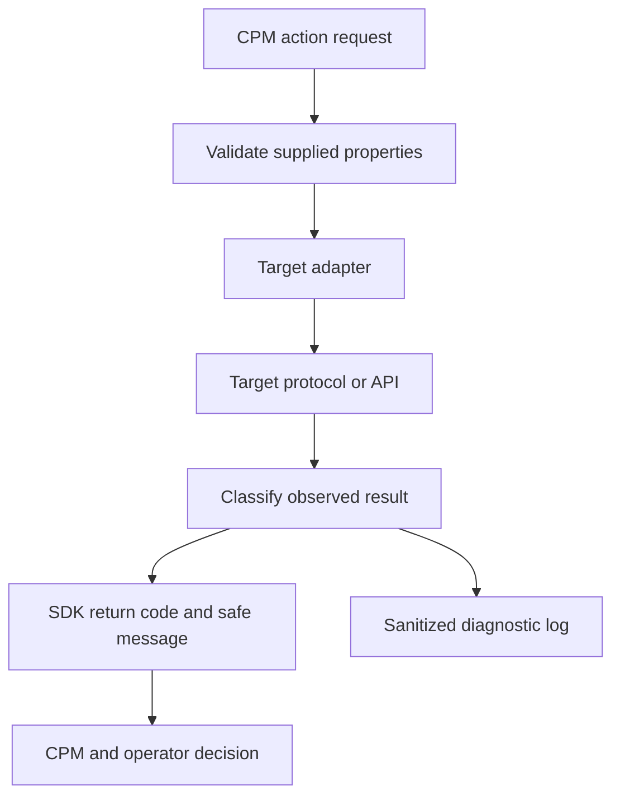

# Build and Debug a Custom CyberArk CPM Plugin

Author: [nawazdhandala](https://www.github.com/nawazdhandala)

Tags: CyberArk, Security, Software Development

Description: Design a custom CPM plugin around explicit actions, bounded target operations, useful errors, and staged manual testing before integrating it with CyberArk.

An unsupported target does not become safe to rotate just because a script can change its password once. A CPM plugin must distinguish authentication failure from network failure, handle uncertain outcomes, and report enough information for an operator to recover without exposing credentials.

This guide uses CyberArk's Credentials Management .NET SDK workflow. It explains the integration points and manual test setup; the target-specific transport still must be implemented against that target's official API or protocol. It is not a ready-made plugin for an unnamed product.

## Choose and freeze the supported extension path

Check for an existing supported integration first. For a REST-based target, also assess the vendor's [REST API infrastructure](https://docs.cyberark.com/plugins-pam-sh/latest/en/pam-sh/plugins/cpm-plugins-rest-api-infrastructure/) before writing a custom assembly. A command-prompt-driven device may be better suited to the terminal-plugin tooling.

For the .NET route, record the CPM/PVWA build, SDK package, chosen runtime, target software version, and development tools. The current [SDK prerequisite page](https://docs.cyberark.com/plugins-pam-sh/latest/en/pam-sh/pasimp/plug-in-netinvoker/) specifies PVWA 15.2 or later and requires Visual Studio 2022 version 17.8 or later for its .NET 8 SDK. Do not mix a .NET Framework template with .NET 8 binaries because both happen to be called SDK plugins.

Keep this compatibility record with the source and build output. The examples below describe the documented manual harness; no proprietary SDK assembly was built or executed for this article.

## Define the action contract before coding

Write a contract for each supported operation:

| Action | Required proof |
|---|---|
| Verify | The current target credential authenticates to the intended account. |
| Logon | The prerequisites for changing that credential are satisfied. |
| Change | The requested replacement was accepted and the outcome can be established. |
| Prereconcile | The recovery identity can authenticate for the intended recovery path. |
| Reconcile | The authorized reset completed for the correct target account. |

The SDK maps these to `verifypass`, `logon`, `changepass`, `prereconcilepass`, and `reconcilepass`. Its [project-structure guide](https://docs.cyberark.com/plugins-pam-sh/latest/en/pam-sh/pasimp/plug-in-netinvoker_project-structure/) describes the action classes and a shared `BaseAction` for common functionality.

Use a transport layer that can be tested independently from the CPM wrapper. It should know how to connect, authenticate, submit a change, and interpret the target's response. The wrapper should translate that result into the SDK's action result rather than scattering target-specific parsing across every action.



## Implement the SDK boundary precisely

Start from the appropriate vendor template. Reference the matching `CyberArk.Extensions.Utilties.dll` and `CyberArk.Extensions.Plugins.Models.dll` from the supported engine, preserve the required constructor, and add the action classes. Compile without unresolved references or warnings that conceal compatibility problems.

Action registration differs by runtime: the .NET Framework path uses the `ActionName` property, while .NET 8 uses a `CPMAction` attribute. The action's `run` method supplies the result. The [action implementation reference](https://docs.cyberark.com/plugins-pam-sh/latest/en/pam-sh/pasimp/plug-in-netinvoker_implement-action/) defines zero as success, documents error codes 8800–8900, and exposes the operator message through `platformOutput.Message`.

Create a small error catalog inside that documented range. For example, reserve separate codes for invalid configuration, failed authentication, target policy rejection, and an indeterminate change result. These are your plugin's meanings, not existing universal CyberArk codes. Ensure the platform configuration and operational runbook interpret them consistently.

Do not return success because a request was sent. Some APIs acknowledge a queued job before the password changes. Follow the target's documented completion mechanism, with bounded timeouts and a clear outcome when completion cannot be established.

## Handle secrets and uncertain outcomes deliberately

Use the SDK's account objects. Its [property reference](https://docs.cyberark.com/plugins-pam-sh/latest/en/pam-sh/pasimp/plug-in-netinvoker_access/) separates `CurrentPassword`, `NewPassword`, account properties, platform properties, and linked accounts. This prevents accidental reuse of the managed password where the reconcile credential is required.

Validate the endpoint, username, required properties, and operation before opening a connection. Use the SDK's validation and secret-handling utilities where applicable. Avoid converting a secure value to an ordinary string earlier than the target client requires, and never include passwords, bearer tokens, or complete authentication responses in logs.

A timeout after sending a password update is especially important. The target might have accepted the change even though the client missed the response. Do not automatically replay the operation unless the target's documented semantics make that safe. Report the uncertain state and follow the approved verification or reconciliation procedure.

## Prepare a disposable manual-test account

Use a lab account with no production consumers. Assemble the invoker and its dependencies according to the chosen runtime. The vendor's [manual-test instructions](https://docs.cyberark.com/plugins-pam-sh/latest/en/pam-sh/pasimp/plug-in-netinvoker_test/) list different dependencies for .NET Framework and .NET 8.

The following `user.ini` illustrates the required identity metadata and password fields. `address` is an example property your adapter must explicitly consume. Replace placeholders only in a restricted local lab file, never in source control.

```ini
[targetaccount]
username=REPLACE_LAB_USER
address=REPLACE_LAB_ENDPOINT
password=REPLACE_CURRENT_LAB_PASSWORD
newpassword=REPLACE_NEW_LAB_PASSWORD
safename=PluginLab
foldername=Root
objectname=DisposableTarget
PolicyID=AcmeRotationLab
ManagementType=password
```

From the test directory containing the matching invoker, dependencies, and your built assembly, run Verify first:

```powershell
& .\CANetPluginInvoker.exe .\user.ini verifypass .\AcmeRotation.dll True
```

Here `AcmeRotation.dll` is your compiled plugin filename, not a supplied product component. Inspect the result and logs before proceeding. The manual flag enables the documented test mode; it does not make target operations non-mutating.

For a separately approved Change test, run `logon` and then `changepass`, inspecting the first result before invoking the second. Reconcile testing similarly uses `prereconcilepass` and `reconcilepass`, with the approved recovery account in the documented `[extrapass3]` section. Update the fixture's current-password value after a successful rotation. Remove filled secret fixtures when the lab session ends.

## Debug failure classes rather than only the happy path

Test invalid credentials, an unavailable endpoint, an untrusted certificate, policy rejection, malformed responses, and timeout after submission. For each case, assert the action result, operator message, target-side state, and absence of secrets in diagnostic output. Use a controllable mock target for transport tests, then repeat the relevant cases against the supported real target.

The SDK's [logger reference](https://docs.cyberark.com/plugins-pam-sh/latest/en/pam-sh/pasimp/plug-in-netinvoker_utilities_logger/) places plugin logs under `Logs/ThirdParty` and documents the platform Debug setting. Log the action, stage, correlation identifier, elapsed time, and sanitized target error. A message such as “change rejected by target policy” is more useful than “operation failed,” while still avoiding sensitive payloads.

Finally, test through an isolated CPM platform and restricted Safe. Manual invocation does not validate scheduling, Vault property mapping, service identity, or dependency handling. Retain the previous package and platform export for code rollback, but remember that reverting plugin code does not restore a password already changed on the target.

Release only when the action matrix, failure cases, and recovery procedure are demonstrated. The deliverable is both a versioned plugin and enough evidence to explain its behavior when a rotation does not complete normally.
