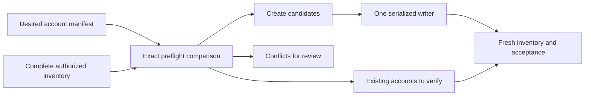

# Bulk-Onboard CyberArk Accounts with Safe, Repeatable Runs

Author: [nawazdhandala](https://www.github.com/nawazdhandala)

Tags: CyberArk, REST API, Automation

Description: Make CyberArk account onboarding repeatable with exact identity checks, paginated inventory, conflict detection, a pinned utility, and recovery from uncertain writes.

A bulk import is not finished when every CSV row has been submitted. It is finished when every intended account exists exactly once with the expected identity and configuration, and the next run makes no unnecessary changes.

That property is called idempotency: repeating the operation should converge on the same intended state. A search followed by a create request does not provide that guarantee by itself. Another importer can create the account between those steps, and a timeout can hide a successful server-side write.

This guide combines a reviewed CyberArk REST utility with an explicit preflight and verification process. Local tests cover the planner and the utility's account lookup with simulated responses. No live PVWA account was created.

## Define account identity before writing code

Choose a stable naming convention and decide which fields distinguish accounts in your estate. For a simple password account, useful fields include Safe, object name, target address, target username, and platform ID. Database names, ports, or other platform properties may be required to distinguish additional cases.

Do not automatically lowercase every value. DNS hostnames and operating-system usernames do not necessarily have the same comparison rules. This tutorial uses exact comparisons and sends spelling differences for review. Establish any normalization policy separately and apply it consistently to both the desired manifest and the inventory.

A useful decision table is:

| Current state | Action |
|---|---|
| No exact name or target identity match | Candidate for creation |
| One account matches the full selected identity | No-op, then verify remaining desired properties |
| Same name but different address, user, or platform | Conflict; stop that row |
| Same target identity under another name | Conflict; review before creating |
| More than one matching account | Ambiguous; do not choose the first |

Keep the import identity separate from the managed account's secret. The planner should not need to retrieve existing passwords to establish whether an account already exists.

## Inventory all pages before declaring an account absent

Obtain an authorized inventory of the affected Safes. It must include all pages, not only the first response. A missing account on page one is not evidence that a new POST is necessary.

CyberArk's official [Get Accounts script](https://github.com/cyberark/epv-api-scripts/blob/b75e88768143fbfeb065aa7d47afe4e0c30ec3e1/Get%20Accounts/Get-Accounts.ps1) follows `nextLink` and accumulates `value` entries. Use an approved authenticated client that preserves certificate verification and has visibility into every affected Safe. A permission-limited inventory can create a false absence even when pagination is correct.

Check the inventory count, query scope, retrieval time, and any failed page. If retrieval is incomplete, stop planning. Do not continue with the partial list and call it a successful empty result.



## Use a small planner that rejects ambiguous matches

The following Python 3 function operates on dictionaries using the REST property names. `existing` must be the complete inventory assembled above. The function is a planning helper, not an HTTP client or a uniqueness constraint in the Vault.

```python
IDENTITY = ("safeName", "name", "address", "userName", "platformId")
TARGET = ("safeName", "address", "userName", "platformId")

def classify(desired, existing):
    if any(not isinstance(desired.get(k), str) or not desired[k]
           for k in IDENTITY):
        raise ValueError("Missing required identity field")
    same_name = [a for a in existing
                 if a.get("safeName") == desired["safeName"]
                 and a.get("name") == desired["name"]]
    same_target = [a for a in existing
                   if all(a.get(k) == desired[k] for k in TARGET)]
    candidates = {a["id"]: a for a in same_name + same_target}
    if not candidates:
        return "create", None
    if len(candidates) != 1:
        raise ValueError("Ambiguous existing accounts")
    account = next(iter(candidates.values()))
    if any(account.get(k) != desired[k] for k in IDENTITY):
        raise ValueError("Existing account conflicts with desired identity")
    return "verify", account["id"]
```

The `verify` result intentionally does not mean “everything matches.” Compare the additional platform properties and management settings your manifest owns. If they differ, produce a separate reviewed update plan. Do not turn the creation job into an automatic secret replacement job.

Before processing rows, reject duplicate names and duplicate target identities within the input itself. Extend `TARGET` before using this helper for accounts distinguished by database, port, or another property. Otherwise, it deliberately stops those cases as conflicts rather than guessing.

## Pin the executor and prepare the CSV deliberately

For the actual write step, this example uses CyberArk's [Account Onboard Utility](https://github.com/cyberark/epv-api-scripts/blob/b75e88768143fbfeb065aa7d47afe4e0c30ec3e1/Account%20Onboard%20Utility/Accounts_Onboard_Utility.ps1), script version **2.6.1** at commit `b75e88768143fbfeb065aa7d47afe4e0c30ec3e1`. Review and obtain that revision through your approved software intake process.

Its CSV fields include `name`, `username`, `address`, `safe`, `platformID`, `password`, `EnableAutoMgmt`, and `ManualMgmtReason`. Notice that CSV `safe` maps to REST `safeName`. Use only the reviewed creation candidates, and prepare existing Safes, platform definitions, and required permissions first.

From the directory containing the reviewed script, this invocation creates accounts without creating Safes and skips accounts the utility finds already present:

```powershell
& .\Accounts_Onboard_Utility.ps1 `
    -PVWAURL 'https://REPLACE_PVWA_FQDN/PasswordVault' `
    -CsvPath '.\REPLACE_APPROVED_ACCOUNTS.csv' `
    -Create -NoSafeCreation -SkipDuplicates -DisableAutoUpdate
```

The utility's [parameter documentation](https://github.com/cyberark/epv-api-scripts/blob/b75e88768143fbfeb065aa7d47afe4e0c30ec3e1/Account%20Onboard%20Utility/README.md) describes these switches. Keep account searching enabled, use valid server trust, and avoid bypass options. The command is a write operation, not a dry run.

A password-bearing CSV is sensitive even if the importer masks selected log messages. Restrict the input file, output records, working directory, and logs; do not place them in source control. Avoid verbose or debug capture of secret-bearing operations. Use the approved retention and cleanup process after verification.

For an initial validation cohort, explicitly choose whether automatic management starts immediately or remains disabled with a documented reason. Do not rely on an omitted field to express your rollout policy. A successfully created object can otherwise start password work before its dependencies are ready.

## Handle interruptions as uncertain state

Run one writer for the import scope and prevent overlapping manual or automated onboarding. A process-local lock does not coordinate another workstation; use the organization's shared job-control mechanism.

If a create request times out, record the row as **unknown**, not failed or absent. The server may have committed it before the response was lost. Refresh the inventory and rerun the exact comparison before deciding what happens next. A single empty result after an ambiguous write is insufficient justification for another POST; investigate until the outcome is established.

Similarly, a duplicate or conflict response should trigger a read and comparison. It is not automatically success. If the existing object differs, preserve the evidence and stop that row. Do not repair the situation by deleting an account that may already be in use.

The utility's skip result is an execution detail. Your preflight, single-writer control, and post-write verification supply the stronger operational guarantee. They still depend on correct scope and complete visibility.

## Prove that the next run is harmless

After importing a small cohort, refresh all relevant pages and compare every row again. Record account IDs, intended identity, selected non-secret settings, and outcome. Confirm that the second plan proposes zero creates and zero unapproved changes.

Test the workflow with an existing exact match, a same-name conflict, a duplicate input row, a match on a later page, and an interrupted request whose write succeeded. These cases reveal errors that a clean first-time import cannot expose.

Finally, exercise the intended account workflow on approved test targets and expand in measured groups. Keep counts for created, verified, conflicted, unknown, and failed rows separately. A repeatable import is one whose remaining work is explicit and whose rerun cannot silently overwrite an existing account's meaning.
