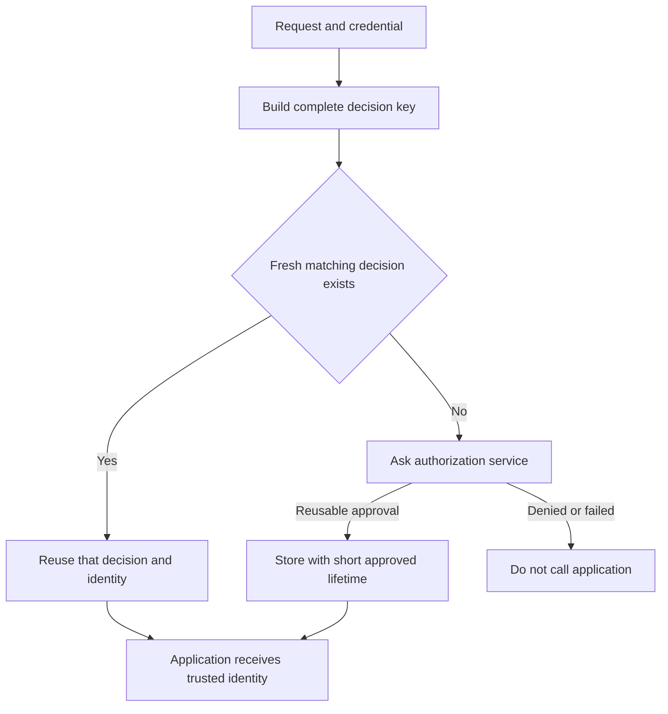

# Cache NGINX auth_request Decisions Without Mixing Users

Author: [nawazdhandala](https://www.github.com/nawazdhandala)

Tags: Nginx, Caching, Security

Description: Scope cached NGINX authorization decisions to credentials and request context, protect sensitive cache keys, and test isolation plus revocation delay.

Caching an authorization response can reduce calls to an authentication service. It can also turn one user's approval into another user's access if the cache key identifies only the auth endpoint. Most requests use the same internal URL, so `/auth` alone says almost nothing about which decision may safely be reused.

Treat the cached object as a decision with inputs: credential, destination, operation, resource, and any other policy context. Reuse is appropriate only when those inputs match and the decision is still valid.

This guide uses NGINX 1.30.7 and a purpose-built authorization fixture. It covers a narrow bearer-credential API contract, not browser sessions, multi-factor challenges, or arbitrary OAuth2 Proxy responses.

## Decide whether caching is acceptable

Start with the required revocation behavior. If a disabled credential must stop working immediately, a time-based positive decision cache may not meet the requirement. A short lifetime limits the delay but does not eliminate it.

The auth service must explicitly permit reuse for the chosen duration. That duration must not exceed the credential's remaining validity or the policy's acceptable revocation delay. If the service cannot calculate a safe lifetime, leave caching disabled.

The example assumes authorization depends only on the bearer credential, original method, host, and full request URI. Cookies cause a bypass. Body-dependent permissions, client IP rules, tenant headers, or changing device posture require a different contract and additional inputs. Do not deploy the example unchanged when those factors affect access.

## Protect the cache itself

A credential in a cache key is sensitive even when the cache filename looks like a hash. NGINX's [1.30.7 file-cache implementation](https://github.com/nginx/nginx/blob/release-1.30.7/src/http/ngx_http_file_cache.c) writes key material into cache files. Restrict directory access, backups, debug output, and operational tooling accordingly.

The example below uses the full Authorization field so the isolation rule is visible. Run it only where your security policy permits credential-bearing cache storage. If that is unacceptable, use a reviewed credential-digest implementation or move decision caching into the auth service. Do not replace the credential with a client-supplied user name: that trades a storage concern for an authorization flaw.

## Key the decision by its actual inputs

Place the following fragment inside `http`. Create the cache directory through your deployment's secret-aware storage process, and replace the loopback ports with your reviewed endpoints.

```nginx
proxy_cache_path /var/cache/nginx/auth-decisions
    keys_zone=auth_decisions:10m max_size=50m inactive=1m;

map $http_authorization $missing_credential {
    default 0;
    ""      1;
}

map $upstream_status $dont_store_auth {
    default 1;
    202     0;
}

server {
    listen 127.0.0.1:8080;

    location = /_auth {
        internal;
        proxy_pass http://127.0.0.1:4180/auth;
        proxy_pass_request_body off;
        proxy_set_header Content-Length "";
        proxy_set_header X-Original-URI $request_uri;
        proxy_set_header X-Original-Method $auth_method;
        proxy_set_header X-Original-Host $host;

        proxy_cache auth_decisions;
        proxy_cache_key "$scheme\n$host\n$auth_method\n$request_uri\n$http_authorization";
        proxy_cache_valid 202 2s;
        proxy_cache_bypass $missing_credential $http_cookie;
        proxy_no_cache $missing_credential $http_cookie $dont_store_auth;
        proxy_cache_use_stale off;
        proxy_cache_background_update off;
    }

    location /private/ {
        set $auth_method $request_method;
        auth_request /_auth;
        auth_request_set $auth_user $upstream_http_x_auth_request_user;
        proxy_set_header X-User $auth_user;
        proxy_set_header Authorization "";
        proxy_pass http://127.0.0.1:8081;
    }
}
```

The main request captures its method before authorization. `$request_uri` retains the original URI, including arguments; it does not collapse all decisions onto the internal `/_auth` location. Newline separators keep the key fields distinct. Do not log the resulting key.

The [map module](https://nginx.org/en/docs/http/ngx_http_map_module.html) derives the missing-credential and storage-decision flags. A missing credential or any cookie bypasses reads and prevents writes. Only a 202 auth response is eligible for storage in this example. The service still needs to reject malformed or invalid credentials; the cache does not validate them.

The [auth_request module](https://nginx.org/en/docs/http/ngx_http_auth_request_module.html) permits access on 2xx responses and captures identity headers after the subrequest completes. A cached approval therefore includes the identity headers associated with that approval. Application permissions must not rely on other client-supplied identity fields.

## Make the auth service's response policy explicit

For a reusable approval, the lab auth service sends:

```http
HTTP/1.1 202 Accepted
Cache-Control: public, max-age=2
X-Auth-Request-User: alice
```

Here `public` deliberately permits caching despite the Authorization request header. It is appropriate only for this internal decision endpoint with a credential-specific key. It is not an instruction to publicly cache authenticated application pages.

The two-second value is a lab example. Origin response cache headers can override `proxy_cache_valid`; the directive is not an absolute ceiling. Keep the auth service's response policy aligned with the approved lifetime. Never ignore `Cache-Control`, `Set-Cookie`, or related cache restrictions merely to force a hit. These behaviors are documented in the [NGINX proxy cache reference](https://nginx.org/en/docs/http/ngx_http_proxy_module.html#proxy_cache_valid).

The fixture returns `Cache-Control: no-store` on denials. Stale use and background updates are explicitly disabled because an expired authorization approval should not silently continue while a new decision is pending.



## Test identity, resource, and time boundaries

Use two synthetic credentials with distinct identities and an auth service that counts calls. Avoid real tokens in test logs. First send Alice's request twice: both should identify Alice, while the second avoids another auth call. Then send Bob's request to the same URI and require a separate decision with Bob's identity.

Next, keep Alice's credential but change to a denied resource. If the cached approval is reused, the key or policy contract is incomplete. Repeat requests without credentials and confirm they are checked rather than sharing an anonymous approval.

The local NGINX 1.30.7 test passed those checks. Alice's repeated URI used one auth call; Bob caused another; Alice's denied URI caused its own rejection. Two requests without credentials both reached the auth fixture and were denied.

The test then revoked Alice in the fixture. Before expiry, the existing cached approval still allowed her request. After waiting beyond the two-second lifetime, the next request consulted the auth service and was denied. This observed delay is part of the design, not a bug to conceal in a hit-rate report.

Before rollout, also test method changes, cookies, credential expiry, auth-service failure, and any extra policy input your application uses. The local fixture did not cover those additional dimensions. Measure saved auth calls alongside wrong-identity checks and revocation latency. If the required correctness cannot be expressed confidently in the key and lifetime, keep the authorization request uncached.
