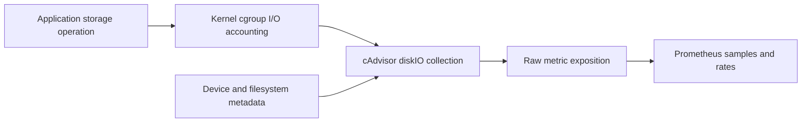

# Diagnose Missing cAdvisor Disk I/O Metrics

Author: [nawazdhandala](https://www.github.com/nawazdhandala)

Tags: Docker, Linux, Monitoring

Description: Distinguish disk I/O counters from filesystem usage, trace cgroup accounting and device identity, and test a small staging write without destructive benchmarks.

A container can use disk space while cAdvisor reports no disk I/O series. That is not necessarily a contradiction. Space usage, application reads and writes, and block-device accounting measure different things and follow different collection paths.

Before adding mounts or changing privileges, identify the exact metric that disappeared. Then determine whether the kernel produced corresponding accounting, whether cAdvisor collected it, and whether Prometheus retained it. This guide uses cAdvisor 0.55.1 source and a Linux cgroup v2 host as the concrete reference.

## Start with the metric, not the panel title

A dashboard labeled “disk usage” may display bytes stored, bytes transferred, operations, or a calculated rate. These are not interchangeable:

| Metric or observation | What it represents |
| --- | --- |
| `container_fs_usage_bytes` | Reported filesystem usage |
| `container_fs_reads_bytes_total` | Cumulative accounted read bytes |
| `container_fs_writes_bytes_total` | Cumulative accounted write bytes |
| `rate(container_fs_writes_bytes_total[5m])` | Average accounted write bytes per second over a window |
| Application write-call bytes | Bytes submitted by application code, before considering storage behavior |

In cAdvisor 0.55.1, the read/write byte counters come from disk I/O statistics and belong to the `diskIO` metric group. Filesystem usage belongs to a separate group. Enabling `disk` alone does not enable every I/O counter. [Versioned metric implementation](https://github.com/google/cadvisor/blob/v0.55.1/metrics/prometheus.go).

Also inspect raw counters before rates. A newly discovered series needs enough samples for a rate calculation; a missing rate is not proof that the exporter omitted the counter. [Prometheus rate function](https://prometheus.io/docs/prometheus/latest/querying/functions/#rate).

## Record the actual storage path

On the intended Docker host, inspect the daemon and the affected container:

```sh
docker info --format 'Root={{.DockerRootDir}} Driver={{.Driver}} Cgroup={{.CgroupVersion}}'
docker inspect --format '{{json .Mounts}}' REPLACE_WITH_CONTAINER
lsblk --output NAME,MAJ:MIN,TYPE,MOUNTPOINTS
```

Replace the container placeholder. The first output identifies the storage driver and data root. The second distinguishes named volumes, bind mounts, and other mounted paths. The third shows block-device identities and mount points; `MAJ:MIN` is the kernel's major/minor device identifier. Run it on Linux with util-linux installed. [lsblk reference](https://man7.org/linux/man-pages/man8/lsblk.8.html).

Determine where the application actually writes. An application directory may be a volume rather than the container's writable layer, or it may be memory-backed storage. Looking only at Docker's data root can therefore miss the relevant filesystem.

OverlayFS introduces another distinction: the first modification of an image-layer file can copy it into the writable layer. The resulting storage activity need not equal the application's write-call size. [Docker OverlayFS behavior](https://docs.docker.com/engine/storage/drivers/overlayfs-driver/).

## Look for raw cgroup I/O accounting

Identify the workload's cgroup directory on the host using your runtime's process and cgroup information. Do not assume a rootful Docker path for a rootless container. Once verified, inspect its `io.stat` file:

```sh
cat /sys/fs/cgroup/REPLACE_WITH_VERIFIED_CGROUP_PATH/io.stat
```

A line can contain a device identifier followed by fields such as `rbytes`, `wbytes`, `rios`, and `wios`. The following is illustrative data, not output from a tested host:

```text
259:0 rbytes=4096 wbytes=8388608 rios=1 wios=64 dbytes=0 dios=0
```

Check that the device corresponds to the storage path under investigation. An absent file, an unreadable file, an empty file, and unchanged counters are different observations. Preserve that distinction in your incident notes. The kernel documents `io.stat`, controller interfaces, and filesystem-dependent writeback accounting in its [cgroup v2 I/O documentation](https://docs.kernel.org/admin-guide/cgroup-v2.html#io).

Do not sum parent and child cgroups indiscriminately. You may count the same workload at multiple levels. Choose the leaf workload and device you intend to compare before calculating a delta.

## Generate a small, controlled staging write

Use a disposable staging container with Python 3, a writable test directory on the storage path being investigated, and at least 16 MiB of free scratch space. Run this helper inside that workload so the I/O is attributed in the relevant execution context:

```python
import os
import sys
import tempfile
from pathlib import Path

if len(sys.argv) != 2:
    raise SystemExit("Usage: write_probe.py /approved/staging/directory")

directory = Path(sys.argv[1])
if not directory.is_dir():
    raise SystemExit("Test directory must already exist")

size = 8 * 1024 * 1024
with tempfile.TemporaryFile(dir=directory) as stream:
    for _ in range(8):
        stream.write(os.urandom(1024 * 1024))
    stream.flush()
    os.fsync(stream.fileno())
    stream.seek(0)
    observed = len(stream.read())
    if observed != size:
        raise SystemExit("Unexpected readback size")

print(f"Completed {size} bytes of temporary write and readback")
```

Save it as `write_probe.py`, then run `python3 write_probe.py /approved/staging/directory`. It creates its own temporary file, writes eight MiB, flushes it, requests filesystem synchronization, reads it back, and closes the temporary file. It does not overwrite an existing application file. [Python fsync behavior](https://docs.python.org/3/library/os.html#os.fsync) and [temporary files](https://docs.python.org/3/library/tempfile.html).

This is a bounded activity probe, not a performance benchmark. The readback can come from cache, so do not demand an eight-MiB increase in physical read bytes. Metadata, copy-on-write, filesystem implementation, and accounting attribution can also make write counters differ from the helper's logical byte count. Do not drop the host's page cache to force a more convenient result.

Capture `io.stat` before and after, allow collection intervals to pass, and inspect raw exporter output for the same workload and device.

## Separate device visibility from accounting



Mounts such as `/sys`, the relevant storage paths, and `/dev/disk` can help the exporter observe host state and identify devices. They cannot manufacture accounting that the kernel or filesystem did not attribute to that cgroup. Conversely, valid `io.stat` data does not prove that cAdvisor sees the same hierarchy and device mapping. [cAdvisor deployment mounts](https://github.com/google/cadvisor/blob/v0.55.1/README.md).

Review startup and collection errors before broadening access. Check metric flags as well: `--enable_metrics` is an allowlist that overrides the disabled list. If it contains only CPU, memory, and network groups, missing disk I/O is an intentional configuration result. [cAdvisor flags](https://github.com/google/cadvisor/blob/v0.55.1/docs/runtime_options.md).

## Treat rootless coverage as a separate acceptance test

Rootless Docker has different socket and data paths, delegated controllers, and possible storage implementations. Do not infer full disk-I/O coverage merely because CPU or memory metrics work. Docker documents rootless cgroup resource management requirements and storage limitations separately. [Rootless resource management](https://docs.docker.com/engine/security/rootless/tips/#limiting-resources) and [rootless limitations](https://docs.docker.com/engine/security/rootless/troubleshoot/).

If raw workload I/O accounting is unavailable, review the host/runtime boundary with its owner. If accounting exists but is not visible to the exporter, review namespace and mount configuration. A host-wide disk metric may be useful as a fallback, but label it as host-wide rather than presenting it as per-container usage.

## Close the investigation with evidence

The strongest result is a matched chain: known staging activity, the correct cgroup/device counters, corresponding cAdvisor series, and a Prometheus query that retains them. Keep the exporter version, flags, storage driver, mount path, and scrape timestamps with that evidence.

If one link remains unsupported, record the limitation instead of replacing missing samples with zeros. Zero means observed inactivity; missing accounting means the system did not establish that observation.
