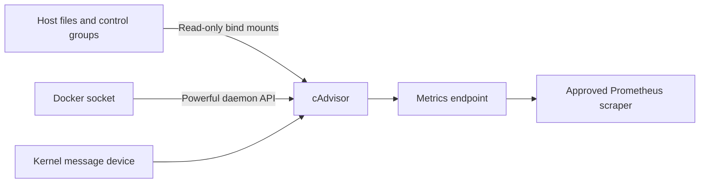

# Run cAdvisor with Docker Compose: Mounts, Devices, and Access

Author: [nawazdhandala](https://www.github.com/nawazdhandala)

Tags: Docker, Monitoring, Prometheus

Description: Understand cAdvisor's host mounts and privileges, deploy a pinned Compose example, and verify container metrics without exposing its endpoint publicly.

cAdvisor reads information that ordinary application containers should not see: host control groups, container storage, and Docker's API. That access explains why copying its deployment into an application stack deserves more review than adding another web service.

A working metrics endpoint is only the first check. You also need to establish which host it observes, whether individual containers appear, and how much authority the monitoring container has. This guide translates the upstream deployment into Docker Compose and makes those tradeoffs explicit.

## Establish the host assumptions

The example targets a native Linux host with rootful Docker Engine, Docker Compose v2, the Docker socket at `/var/run/docker.sock`, and Docker storage at `/var/lib/docker`. It is not a recipe for rootless Docker or for observing a macOS host through Docker Desktop's Linux virtual machine.

Run these read-only checks on the intended Docker host:

```sh
docker context show
docker info --format 'Root={{.DockerRootDir}} Driver={{.Driver}}'
docker info --format '{{json .SecurityOptions}}'
test -S /var/run/docker.sock
test -d /dev/disk
test -c /dev/kmsg
```

The context identifies which daemon receives commands; the next two lines show storage and security configuration. Each `test` succeeds silently when the expected local resource exists. Stop and adapt the example if the paths differ. With a remote Docker context, checking your laptop's paths says nothing about the remote host. [Docker system information](https://docs.docker.com/reference/cli/docker/system/info/).

## Know what each mount provides

The upstream quick start mounts the following host paths. A bind mount makes an existing host path visible inside a container; `ro` requests read-only filesystem access through that mount.

| Host path | Container path | Purpose and concern |
| --- | --- | --- |
| `/` | `/rootfs` | Host filesystem context; broad visibility into host data |
| `/var/run` | `/var/run` | Runtime sockets, including Docker's socket |
| `/sys` | `/sys` | Kernel and control-group information |
| `/var/lib/docker` | `/var/lib/docker` | Docker storage information for the default data root |
| `/dev/disk` | `/dev/disk` | Disk-device links used for identification |

This is the upstream compatibility baseline, not a universal minimum. A custom data root or storage backend needs a separate review. The source release's README retains an older example version variable, so use the explicitly selected release below instead of copying that variable unchanged. [cAdvisor v0.55.1 deployment source](https://github.com/google/cadvisor/blob/v0.55.1/README.md).

## Treat the socket as privileged access

Read-only filesystem access does not turn a Unix socket into a read-only API. A process that can connect to the Docker socket can send requests to the daemon. Mount flags do not inspect those requests or reject container-creation operations.

Likewise, `privileged: true` grants broad access beyond the mounted directories. Therefore, the configuration below must run as trusted host-monitoring software. It is not a sandbox for an untrusted exporter. Docker documents the daemon's substantial host authority in its [security guidance](https://docs.docker.com/engine/security/).

Even ordinary read-only bind mounts have subtleties: recursively making submounts read-only depends on kernel support and mount settings. Do not interpret a top-level `ro` flag as proof that every nested mount is immutable. [Docker bind-mount behavior](https://docs.docker.com/engine/storage/bind-mounts/).



The diagram separates filesystem reads from API authority. Both need review.

## Create the scoped Compose deployment

Save this as `compose.yaml` in a dedicated monitoring directory. It pins cAdvisor's `0.55.1` registry image by its verified multi-platform manifest digest. The GitHub release tag is `v0.55.1`; the registry tag is `0.55.1`, without `v`. They are different identifiers. [Selected release](https://github.com/google/cadvisor/releases/tag/v0.55.1).

```yaml
services:
  cadvisor:
    image: ghcr.io/google/cadvisor:0.55.1@sha256:e02855207ec07bb45ee41f720645945251f093f24c28f8c29cf718490f784922
    restart: unless-stopped
    privileged: true
    devices:
      - /dev/kmsg:/dev/kmsg
    ports:
      - "127.0.0.1:8080:8080"
    volumes:
      - type: bind
        source: /
        target: /rootfs
        read_only: true
        bind:
          create_host_path: false
      - type: bind
        source: /var/run
        target: /var/run
        read_only: true
        bind:
          create_host_path: false
      - type: bind
        source: /sys
        target: /sys
        read_only: true
        bind:
          create_host_path: false
      - type: bind
        source: /var/lib/docker
        target: /var/lib/docker
        read_only: true
        bind:
          create_host_path: false
      - type: bind
        source: /dev/disk
        target: /dev/disk
        read_only: true
        bind:
          create_host_path: false
```

Long-form mounts make their intent visible. `create_host_path: false` prevents a missing source from silently becoming an empty directory. The configuration deliberately retains upstream's privileged mode and kernel-message device mapping instead of claiming an untested minimal-capability replacement. [Compose service attributes](https://docs.docker.com/reference/compose-file/services/).

The published port binds to IPv4 loopback for checks from the host. It does not authenticate callers. Keep the host on a maintained Docker Engine: Docker documents a localhost-publishing exposure caveat for releases older than 28.0.0. If Prometheus runs on the same Compose network, it can use `cadvisor:8080`; remove the published port when host access is unnecessary. Remote scraping needs an explicitly controlled network path. [Port-publishing security](https://docs.docker.com/engine/network/port-publishing/).

## Validate before starting

First render the configuration without creating containers:

```sh
docker compose config --quiet
docker compose config --images
```

Expect successful validation and the pinned cAdvisor reference. This checks the Compose model, not host permissions, metric availability, or image trust. [Compose configuration command](https://docs.docker.com/reference/cli/docker/compose/config/).

After reviewing host access and selecting a staging host, start the service:

```sh
docker compose up -d cadvisor
docker compose logs --tail=100 cadvisor
curl --fail --silent --show-error http://127.0.0.1:8080/metrics \
  --output cadvisor-metrics.txt
```

Run the curl command on the daemon host. A successful HTTP response should produce a text metrics file. Inspect it for CPU and memory series belonging to a known running container, rather than accepting machine-level totals as sufficient proof. Check logs for discovery, filesystem, and permission errors.

Repeat the scrape while a known staging workload performs ordinary work. Verify that its identity is stable and relevant counters change. Avoid manufacturing an out-of-memory event on a production host simply to test collection.

## Reduce access only against explicit coverage requirements

Write down the metric families you need before changing privileges. Then remove one permission or mount at a time in staging and repeat the same workload checks. Keep the before-and-after scrape files and logs.

cAdvisor's running guide describes additional requirements for particular modes: process metrics need host process visibility, and Docker user-namespace remapping needs special handling. It also discusses non-privileged configurations with explicit devices and capabilities. Those recipes depend on the features and host involved; they are not interchangeable with this baseline. [Versioned running guide](https://github.com/google/cadvisor/blob/v0.55.1/docs/running.md).

Do not add `pid: host`, disable host security enforcement, or relabel the host root directory merely because one metric is missing. Identify the exact denied resource first. If your security policy prohibits the needed access, document the resulting coverage limit or choose a different collection arrangement.

## Diagnose symptoms by layer

| Symptom | First evidence to inspect |
| --- | --- |
| Container never starts | Missing bind sources, device availability, runtime error |
| Endpoint responds but containers are absent | Docker socket access and discovery logs |
| CPU and memory exist but filesystem metrics do not | Data root, storage backend, relevant host paths |
| Remote scraper cannot connect | Loopback binding and intended network route |
| Metrics change after a host upgrade | Kernel, cgroup mode, runtime, and cAdvisor version |

Keep the Compose file, selected digest, host facts, required metric list, and staging results together. That record makes upgrades reviewable and helps distinguish a deliberate access reduction from an unnoticed monitoring gap.
