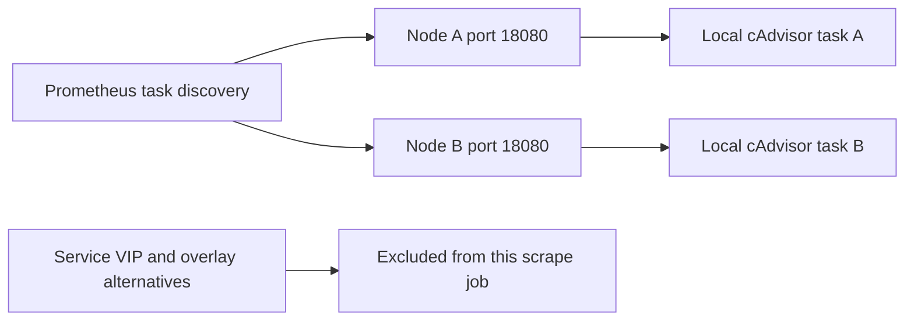

# Deploy cAdvisor in Docker Swarm Without Duplicate Node Scrapes

Author: [nawazdhandala](https://www.github.com/nawazdhandala)

Tags: Docker, Prometheus, Monitoring

Description: Run cAdvisor as a Swarm global service and select one host-published target per node, with discovery filters and checks for duplicate monitoring paths.

A Swarm global service creates one task on each eligible node. That sounds like one monitoring target per machine, but discovery can expose additional routes to the same task. Scraping a service address, an overlay address, and a host-published address can collect the same node more than once.

Choose one route deliberately. This tutorial uses a fixed host-published port and Prometheus task discovery. It filters for one service, global scheduling, desired-running tasks, and the host route. The example targets cAdvisor 0.55.1 and Prometheus 3.7.3; it is a staging recipe whose host metric coverage must be verified on your Linux distribution.

## Separate scheduling from routing

Global scheduling determines placement. Port publication determines how traffic reaches a task. Swarm's routing mesh can accept traffic on a node and forward it to a service task elsewhere, which is undesirable when the scrape's identity is supposed to represent the addressed host.

Publishing with `mode=host` bypasses that routing mesh. With one global task per eligible node and a fixed published port, each selected node exposes its local task. Confirm that the port is unused and reachable only by approved scrapers before deployment. [Swarm service publication](https://docs.docker.com/engine/swarm/services/).



Do not simultaneously add static targets for the same node endpoints. Separate jobs are separate collection paths even when both look healthy.

## Deploy a deliberately limited staging service

Prerequisites are a rootful Linux Swarm, access to a manager, default Docker paths on the selected nodes, and a reviewed host-monitoring security policy. Label only nodes on which you have checked those prerequisites:

```sh
docker node update --label-add cadvisor=enabled REPLACE_WITH_NODE_NAME
```

Replace the node name; repeat for each intended node. The label makes rollout explicit and provides an inventory of expected coverage. [Node label updates](https://docs.docker.com/reference/cli/docker/node/update/).

Run this on a manager after reviewing the image and mounts:

```sh
docker service create \
  --name cadvisor \
  --label prometheus-job=cadvisor \
  --mode global \
  --constraint 'node.platform.os==linux' \
  --constraint 'node.labels.cadvisor==enabled' \
  --publish published=18080,target=8080,mode=host \
  --update-order stop-first \
  --mount type=bind,src=/,dst=/rootfs,readonly \
  --mount type=bind,src=/var/run,dst=/var/run,readonly \
  --mount type=bind,src=/sys,dst=/sys,readonly \
  --mount type=bind,src=/var/lib/docker,dst=/var/lib/docker,readonly \
  ghcr.io/google/cadvisor:0.55.1@sha256:e02855207ec07bb45ee41f720645945251f093f24c28f8c29cf718490f784922 \
  --docker_only=true \
  --enable_metrics=cpu,memory,network
```

This adapts the [official Prometheus Swarm example](https://prometheus.io/docs/guides/dockerswarm/) with an explicit image, rollout constraint, fixed host port, and limited metric groups. The service-create flags are documented by [Docker](https://docs.docker.com/reference/cli/docker/service/create/). `stop-first` avoids intentional old/new overlap during updates and accepts a temporary monitoring gap.

The metric allowlist excludes process, performance-event, and OOM-event collection; it does not promise those capabilities without their additional host access. `--enable_metrics` overrides the disabled-metrics list. [cAdvisor runtime options](https://github.com/google/cadvisor/blob/v0.55.1/docs/runtime_options.md).

This command is not equivalent to upstream's privileged standalone-container quick start. Swarm service creation does not expose all the same runtime options as `docker run`. Do not paste unsupported privileged/device settings into a stack and assume they took effect. If this service cannot observe your required CPU, memory, and network metrics under the host's security policy, stop rollout and review another supported host-agent deployment. [cAdvisor platform requirements](https://github.com/google/cadvisor/blob/v0.55.1/docs/running.md).

Read-only mounting `/var/run` does not restrict Docker API requests through its socket. Treat the exporter and its selected image as trusted host software.

## Discover the host route only

Assume Prometheus can query the manager's local Docker socket and reach each node's advertised address on port 18080. A containerized Prometheus needs that socket made available explicitly. Socket access is powerful; use a separately reviewed authenticated discovery arrangement if direct daemon access is unacceptable. Never expose an unauthenticated Docker TCP API to solve discovery.

Add this job to the existing Prometheus configuration:

```yaml
scrape_configs:
  - job_name: cadvisor-swarm
    scrape_interval: 30s
    scrape_timeout: 10s
    dockerswarm_sd_configs:
      - host: unix:///var/run/docker.sock
        role: tasks
        refresh_interval: 30s
    relabel_configs:
      - source_labels: [__meta_dockerswarm_service_name]
        regex: cadvisor
        action: keep
      - source_labels: [__meta_dockerswarm_service_mode]
        regex: global
        action: keep
      - source_labels: [__meta_dockerswarm_task_desired_state]
        regex: running
        action: keep
      - source_labels: [__meta_dockerswarm_task_port_publish_mode]
        regex: host
        action: keep
      - source_labels: [__meta_dockerswarm_network_name]
        regex: .+
        action: drop
      - source_labels: [__address__]
        regex: '.+:18080'
        action: keep
      - source_labels: [__meta_dockerswarm_node_id]
        target_label: node_id
      - source_labels: [__meta_dockerswarm_node_hostname]
        target_label: node_name
      - source_labels: [__meta_dockerswarm_node_id]
        target_label: instance
```

These filters are specific to the service created above. A stack deployment usually prefixes service names; inspect the actual name before adapting the first rule.

Host-published task targets have no network metadata. The network-name drop rule discards overlay alternatives rather than demanding a particular overlay. A network-name keep rule copied from an overlay example would discard the desired host route. The address rule also excludes additional published ports. [Swarm discovery labels](https://prometheus.io/docs/prometheus/latest/configuration/configuration/#dockerswarm_sd_config).

Prometheus 3.7.3 constructs host-published task addresses from the node address and published port. It also handles network attachments separately, which is why reviewing discovered targets matters. [Versioned discovery implementation](https://github.com/prometheus/prometheus/blob/v3.7.3/discovery/moby/tasks.go).

## Prove one target per eligible node

First run the matching `promtool check config` against your completed configuration. This validates syntax, not manager access or successful scraping. Then inspect the service:

```sh
docker service ps --no-trunc cadvisor
docker service inspect cadvisor --format '{{json .Endpoint.Ports}}'
```

Expect a task on each eligible active node and publication in host mode. A task that is rejected, pending, or repeatedly restarting is a deployment problem, not a relabeling problem.

In Prometheus service discovery, inspect both kept and dropped entries. Each kept target should have a node address ending in `:18080`, the intended service name, and a unique `node_id`. Verify its hostname against Swarm inventory and its metrics against a known container on that node.

Do not use a successful `up` query as proof of uniqueness. Inspect the active target list, including other jobs that may collect the same endpoint. Also inspect dropped targets: a filter can remove duplicates, but a mistaken filter can remove every target.

## Test replacement and missing coverage

Rehearse a single-node update in staging. The old task should become undesired, its discovery entry should be excluded, and the replacement should resume collection with the same node identity. Because discovery is periodic, allow for refresh and scrape delays when interpreting the transition.

Next, compare the expected labeled-node inventory with active targets. Global mode does not imply every physical host is monitored: constraints, drained nodes, unsupported architectures, missing paths, and failed tasks can all reduce coverage. Removing a task from discovery can make its series disappear rather than leave a permanent `up=0` signal.

Keep the service specification, discovery configuration, expected node list, and sample target output together. The acceptance condition is one intentional collection path for every eligible node, with a clear explanation for every missing node and every excluded alternative.
