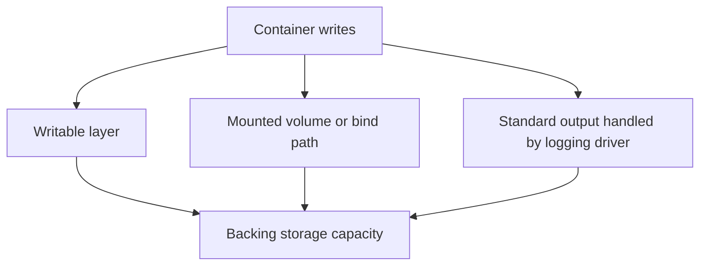

# Why cAdvisor Filesystem Usage Differs from a Container's Writable Layer

Author: [nawazdhandala](https://www.github.com/nawazdhandala)

Tags: Docker, Linux, Monitoring, Prometheus

Description: Diagnose differences between cAdvisor filesystem usage and Docker writable-layer size, then monitor host capacity, container growth, volumes, and logs separately.

A container's writable layer is growing, but its `container_fs_usage_bytes` graph shows a different number. Or the graph barely moves while the host runs out of disk space. Neither observation is enough to conclude that cAdvisor is broken.

Container storage has several accounting boundaries: the writable layer, shared image layers, mounted volumes, runtime logs, and the underlying filesystem. A measurement that answers one question may be unsuitable for another. Resolve those boundaries before changing a dashboard or deleting files.

This guide traces cAdvisor 0.55.1's Docker filesystem path and uses read-only inspection examples. It does not assume the same behavior for every storage driver, containerd snapshotter, or kubelet version.

## Separate the storage areas first

A writable layer contains files added or changed relative to the container image. With OverlayFS, modifying a file from a lower image layer can copy it into the writable upper layer. The merged filesystem visible inside the container includes both lower and upper content; it is not a view of only newly consumed writable-layer space. [Docker OverlayFS explanation](https://docs.docker.com/engine/storage/drivers/overlayfs-driver/).

Volumes and bind mounts introduce separate storage paths. A database writing into a mounted volume can consume substantial capacity without growing the writable layer. Docker volumes persist separately from a container's writable layer. [Docker volume lifecycle](https://docs.docker.com/engine/storage/volumes/).



The diagram assumes local storage for illustration. A remote volume or remote logging driver may use different infrastructure, and local buffering can still matter. Monitor the actual destination rather than inferring it from the application's path.

## Trace what the cAdvisor metric actually exports

In the pinned exporter, `container_fs_usage_bytes` is a gauge derived from `FsStats.Usage`, with a `device` label. Its name does not promise equality with Docker's writable-layer size. [Prometheus exporter implementation](https://github.com/google/cadvisor/blob/v0.55.1/metrics/prometheus.go).

The Docker handler selects storage paths and supplies both a root filesystem directory and another directory associated with the container. The common filesystem handler calculates base usage and total usage; when successful, total usage includes the extra directory's usage. [Docker handler](https://github.com/google/cadvisor/blob/v0.55.1/container/docker/handler.go), [common filesystem handler](https://github.com/google/cadvisor/blob/v0.55.1/container/common/fsHandler.go).

The Docker filesystem conversion puts that total into `FsStats.Usage`. It sets `FsStats.Limit` from filesystem capacity. Consequently, a reported filesystem limit can be the capacity of shared backing storage, not a dedicated quota allocated to this container. [Docker filesystem conversion](https://github.com/google/cadvisor/blob/v0.55.1/container/docker/fs.go).

This source path explains why the metric can differ from a writable-layer-only measure. It also explains why summing a repeated capacity value across containers is not a meaningful way to discover the size of a disk.

The common handler refreshes directory usage separately, with a default period of one minute and error backoff in this version. Scraping every few seconds does not force a new directory scan each time. Compare observations after an appropriate collection interval, and inspect collection errors before trusting an unchanged value.

## Ask Docker for the writable-layer measurement

On a host where you have Docker access, replace `CONTAINER_NAME` with the specific container:

```bash
docker container inspect --size \
  --format 'name={{.Name}} writable_bytes={{.SizeRw}} rootfs_bytes={{.SizeRootFs}}' \
  CONTAINER_NAME
```

Docker documents `SizeRw` as the size of files created or changed relative to the image and `SizeRootFs` as the total size of files in the container. The command is read-only, although calculating sizes can require filesystem work. Use it for targeted diagnosis rather than an aggressive fleet-wide polling loop. [Docker inspect size fields](https://docs.docker.com/reference/cli/docker/container/inspect/).

Record the time, container identity, runtime version, and storage driver alongside the output. A missing or unsupported size result is not a zero-byte measurement. Do not expect logical sizes, allocated blocks, compressed image transfer sizes, and shared disk consumption to reconcile as identical values.

Inspect the container's mounted storage separately:

```bash
docker container inspect --format '{{json .Mounts}}' CONTAINER_NAME
```

The result identifies mount types, sources, and destinations. Determine whether the path growing inside the application belongs to the writable layer or to one of these mounts. Keep host paths out of public incident reports if they reveal sensitive deployment details.

## Compare a single series without hiding its device

Use the actual labels from your scrape in this query:

```promql
container_fs_usage_bytes{
  job="cadvisor", instance="node-a:8080", id="/docker/EXAMPLE"
}
```

This returns each reported device series for that container. Keep the device in the legend initially. Do not collapse multiple devices into a total until you have established that their accounting is disjoint.

Use a comparison table during diagnosis:

| Observation | Likely question to investigate |
| --- | --- |
| Writable layer grows; volume unchanged | Application writes outside its intended mount |
| Volume grows; writable layer stable | Persistent data growth requiring volume monitoring |
| cAdvisor total exceeds writable size | Additional accounted directory content or different accounting |
| Host available space falls; container readings stable | Images, logs, other containers, or unobserved storage |
| Metric unchanged after writes | Collection interval, errors, unsupported path, or wrong identity |

These are investigation directions, not automatic diagnoses. For example, a flat series can also belong to a replaced container that no longer receives writes.

## Monitor the resource that can actually fill

For host exhaustion, monitor available filesystem bytes and free inodes using a host exporter. Inodes are filesystem records needed to represent files; a filesystem can run out of them before running out of bytes. Node Exporter's filesystem collector supplies filesystem statistics for this purpose. [Node Exporter collectors](https://github.com/prometheus/node_exporter#enabled-by-default).

For a named volume, use the storage system's capacity and usage measurements, or a deliberately scoped filesystem collector that observes that mount. For writable-layer growth, retain the runtime measurement or a verified collector path with a documented accounting boundary.

Logs require their own policy. Docker's logging-driver documentation describes rotation behavior and warns about unbounded default JSON-file logging. Review the selected driver's settings and existing containers' configuration; changing daemon defaults does not retroactively reconfigure every existing container. [Docker logging configuration](https://docs.docker.com/engine/logging/configure/).

Avoid deleting files directly from Docker's managed storage to reconcile a graph. Establish ownership and use the runtime's supported lifecycle operations only after reviewing what is needed. Capacity monitoring should identify a responsible resource, not encourage blind cleanup.

## Validate the interpretation in staging

Use an approved disposable workload and observe one small, bounded write to its writable layer, then a separate write to its mounted volume. Record Docker size output and the corresponding cAdvisor series after collection has refreshed. Check the host's available space as a third independent observation.

The expected result is a documented relationship between measurements, not universal numerical equality. Repeat for each runtime and storage layout you actually operate. The command examples and query here were checked structurally and with synthetic data; no live Docker storage experiment is claimed.

A useful dashboard puts backing capacity, writable-layer growth, mounted data, and logs in separate views. That makes a disagreement between numbers an explanation of storage boundaries instead of a reason to distrust every measurement.
