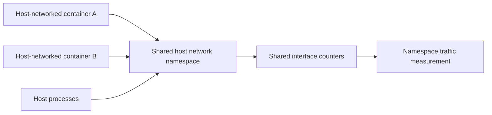

# Diagnose Missing cAdvisor Metrics for Host-Networked Containers

Author: [nawazdhandala](https://www.github.com/nawazdhandala)

Tags: Docker, Linux, Networking, Monitoring

Description: Distinguish missing network collection from shared-namespace accounting, inspect host-networked containers safely, and choose metrics that match the attribution you need.

A container handles requests successfully, but its cAdvisor network panel is empty. Another container shows traffic that seems to include the whole host. Increasing permissions or adding a new label may not solve either symptom: the underlying counters can belong to a shared network namespace rather than to one container.

Start by identifying the accounting boundary. This guide examines cAdvisor 0.55.1's Docker and libcontainer paths and provides read-only checks for a native Linux Docker host. Docker Desktop and rootless networking have additional layers; do not apply host PID assumptions to those environments unchanged.

## Why host networking changes the question

A network namespace isolates interfaces, routing tables, sockets, and other networking resources. Interface byte counters belong to those interfaces within that namespace. They are not automatically divided among the processes using them. [Linux network namespace overview](https://man7.org/linux/man-pages/man7/network_namespaces.7.html).

With Docker host networking on Linux, a container shares the host's network namespace instead of receiving its own isolated network stack. Docker documents that host-mode containers do not receive their own IP address and that published-port mappings do not apply in the usual way. [Docker host network driver](https://docs.docker.com/engine/network/drivers/host/).



If a collector attaches container A's name to a shared interface counter, that label does not make the bytes exclusive to A. Adding A and B's copies can count the same traffic twice. Conversely, a collector may suppress redundant shared-namespace samples, leaving a container panel empty without indicating zero traffic.

## Separate host mode from another container's namespace

First inspect the container on the actual Docker host:

```bash
docker container inspect \
  --format 'name={{.Name}} mode={{.HostConfig.NetworkMode}} pid={{.State.Pid}} running={{.State.Running}}' \
  CONTAINER_NAME
```

Replace `CONTAINER_NAME` with the application container. Record the network mode and current PID, which is its process identifier on that host. A stopped container can have PID zero; do not use that as a live process path. [Docker inspect formatting](https://docs.docker.com/reference/cli/docker/container/inspect/).

The modes are materially different:

| Mode | Boundary to investigate |
| --- | --- |
| `host` | Shared host network stack |
| A bridge network | Usually a separate container network namespace |
| `container:...` | Namespace owned by another container |
| Kubernetes Pod networking | A shared Pod network boundary; inspect the runtime's representation |

In cAdvisor 0.55.1's Docker handler, the explicit removal of network metric groups uses Docker's `IsContainer()` check. That is the shared-other-container case. Do not describe this branch as proof that every `host` mode container is always filtered. The common helper removes network groups when instructed. [Docker handler source](https://github.com/google/cadvisor/blob/v0.55.1/container/docker/handler.go), [network-group helper](https://github.com/google/cadvisor/blob/v0.55.1/container/common/helpers.go).

## Confirm the namespace without changing it

On the same native Linux host, with permission to inspect process namespaces, replace `12345` with the freshly observed positive PID:

```bash
readlink /proc/1/ns/net
readlink /proc/12345/ns/net
cat /proc/12345/net/dev
```

The two symbolic links identify network namespaces. Matching namespace identifiers support the conclusion that the container process shares PID 1's network namespace, assuming you are inspecting the real host's `/proc`. The final command reads interface counters visible to that process's namespace. [Process namespace entries](https://man7.org/linux/man-pages/man5/proc_pid_ns.5.html), [process network information](https://man7.org/linux/man-pages/man5/proc_pid_net.5.html).

This does not assign those bytes to the individual process. The process path selects its namespace's view. If the container restarts between inspection and reading, obtain the PID again; it may no longer exist or may have been reused.

Do not run these commands in a random administration container and assume its PID 1 is the host. Nor should a remote Docker context's returned PID be interpreted against the local machine's `/proc`. A permission error and a missing process are different failures; preserve the error rather than treating either as an empty counter set.

## Trace collection before changing the dashboard

In the examined libcontainer handler, network usage is read from `/proc/<pid>/net/dev` when a positive PID is known and the network metric group is enabled. Interface filtering also matters: the pinned implementation ignores certain interface-name prefixes, including loopback and several virtual-interface prefixes. [Versioned network collection](https://github.com/google/cadvisor/blob/v0.55.1/container/libcontainer/handler.go).

Use this investigation order:

1. Confirm that the scrape target is healthy and the application container identity is current.
2. Inspect raw network series before dashboard aggregation or relabeling.
3. Check enabled metric groups and any handler-specific suppression.
4. Check cAdvisor's process and filesystem visibility and collection errors.
5. Compare the interfaces seen in the namespace with those actually exported.

Do not immediately enable every capability. First establish whether the missing data comes from access, filtering, unsupported runtime behavior, or a deliberate shared-namespace boundary.

For a known exported series, this query keeps the interface visible:

```promql
rate(container_network_receive_bytes_total{
  job="cadvisor", instance="node-a:8080", id="/docker/EXAMPLE"
}[5m])
```

Replace the target and ID with observed labels. The result is received bytes per second per returned interface, not automatically bytes per second attributable to only that application's requests. Check the matching transmit counter separately. The five-minute rate smooths observations and handles observed counter resets. [Prometheus rate function](https://prometheus.io/docs/prometheus/latest/querying/functions/#rate).

## Choose a metric that answers the operational question

For host link saturation, use one host-level interface measurement and identify the relevant physical or virtual link. For service throughput, prefer application or proxy metrics that count requests and payloads at a defined protocol boundary. Those payload sizes need not equal wire bytes because headers, encryption, retransmissions, and encapsulation add overhead.

For process or container traffic attribution within a shared namespace, evaluate a collector designed for that attribution, such as one using socket or cgroup information. Verify its kernel support, privileges, handling of short-lived processes, and definition of bytes. A container label alone is not evidence of correct attribution.

For Pod networking, decide whether the dashboard intends to show Pod traffic or application-container traffic. Shared network ownership means those can be different requirements. Do not duplicate a Pod's shared totals onto every sidecar and then sum them.

## Validate with a controlled comparison

In staging, generate a small bounded request stream to one application while another host-networked workload stays idle. Observe the namespace counters, exported series, and application request metrics. If both container-labeled network panels move together, investigate shared accounting before claiming both applications generated traffic.

The published query was checked against synthetic counters, including a reset and multiple interfaces. The Linux inspection commands were source-reviewed and syntax-checked, not run against a live Docker host. Deployment validation must still establish the namespace and collector behavior on your machines.

A correct outcome may be a host traffic panel plus application throughput panels, rather than a misleading per-container network graph. Make that boundary explicit so missing series and shared measurements are investigated accurately.
