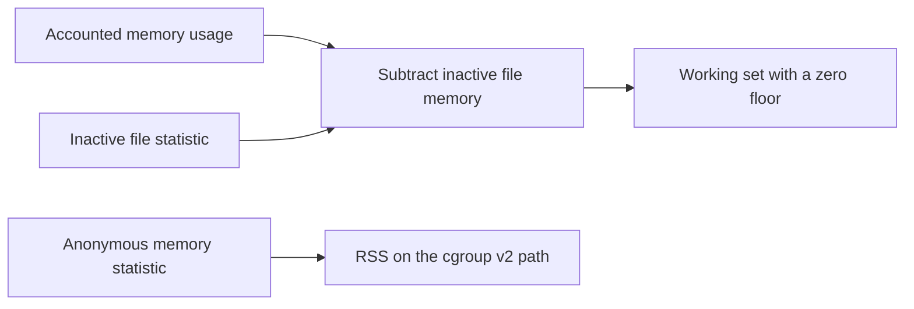

# Understand cAdvisor Memory Usage, Working Set, RSS, and Limits

Author: [nawazdhandala](https://www.github.com/nawazdhandala)

Tags: Docker, Linux, Prometheus, Monitoring

Description: Read cAdvisor memory gauges correctly, compare usage with working set and RSS, and build limit-aware queries without mistaking cache or missing data for safety.

A container can show 800 MiB of memory usage, a 500 MiB working set, and 350 MiB of RSS at the same time. Those readings are not three competing estimates of application heap size. They describe different parts or transformations of the container's memory accounting.

The useful question is what changed: anonymous application memory, filesystem cache, kernel allocations, or the configured limit. This guide follows cAdvisor 0.55.1's implementation and uses Prometheus 3.7.3 for query checks. Other exporter versions and cgroup modes should be checked before reusing a dashboard unchanged.

## Start with the accounting boundary

Linux cgroups group processes for resource accounting and control. Container memory statistics describe that group, not simply the sum of a runtime's managed heap. A Java heap, for example, does not include every native allocation, thread stack, or file-backed mapping associated with the process.

Select one container identity and one scrape source before comparing gauges. Root and parent cgroups can overlap their descendants. Adding parent and child readings can count the same memory more than once. Duplicate kubelet and standalone cAdvisor targets create another source of misleading totals.

The following names come from the pinned exporter. RSS expands to resident set size, but the exported value's source matters more than the familiar name. [cAdvisor metric definitions](https://github.com/google/cadvisor/blob/v0.55.1/metrics/prometheus.go).

| Metric | Useful interpretation | Common mistake |
| --- | --- | --- |
| `container_memory_usage_bytes` | Current accounted memory usage | Treating it as application heap |
| `container_memory_working_set_bytes` | Usage with inactive file memory subtracted, floored at zero | Calling all of it unreclaimable |
| `container_memory_rss` | RSS-related accounting; `anon` on the examined cgroup v2 path | Treating it as every resident page |
| `container_memory_cache` | File-cache accounting | Assuming it can all disappear immediately |
| `container_spec_memory_limit_bytes` | Exported configured memory limit | Treating zero or an absent sample as a real zero-byte budget |

## Understand how working set is calculated

In cAdvisor 0.55.1's libcontainer path, working set starts with usage. The code subtracts `inactive_file` on cgroup v2 or `total_inactive_file` on cgroup v1 when that statistic exists, and clamps a negative result to zero.

The same source maps cgroup v2 cache from `file` and RSS from `anon`. Its cgroup v1 paths use the corresponding cache and RSS statistics, including hierarchical variants when enabled. [Versioned memory conversion](https://github.com/google/cadvisor/blob/v0.55.1/container/libcontainer/handler.go).

For an illustrative snapshot, 800 MiB usage minus 300 MiB inactive file memory produces a 500 MiB working set. If RSS is 350 MiB, it is entirely reasonable for the working set to be larger: subtracting inactive file memory does not remove every other category.



Working set is therefore a useful heuristic, not a perfect inventory of memory that cannot be reclaimed. Conversely, cache is not automatically disposable without cost: dirty data may need writeback, and repeatedly reading evicted data can harm latency. Use the kernel's field definitions when interpreting raw statistics. [cgroup v2 memory interface](https://docs.kernel.org/admin-guide/cgroup-v2.html#memory).

## Put comparable gauges on one timeline

These examples assume job `cadvisor`, host target `node-a:8080`, and cgroup ID `/docker/EXAMPLE`. Replace those exact labels with an observed container identity. A Kubernetes cgroup will usually have a different path and additional useful labels.

```promql
{__name__=~"container_memory_(usage_bytes|working_set_bytes|rss|cache)",
 job="cadvisor", instance="node-a:8080", id="/docker/EXAMPLE"}
```

This returns the four separate series. Display them as bytes with a legend containing the metric name. Do not stack all four: working set is derived from usage, and the categories overlap. A stacked chart would suggest a total that these metrics do not represent.

These are gauges, meaning values that can rise and fall. Applying `rate` to them does not calculate ordinary memory usage and introduces counter assumptions. Read their levels and trends directly. [Prometheus metric types](https://prometheus.io/docs/concepts/metric_types/).

For readability, a panel can display MiB rather than bytes. One MiB is 1024 squared bytes; distinguish it from a decimal MB when comparing tools. Changing the display unit should not change the stored measurement or alert threshold's unit.

## Calculate utilization only against a usable limit

For a single container, this expression compares total usage to a positive exported limit:

```promql
100 * container_memory_usage_bytes{
  job="cadvisor", instance="node-a:8080", id="/docker/EXAMPLE"
}
/
(container_spec_memory_limit_bytes{
  job="cadvisor", instance="node-a:8080", id="/docker/EXAMPLE"
} > 0)
```

The comparison filters the denominator while preserving its value. Do not add `bool`: that changes positive limits to one and breaks the percentage. The two sides must have matching labels and one series per container. [Prometheus vector matching and comparisons](https://prometheus.io/docs/prometheus/latest/querying/operators/).

A 1 GiB limit and 800 MiB usage give 78.125%. Substituting working set in the numerator answers a different question: 500 MiB working set against the same limit gives about 48.8%. Label those panels separately instead of presenting either as the universal “memory percentage.”

In the pinned exporter, `specMemoryValue` maps values above its large-memory threshold to zero. Runtime configuration and cgroup hierarchy also affect what limit is exposed. Treat zero, absent, or implausible limits as a reason to inspect configuration, not as proof that the workload is safe or has no restrictions.

A limit at a parent cgroup can constrain a container even when its own limit appears permissive. In Kubernetes, also distinguish configured requests, which influence scheduling, from limits enforced through the runtime and kernel. [Kubernetes resource management](https://kubernetes.io/docs/concepts/configuration/manage-resources-containers/).

## Explain differences from Docker's display

Docker's Linux CLI subtracts cache for its displayed memory usage, while the API provides the underlying measurements. Docker documents different cache fields for cgroup v1 and v2. Consequently, comparing Docker's displayed number with cAdvisor total usage can produce an expected difference. [Docker stats documentation](https://docs.docker.com/reference/cli/docker/container/stats/).

With Docker access to the correct host, take a non-streaming observation:

```bash
docker stats --no-stream --format '{{.Name}} {{.MemUsage}} {{.MemPerc}}' CONTAINER_NAME
```

Replace `CONTAINER_NAME` with the observed container. This reads statistics; it does not change the container. Compare timestamps, units, limits, and cache treatment before investigating collection errors. Sampling at different moments during an allocation burst can explain differences even after the formulas match.

## Investigate pressure rather than guessing from one gauge

If RSS and working set rise together during a stable workload, investigate retained allocations using the application's own profiler. If usage rises mainly with cache while application memory remains stable, examine file access and latency before declaring a leak.

Neither pattern alone proves the cause of an out-of-memory kill. Correlate restart records, kernel or runtime events, memory pressure, and parent limits. A scrape can miss the allocation spike immediately before termination, and a replacement container has a new identity.

For validation, use synthetic query fixtures with ordinary, zero, and absent limits. Then compare a controlled staging workload's gauges with the corresponding runtime observations. Do not clear the host's caches merely to force two dashboards to agree. The goal is a dashboard whose measurements and denominators are explicit enough to support an investigation.
