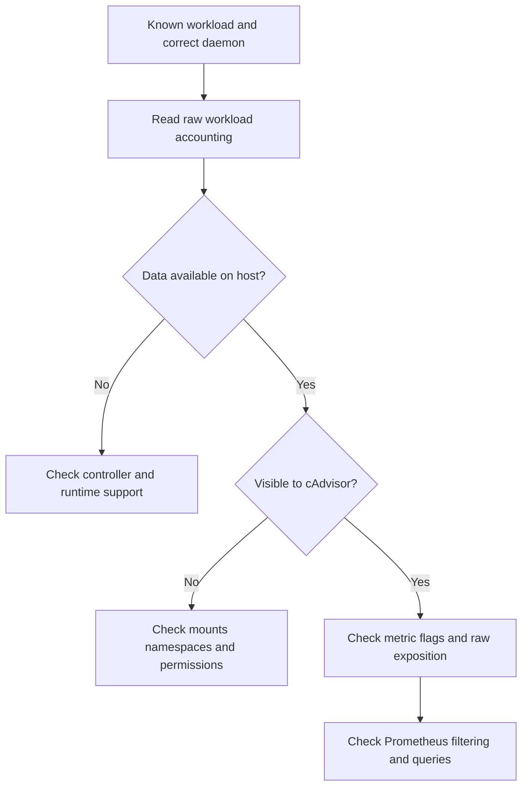

# Diagnose Missing cAdvisor Metrics on cgroup v2 and Rootless Docker

Author: [nawazdhandala](https://www.github.com/nawazdhandala)

Tags: Docker, Linux, Monitoring

Description: Trace missing cAdvisor data through Docker identity, cgroup delegation, exporter visibility, and scrape filtering without weakening host security blindly.

A cAdvisor endpoint can return HTTP 200 while important container metrics are absent. On a rootless Docker host, the problem may be a wrong daemon socket, a different storage path, restricted cgroup visibility, or a controller that was never delegated to the user running Docker.

Do not treat these as one generic permissions problem. Follow the data from the host to the exporter and then to Prometheus. Fix the first broken boundary, keeping the other layers unchanged during the test.

This procedure targets Linux hosts and uses cAdvisor 0.55.1 source as the reference for exporter flags. Commands are inspection steps; they do not restart Docker, modify cgroup controllers, or change security policy.

## Separate rootless mode from cgroup version

A cgroup is the kernel's resource-accounting and control group for processes. cgroup v2 uses a unified hierarchy. Rootless Docker runs the daemon and containers without host-root privileges, using user namespaces. These are related deployment choices, not synonyms. [Docker rootless architecture](https://docs.docker.com/engine/security/rootless/).

Docker documents cgroup-based resource limits in rootless mode as requiring cgroup v2 and systemd. It also notes that the delegated controller set may be limited. A host can use cgroup v2 while a particular user's Docker service still lacks a controller needed for a requested limit. [Rootless resource limits](https://docs.docker.com/engine/security/rootless/tips/#limiting-resources).

Keep resource-limit enforcement separate from basic usage accounting. For example, cgroup v2's `cpu.stat` can expose basic usage counters even when the CPU controller is not enabled; additional throttling fields have different conditions. Missing throttling data does not automatically mean that all CPU accounting is unavailable. [Kernel cgroup v2 CPU interface](https://docs.kernel.org/admin-guide/cgroup-v2.html#cpu).

## Confirm which daemon you are observing

Run these as the user who operates the intended rootless daemon:

```sh
docker context show
docker context inspect --format '{{json .Endpoints.docker.Host}}'
docker info --format 'Root={{.DockerRootDir}} Cgroup={{.CgroupVersion}} Driver={{.CgroupDriver}}'
docker info --format '{{json .SecurityOptions}}'
```

Record the endpoint, data directory, cgroup version, driver, and security options. Context inspection shows the selected context's endpoint; also check whether your invocation uses an explicit host or environment override. Do not add `sudo` reflexively: it may select another user's configuration and a different daemon. [Docker context inspection](https://docs.docker.com/reference/cli/docker/context/inspect/).

Rootless defaults commonly use `$XDG_RUNTIME_DIR/docker.sock` and a data directory under the user's home, rather than `/var/run/docker.sock` and `/var/lib/docker`. Inspect actual values instead of hard-coding another user's numeric ID. [Rootless paths](https://docs.docker.com/engine/security/rootless/tips/).

Compare that endpoint with cAdvisor's configured Docker endpoint and mounted paths. In cAdvisor 0.55.1, `--docker` defaults to `unix:///var/run/docker.sock`; its Docker data root is normally obtained from daemon information. The deprecated `--docker_root` fallback is not a substitute for mounting the correct host data. [Versioned Docker discovery source](https://github.com/google/cadvisor/blob/v0.55.1/container/docker/factory.go).

If cAdvisor is connected to the rootful daemon while workloads run under a rootless daemon, changing PromQL will not make those containers appear.

## Inspect the user service and hierarchy

For a systemd-managed rootless installation, inspect the user service:

```sh
systemctl --user show docker.service \
  --property=ActiveState --property=ControlGroup --property=Delegate
```

`ControlGroup` identifies the service's group; it is not necessarily the leaf group for the application container you are investigating. `Delegate` describes the unit setting, not proof that every controller is available throughout the hierarchy. Use systemd's unit information to orient the investigation, then identify the specific workload group from host-side runtime and process information. [systemctl inspection](https://www.freedesktop.org/software/systemd/man/latest/systemctl.html).

On the Linux host, an initial v2 check is:

```sh
test -f /sys/fs/cgroup/cgroup.controllers
cat /sys/fs/cgroup/cgroup.controllers
```

The file lists controllers available at that hierarchy level. At a parent group, `cgroup.subtree_control` shows which are enabled for children. Neither the root list nor a parent setting proves that the exporter can see a particular workload's files. [Kernel hierarchy interfaces](https://docs.kernel.org/admin-guide/cgroup-v2.html).

Do not write controller names into these files during diagnosis. systemd owns the relevant hierarchy, and controller changes can affect running workloads. If delegation is the problem, have the host owner review a persistent systemd configuration change in staging.

## Read the workload's raw files safely

Once you have identified the correct cgroup v2 directory, this Python 3 helper reads a small set of files without modifying them. Save it as `inspect_cgroup.py` and pass that directory as its only argument:

```python
import sys
from pathlib import Path

if len(sys.argv) != 2:
    raise SystemExit("Usage: inspect_cgroup.py /verified/cgroup/path")

root = Path(sys.argv[1])
if not root.is_dir():
    raise SystemExit("Expected an existing cgroup directory")

for name in (
    "cgroup.controllers",
    "cgroup.subtree_control",
    "cpu.stat",
    "memory.current",
    "io.stat",
):
    path = root / name
    try:
        value = path.read_text().strip()
    except FileNotFoundError:
        print(f"{name}: MISSING")
    except PermissionError:
        print(f"{name}: UNREADABLE")
    else:
        print(f"{name}: {value or '(empty)'}")
```

For example, run `python3 inspect_cgroup.py /sys/fs/cgroup/REPLACE_WITH_VERIFIED_PATH` after replacing the placeholder. The output distinguishes an absent file, a permission denial, and an empty file. It does not infer a container identity or label an empty value as zero.

Use a known staging workload with ordinary CPU and memory activity. Capture observations on the host, then compare with what the exporter can access through its configured namespaces and mounts. The path visible inside a container may be rooted differently from the host path. Docker's [runtime metrics guide](https://docs.docker.com/engine/containers/runmetrics/) explains why cgroup location and version matter.

## Follow the first missing observation



If host files change but cAdvisor does not expose corresponding data, inspect its startup and collection logs. Record the exact denied or missing path. Review `--enable_metrics` and `--disable_metrics`; an explicit enabled list overrides the disabled list. [cAdvisor runtime flags](https://github.com/google/cadvisor/blob/v0.55.1/docs/runtime_options.md).

If the raw `/metrics` response contains the series but Prometheus does not, move to scrape configuration, metric relabeling, and query selectors. At that point, adding host mounts is unrelated to the observed failure.

## Choose a fix that matches the boundary

| Evidence | Appropriate next action |
| --- | --- |
| Wrong Docker endpoint | Correct the reviewed endpoint and socket mount |
| Raw accounting unavailable | Review runtime support and controller delegation |
| Host file readable, exporter view wrong | Correct namespaces or mount layout in staging |
| Exporter logs show access denied | Review the specific access requirement with the host owner |
| Series exists before ingestion | Inspect Prometheus filters and labels |

Rootless isolation intentionally limits what a container can access. A rootless `--privileged` container does not become unrestricted host root. Do not switch the workload daemon to rootful mode merely to make a dashboard populate.

If the required host-wide observation cannot fit the security model, consider a separately reviewed host monitoring service with a documented scope. State any remaining metric gaps explicitly. Rootless runtime and networking limitations are environment-dependent; verify them against Docker's [rootless troubleshooting guide](https://docs.docker.com/engine/security/rootless/troubleshoot/).

A successful resolution includes a known workload, identified raw accounting, corresponding exporter series, and the expected Prometheus result. An HTTP 200 response or a newly privileged container alone is not that evidence.
