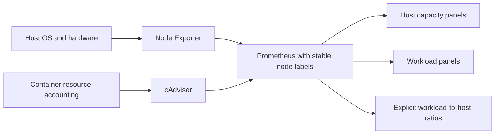

# Use cAdvisor and Node Exporter Without Duplicating Host Metrics

Author: [nawazdhandala](https://www.github.com/nawazdhandala)

Tags: Prometheus, Kubernetes, Linux, Monitoring

Description: Assign host and container metrics clear roles, use stable node identity for joins, and avoid adding overlapping cAdvisor and Node Exporter measurements.

Adding Node Exporter to a host already monitored by cAdvisor is useful. Node Exporter describes the operating system and hardware; cAdvisor describes container resource accounting. The trouble starts when a dashboard treats every reported byte or CPU-second as an independent quantity and adds them together.

A host's memory use already includes memory consumed by its workloads. Adding container memory to host memory does not create a more complete total. It creates an overlapping measurement with unclear meaning.

Use both exporters, but define which source answers each question. The examples below use Node Exporter 1.9.1 metric definitions, the Kubernetes cAdvisor label convention reviewed in Kubernetes 1.35.0, and Prometheus 3.7.3 query tests.

## Give each source a clear job

[Node Exporter](https://github.com/prometheus/node_exporter/blob/v1.9.1/README.md) collects host hardware and operating-system metrics. cAdvisor's [metric catalog](https://github.com/google/cadvisor/blob/v0.55.1/docs/storage/prometheus.md) includes container resource measurements and some machine information. Overlap in subject matter does not make those measurements interchangeable.

| Monitoring question | Primary source in this design |
|---|---|
| How much host memory is available? | Node Exporter |
| Which container's working set is growing? | cAdvisor |
| How full is a host filesystem? | Node Exporter filesystem collector |
| How much CPU time did a container consume? | cAdvisor CPU counter |
| Is either collection endpoint unavailable? | Its own Prometheus scrape-health series |

This is an ownership policy for dashboards and alerts. You do not need to delete every overlapping metric immediately. Keeping raw data can help investigations, provided production totals and alerts use an intentional source.



The final branch compares different measurements through a documented ratio; it does not add overlapping usage together.

## Confirm Node Exporter observes the host

A containerized Node Exporter needs the host namespaces and filesystem view required by its collectors. The versioned README warns that an ordinary container deployment can observe the container instead of the intended host and describes the `--path.rootfs` relationship to the host mount.

Before using its capacity metrics as denominators, compare one node's identity and memory capacity with your host inventory. Check filesystem coverage too: mounting the root alone does not automatically make every desired non-root mount visible in all deployment layouts.

A wrong host view can produce convincing values. Validate it before debugging joins or adding aggregation. For cAdvisor, similarly verify a known application container and confirm you are not selecting the host-root cgroup as if it were a workload.

## Keep scrape identity and node identity separate

Prometheus normally identifies a scrape endpoint with `job` and `instance`. Node Exporter and cAdvisor on one machine often have different ports, so their `instance` values differ. The [jobs and instances documentation](https://prometheus.io/docs/concepts/jobs_instances/) explains these target labels.

Retain those endpoint labels and add a stable `node` label for cross-exporter correlation. In a multi-cluster environment, add `cluster` too. Use the same trusted node identity in both scrape configurations or discovery relabeling rules.

For illustration, the target identity contract might be:

| Source | job | instance | cluster | node |
|---|---|---|---|---|
| Node Exporter | node-exporter | worker-a:9100 | staging | worker-a |
| Kubelet cAdvisor endpoint | kubelet-cadvisor | worker-a:10250 | staging | worker-a |

These are example labels, not a complete kubelet scrape configuration. Preserve its required authentication, TLS, and `/metrics/cadvisor` path. Do not derive node identity by blindly removing the last colon-delimited segment from an address; IPv6, proxies, and service discovery make that fragile.

## Check uniqueness before joining capacity

Before comparing workloads with host capacity, ensure the denominator has one series per node:

```promql
count by (cluster, node) (
  node_memory_MemTotal_bytes{
    job="node-exporter", cluster!="", node!=""
  }
) != 1
```

An empty result means observed nodes have a single matching series. It does not detect nodes entirely absent from the result; compare against inventory separately. If a node has two series, inspect duplicate scrape targets or exporter replicas. Do not hide the problem by adding both capacities or choosing `max` without understanding the duplication.

The [Node Exporter memory collector](https://github.com/prometheus/node_exporter/blob/v1.9.1/collector/meminfo_linux.go) obtains memory information from procfs and exports byte-valued fields. Use the intended field consistently rather than mixing total memory with an unrelated container limit.

## Compare workload working set with host capacity

The following query assumes both jobs carry the validated `cluster` and `node` labels. It selects named Kubernetes application containers, excluding the conventional sandbox name `POD`, and compares their working-set sum with host memory capacity:

```promql
100 *
sum by (cluster, node) (
  container_memory_working_set_bytes{
    job="kubelet-cadvisor", cluster!="", node!="",
    namespace!="", pod!="", container!="", container!="POD"
  }
)
/ on (cluster, node)
node_memory_MemTotal_bytes{
  job="node-exporter", cluster!="", node!=""
}
```

A result of 25 means selected application working sets total one quarter of reported host memory capacity. It does not mean the host has 75% available memory. Host services, kernel accounting, caches, and unselected workloads can consume capacity too.

Inspect the actual Kubernetes label contract and confirm one observation per application cgroup before using this selector. The [kubelet mapping](https://github.com/kubernetes/kubernetes/blob/v1.35.0/pkg/kubelet/server/server.go) can assign pod names to parent groups; the nonempty container filter helps avoid those parents under the stated convention. Adapt standalone Docker queries from their actual labels instead of assuming Kubernetes fields exist.

The explicit `on (cluster, node)` matches the sources by machine identity rather than endpoint port. [Prometheus vector matching](https://prometheus.io/docs/prometheus/latest/querying/operators/#vector-matching) requires the intended uniqueness. A missing denominator produces no ratio for that node; it should not be silently converted into zero utilization.

## Keep alerts and validation independent

Use separate scrape-health alerts for both sources. A working cAdvisor target cannot establish that Node Exporter is current, and vice versa. Avoid two paging rules for the same host-capacity condition merely because both sources expose related measurements.

Local synthetic tests for this article verify a 25% workload-to-host ratio, exclusion of parent and sandbox rows, a missing-host denominator, and detection of duplicate capacity series. They do not validate host mounts or live Kubernetes discovery.

For rollout, compare several known nodes and a pod with multiple containers. Keep host available-memory panels beside workload working-set panels, with their meanings stated clearly. When the numbers differ, investigate the accounting boundaries rather than forcing them to sum into one misleading total.
